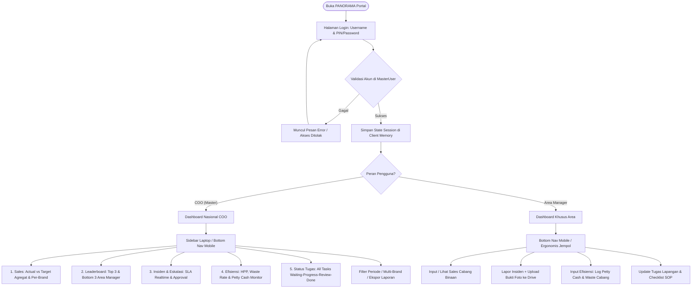

# BLUEPRINT SPESIFIKASI PRODUK: PANORAMA (Portal Operasional Eksekutif COO)
================================================================================
VERSI DOKUMEN : v5.6.3
PENYUSUN      : ZettBOT by Zettbos (Universal Product Architect & Lead Engineer)
TANGGAL       : 2 November 2026
STATUS        : PRODUCTION READY (Universal Core Router Fallback Engine & Sanitizer-Proof GAS Architecture)
================================================================================

================================================================================
ZONA ATAS: SPESIFIKASI KEBUTUHAN PRODUK (BLUEPRINT AWAL)
================================================================================

## 1. NAMA PROJEK & PROBLEM STATEMENT
- **Nama Aplikasi:** **PANORAMA** (Portal Monitoring Operasional Terpadu COO & Area Manager)
- **Problem Statement:**
  Sebagai seorang Chief Operating Officer (COO) yang membawahi 14 Area Manager dengan ~150 cabang gerai F&B multi-brand (Momoyo, Tomoro Coffee, Mixue, Tianlala, ICB, Ultimashot, Wedrink), pemantauan operasional yang tersebar di berbagai wilayah sering kali lambat, terfragmentasi di chat WhatsApp, dan sulit dievaluasi secara objektif. 
- **Solusi PANORAMA:**
  Sebuah portal web app operasional eksekutif yang ultra-presisi di semua layar ponsel (termasuk Samsung Galaxy Z Fold / ponsel lipat maupun layar ponsel reguler) serta monitor laptop. Memusatkan data performa ke dalam satu dashboard ringkas dengan 5 pilar utama:
  1. **Sales Performance:** Perbandingan Actual vs Target secara real-time.
  2. **Leaderboard Area Manager:** Ranking 3 Teratas (Top 3) dan 3 Terbawah (Bottom 3).
  3. **Insiden & Eskalasi Operasional:** Pelacakan kendala lapangan & SLA kecepatan resolusi penanganan.
  4. **Efisiensi Operasional:** Monitoring HPP Bahan Baku, Waste & Spoiled Rate, serta Penggunaan Petty Cash Toko.
  5. **Status Tugas Operasional:** Kanban & tracker penugasan (Waiting, In Progress, Review, Completed).
  Semua data tersimpan otomatis di Google Sheets dan berkas bukti fisik terunggah rapi di folder Google Drive per Area.

---

## 2. PERAN PENGGUNA (ROLE & PERMISSIONS)
Sistem memisahkan akses secara ketat dengan 2 tingkat wewenang (*Multi-Tier Access*):

1. **Akun Master (COO / Atasan):**
   - Akses penuh tanpa batas (*Master Administrator*).
   - Memantau performa agregat nasional serta seluruh 14 Area Manager (Kenny, Shahnaz, Dimas, Rifal, Mila, Angga, Gilang, Eka, Wisam, Faisal Kumis, Wahyu Fatwa, Jeje, Candra, Agung).
   - Melihat leaderboard 3 Teratas & 3 Terbawah secara instan.
   - Mengatur target penjualan, batas toleransi HPP & Waste, serta menyetujui (approve) eskalasi & tugas.
   - Mengekspor laporan ringkasan eksekutif ke Excel / PDF.
   - Mengelola akun dan master data cabang.

2. **Akun Bawahan (Area Manager / User):**
   - Akses terisolasi per wilayah (*Area-Isolated User*).
   - Hanya dapat melihat data, cabang, dan target milik area yang ditugaskan kepadanya.
   - Menginput laporan penjualan harian cabang binaannya.
   - Melaporkan insiden lapangan dan mengunggah foto bukti ke Google Drive.
   - Menginput catatan petty cash toko dan persentase waste/spoiled.
   - Memperbarui status pengerjaan tugas dari status *Waiting* -> *In Progress* -> *Review*.
   - Tidak dapat mengubah target penjualan, tidak dapat melihat data area manager lain (menjaga fokus & kerahasiaan operasional).

---

## 3. ARSITEKTUR & LINGKUNGAN KERJA
- **Platform Backend:** Google Apps Script (GAS) Web App dengan deployment idempoten.
- **Database Terpusat:** Google Sheets (Spreadsheet terhubung via Script Properties / Active Spreadsheet).
- **File Storage:** Google Drive Folder API terstruktur otomatis (folder utama `PANORAMA UPLOADS` -> Subfolder `Area X - [Nama AM]` -> Kategori -> File Bukti).
- **Frontend Framework:** Vanilla HTML5, CSS3 Modern (Dynamic High-Contrast Corporate), Vanilla JavaScript ES6+.
- **Desain Arsitektur:** **Modular Web App (Google Apps Script)**:
  * `code.gs`: Backend Controller (menangani `doGet`, API routing, CRUD database, autentikasi session token, Google Drive upload handler).
  * `setup.gs`: Safe Migration & Database Seeder (Membuat tab sheet tanpa underscore, proteksi data riil, seeder 14 Area Manager & 150 cabang).
  * `index.html`: Shell tampilan utama responsif dengan arsitektur SPA (*Single Page Application*).
  * `css.html`: Design System Dynamic High-Contrast Corporate (Variabel CSS, responsive grid, viewport foldable, fluid typography).
  * `js.html`: Client-Side Engine (State caching in-memory, tab switching instan, offline tolerance, modal dialogs, AJAX dispatcher).

---

## 4. ALUR KERJA APLIKASI (USER FLOW)


---

## 5. DESAIN BASIS DATA (GOOGLE SHEETS SCHEMA)
*Penting: Seluruh nama tab lembar kerja Google Sheets menggunakan PascalCase/spasi alami tanpa karakter underscore (`_`). Seluruh pembacaan data di backend menggunakan Index-Based Mapping (COL array index) agar kebal terhadap perubahan nama header.*

### Tab 1: `MasterUser` (Data Akun & Hak Akses)
| Indeks | Nama Kolom | Tipe Data | Keterangan & Contoh |
| :--- | :--- | :--- | :--- |
| `0` (A) | `UserID` | String | Kode unik user (`USR-001`, `USR-002`) |
| `1` (B) | `Username` | String | Username login (`coo_master`, `kenny`, `shahnaz`) |
| `2` (C) | `Password` | String | Hash / PIN login (`coo123`, `am2026`) |
| `3` (D) | `NamaLengkap` | String | Nama pejabat (`Chief Operating Officer`, `Kenny`) |
| `4` (E) | `Role` | String | Peran (`COO`, `AREA_MANAGER`) |
| `5` (F) | `AreaID` | String | Wilayah tugas (`ALL` untuk COO, `AREA-01` s/d `AREA-14`) |
| `6` (G) | `NoWhatsApp` | String | Nomor telepon untuk koordinasi (`0812xxxxxxxx`) |
| `7` (H) | `Status` | String | Status akun (`ACTIVE`, `INACTIVE`) |

### Tab 2: `MasterCabang` (14 Area & ~150 Gerai F&B)
| Indeks | Nama Kolom | Tipe Data | Keterangan & Contoh |
| :--- | :--- | :--- | :--- |
| `0` (A) | `CabangID` | String | ID unik cabang (`CBG-001`, `CBG-002`) |
| `1` (B) | `AreaID` | String | Kode Area (`AREA-01` s/d `AREA-14`) |
| `2` (C) | `AreaManager` | String | Nama Penanggungjawab (`Kenny`, `Shahnaz`, `Dimas`, dll.) |
| `3` (D) | `Brand` | String | Brand gerai (`Momoyo`, `Tomoro Coffee`, `Mixue`, `Tianlala`, `ICB`, `Ultimashot`, `Wedrink`) |
| `4` (E) | `NamaCabang` | String | Nama gerai lengkap (`Momoyo Kibin`, `Tomoro Galuh Mas`, dll.) |
| `5` (F) | `KotaKabupaten` | String | Wilayah (`Serang`, `Tangerang`, `Karawang`, dll.) |
| `6` (G) | `TargetSalesBulanan` | Number | Target omzet toko (Rp 150.000.000) |
| `7` (H) | `StatusCabang` | String | Status operasional (`ACTIVE`, `RENOVASI`, `CLOSED`) |
| `8` (I) | `GoogleMapsUrl` | String | URL Google Maps / Lokasi GPS Gerai (`https://maps.google.com/?q=...`) |

### Tab 3: `DataSales` (Transaksi & Realisasi Omzet)
| Indeks | Nama Kolom | Tipe Data | Keterangan & Contoh |
| :--- | :--- | :--- | :--- |
| `0` (A) | `SalesID` | String | Nomor unik otomatis (`SLS-YYYYMMDD-XXX`) |
| `1` (B) | `Tanggal` | String | Tanggal laporan (`YYYY-MM-DD`) |
| `2` (C) | `AreaID` | String | ID Area (`AREA-01`) |
| `3` (D) | `CabangID` | String | ID Cabang (`CBG-001`) |
| `4` (E) | `NamaCabang` | String | Nama toko (`Momoyo Kibin`) |
| `5` (F) | `TargetHarian` | Number | Target penjualan harian (Rp 5.000.000) |
| `6` (G) | `ActualSales` | Number | Realisasi penjualan harian (Rp 5.450.000) |
| `7` (H) | `PersentaseCapaian` | Number | Capaian (`109.0%`) |
| `8` (I) | `TotalTransaksi` | Number | Jumlah bill / struk (`245`) |
| `9` (J) | `CreatedBy` | String | User penginput (`kenny`) |
| `10` (K) | `CreatedAt` | String | Timestamp ISO |
| `11` (L) | `SalesOffline` | Number | Omzet Offline kasir toko / QRIS / EDC / e-wallet toko (Rp 2.145.000) |
| `12` (M) | `SalesGrabFood` | Number | Omzet platform GrabFood (Rp 703.110) |
| `13` (N) | `SalesShopeeFood` | Number | Omzet platform ShopeeFood / Shopee Integrasi (Rp 625.400) |
| `14` (O) | `SalesGoFood` | Number | Omzet platform GoFood / Gojek POS (Rp 172.500) |
| `15` (P) | `SalesTikTok` | Number | Omzet TikTok / TikTok Go (Rp 938.200) |
| `16` (Q) | `SalesQpon` | Number | Omzet voucher Qpon (Rp 395.000) |

### Tab 4: `DataInsiden` (Kasus Operasional, SLA & Bukti Drive)
| Indeks | Nama Kolom | Tipe Data | Keterangan & Contoh |
| :--- | :--- | :--- | :--- |
| `0` (A) | `InsidenID` | String | ID unik sekuensial (`INC-YYYYMM-XXX`) |
| `1` (B) | `TanggalLapor` | String | Waktu laporan dibuat (`YYYY-MM-DD HH:mm`) |
| `2` (C) | `AreaID` | String | ID Area pelapor (`AREA-04`) |
| `3` (D) | `CabangID` | String | ID Cabang terdampak (`CBG-045`) |
| `4` (E) | `Kategori` | String | Kategori (`Mesin Rusak`, `Bahan Kosong`, `Komplain Pelanggan`, `Listrik/Air`, `Sistem POS`) |
| `5` (F) | `TingkatUrgensi` | String | Prioritas (`LOW`, `MEDIUM`, `HIGH`, `CRITICAL`) |
| `6` (G) | `DeskripsiKasus` | String | Rincian kendala |
| `7` (H) | `FileDriveUrl` | String | Tautan bukti foto/dokumen di Google Drive |
| `8` (I) | `StatusResolusi` | String | Status (`OPEN`, `INVESTIGASI`, `ESKALASI_COO`, `RESOLVED`) |
| `9` (J) | `WaktuSelesai` | String | Waktu kasus dinyatakan closed (`YYYY-MM-DD HH:mm`) |
| `10` (K) | `DurasiPenangananJam` | Number | SLA durasi waktu (jam/menit) |
| `12` (M) | `ReportedBy` | String | Nama pelapor (`Rifal`) |
| `13` (N) | `BuktiPenangananUrl` | String | Link berkas foto/dokumen tindakan penanganan lapangan dari AM/SPV di Google Drive |

### Tab 5: `DataEfisiensi` (HPP, Waste & Petty Cash)
| Indeks | Nama Kolom | Tipe Data | Keterangan & Contoh |
| :--- | :--- | :--- | :--- |
| `0` (A) | `EfisiensiID` | String | ID unik sekuensial (`EFF-YYYYMM-XXX`) |
| `1` (B) | `Tanggal` | String | Tanggal periode (`YYYY-MM-DD`) |
| `2` (C) | `AreaID` | String | ID Area (`AREA-02`) |
| `3` (D) | `CabangID` | String | ID Cabang (`CBG-015`) |
| `4` (E) | `HPPBahanBakuPersen` | Number | Realisasi persentase HPP (misal `34.2%`) |
| `5` (F) | `TargetHPPMax` | Number | Batas toleransi HPP COO (misal `35.0%`) |
| `6` (G) | `WasteSpoiledPersen` | Number | Realisasi persentase waste (misal `1.8%`) |
| `7` (H) | `TargetWasteMax` | Number | Toleransi waste COO (misal `2.0%`) |
| `8` (I) | `PlafonPettyCash` | Number | Plafon modal kas kecil (Rp 1.500.000) |
| `9` (J) | `TerpakaiPettyCash` | Number | Realisasi belanja kas kecil (Rp 1.120.000) |
| `10` (K) | `BuktiNotaDriveUrl` | String | Link foto nota/struk di Google Drive |
| `11` (L) | `CatatanOperasional` | String | Keterangan pembelian barang darurat/waste |
| `12` (M) | `UpdatedBy` | String | Pelapor (`Shahnaz`) |

### Tab 6: `DataTugas` (Tracker Tugas Waiting - In Progress - Review - Completed)
| Indeks | Nama Kolom | Tipe Data | Keterangan & Contoh |
| :--- | :--- | :--- | :--- |
| `0` (A) | `TugasID` | String | ID unik tugas (`TSK-YYYYMM-XXX`) |
| `1` (B) | `JudulTugas` | String | Judul instruksi kerja (`Audit Sanitasi Mesin Es Krim`, `Stock Opname Akhir Bulan`) |
| `2` (C) | `AreaID` | String | Ditujukan ke Area mana (`ALL` atau `AREA-01`) |
| `3` (D) | `AssignedTo` | String | Nama Area Manager penerima tugas |
| `4` (E) | `Deadline` | String | Batas akhir pengerjaan (`YYYY-MM-DD`) |
| `5` (F) | `Prioritas` | String | Tingkat kepentingan (`NORMAL`, `URGENT`, `HIGH`) |
| `6` (G) | `StatusTugas` | String | Status progres (`Waiting`, `In Progress`, `Review`, `Completed`) |
| `7` (H) | `CatatanProgres` | String | Update hasil pengerjaan dari lapangan |
| `8` (I) | `FileBuktiTugasUrl` | String | Link foto bukti hasil pengerjaan di Google Drive |
| `9` (J) | `FeedbackCOO` | String | Catatan/evaluasi dari COO |
| `10` (K) | `CreatedAt` | String | Timestamp penugasan |

### Tab 7: `MasterConfig` (Konfigurasi Global & ID Folder Drive)
| Indeks | Nama Kolom | Tipe Data | Keterangan & Contoh |
| :--- | :--- | :--- | :--- |
| `0` (A) | `ConfigKey` | String | Kunci setelan (`DRIVE_ROOT_FOLDER_ID`, `APP_TITLE`, `COO_EMAIL`) |
| `1` (B) | `ConfigValue` | String | Nilai setelan |
| `2` (C) | `Keterangan` | String | Deskripsi fungsi |

### Tab 8: `DataJadwal` (Pengajuan Roster Shift Cabang & Jadwal Kerja Area)
| Indeks | Nama Kolom | Tipe Data | Keterangan & Contoh |
| :--- | :--- | :--- | :--- |
| `0` (A) | `JadwalId` | String | ID unik (`SCH-202610-001`) |
| `1` (B) | `Tipe` | String | Tipe pengajuan (`ROSTER_CABANG` / `VISIT_AREA`) |
| `2` (C) | `Level` | String | Tingkat approval (`SPV_TO_MA` / `MA_TO_COO`) |
| `3` (D) | `AreaId` | String | ID Wilayah (`AREA-01` s/d `AREA-14`) |
| `4` (E) | `CabangId` | String | ID Toko (`CBG-001` atau `ALL` untuk wilayah) |
| `5` (F) | `NamaCabang` | String | Nama Gerai / Wilayah |
| `6` (G) | `Pengaju` | String | Nama Pengaju (SPV / Area Manager) |
| `7` (H) | `Periode` | String | Rentang tanggal bertugas (`13 - 19 Okt 2026`) |
| `8` (I) | `TotalKru` | Number | Jumlah kru terdaftar |
| `9` (J) | `TotalShift` | Number | Total shift yang dialokasikan |
| `10` (K) | `Status` | String | `MENUNGGU_MA`, `MENUNGGU_COO`, `DISETUJUI`, `DITOLAK` |
| `11` (L) | `Catatan` | String | Catatan operasional pengaju |
| `12` (M) | `Approver` | String | Nama atasan yang menyetujui / memeriksa |
| `13` (N) | `Feedback` | String | Catatan evaluasi atasan |
| `14` (O) | `CreatedAt` | String | Timestamp pengajuan |
| `15` (P) | `FileUrl` | String | URL berkas jadwal (Excel / PDF / Gambar) |
| `16` (Q) | `DetailJson` | String | Objek JSON rincian jadwal shift harian |

### Tab 9: `DataKendala` (Laporan Sakit & Dispensasi Darurat)
| Indeks | Nama Kolom | Tipe Data | Keterangan & Contoh |
| :--- | :--- | :--- | :--- |
| `0` (A) | `KendalaID` | String | ID unik (`KDL-202610-001`) |
| `1` (B) | `Tanggal` | String | Tanggal kejadian (`YYYY-MM-DD`) |
| `2` (C) | `Kategori` | String | Kategori kendala (`Sakit`, `Izin Darurat`, `Bencana/Mogok`) |
| `3` (D) | `Pengaju` | String | Nama pengaju |
| `4` (E) | `Role` | String | Peran pengaju (`SPV`, `AREA_MANAGER`) |
| `5` (F) | `AreaID` | String | ID Wilayah (`AREA-01`) |
| `6` (G) | `CabangID` | String | ID Cabang (`CBG-001`) |
| `7` (H) | `NamaCabang` | String | Nama Gerai / Wilayah |
| `8` (I) | `Keterangan` | String | Kronologi & alasan izin darurat |
| `9` (J) | `FileUrl` | String | Link surat dokter / bukti darurat |
| `10` (K) | `FileName` | String | Nama berkas lampiran |
| `11` (L) | `Status` | String | Status persetujuan (`MENUNGGU`, `DISETUJUI`, `DITOLAK`) |
| `12` (M) | `CatatanReviewer`| String | Evaluasi reviewer atasan |
| `13` (N) | `Approver` | String | Pejabat yang mengevaluasi |
| `14` (O) | `CreatedAt` | String | Timestamp pembuatan |

### Tab 10: `DataLibrary` (Pusat Dokumen SOP, Panduan & Edukasi)
| Indeks | Nama Kolom | Tipe Data | Keterangan & Contoh |
| :--- | :--- | :--- | :--- |
| `0` (A) | `DocID` | String | ID unik dokumen (`DOC-001`) |
| `1` (B) | `Judul` | String | Judul dokumen SOP / Panduan |
| `2` (C) | `Kategori` | String | Kategori (`SOP`, `Resep`, `Mesin`, `Pelayanan`) |
| `3` (D) | `Brand` | String | Brand gerai (`ALL`, `Momoyo`, dll.) |
| `4` (E) | `Versi` | String | Nomor versi dokumen (`v1.2`) |
| `5` (F) | `Tanggal` | String | Tanggal terbit |
| `6` (G) | `FileUrl` | String | Link berkas PDF/Video di Drive |
| `7` (H) | `Audience` | String | Sasaran pembaca (`ALL`, `SPV`, `MANAGER`) |
| `8` (I) | `Deskripsi` | String | Rangkuman isi dokumen |
| `9` (J) | `Status` | String | `ACTIVE` / `ARCHIVED` |
| `10` (K) | `Uploader` | String | Nama pengunggah |

### Tab 11: `DataReviews` (Ulasan Konsumen & Integrasi Google Maps AI)
| Indeks | Nama Kolom | Tipe Data | Keterangan & Contoh |
| :--- | :--- | :--- | :--- |
| `0` (A) | `ReviewID` | String | ID unik ulasan (`REV-202610-001`) |
| `1` (B) | `Tanggal` | String | Tanggal ulasan (`YYYY-MM-DD`) |
| `2` (C) | `CabangID` | String | ID Cabang terkait (`CBG-001`) |
| `3` (D) | `NamaCabang` | String | Nama gerai |
| `4` (E) | `AreaID` | String | ID Wilayah (`AREA-01`) |
| `5` (F) | `Rating` | Number | Skor bintang (`1` s/d `5`) |
| `6` (G) | `Reviewer` | String | Nama pelanggan pengulas |
| `7` (H) | `Komentar` | String | Isi feedback/keluhan konsumen |
| `8` (I) | `AiTag` | String | Analisis sentimen/topik AI (`Rasa`, `Pelayanan`, `Kebersihan`) |
| `9` (J) | `AiUrgensi` | String | Tingkat urgensi (`RENDAH`, `SEDANG`, `TINGGI`) |
| `10` (K) | `AiAction` | String | Rekomendasi tindakan tindak lanjut |
| `11` (L) | `StatusRespon` | String | `PENDING`, `TERJAWAB`, `RESOLVED` |
| `12` (M) | `MapsUrl` | String | URL ulasan Google Maps |

### Tab 12: `DataPerubahanJadwal` (Permohonan Tukar Shift SPV & Visit Mendadak AM)
| Indeks | Nama Kolom | Tipe Data | Keterangan & Contoh |
| :--- | :--- | :--- | :--- |
| `0` (A) | `ChangeID` | String | ID unik tiket (`CHG-YYYYMM-XXX`) |
| `1` (B) | `TanggalPengajuan` | String | Tanggal diajukan (`YYYY-MM-DD`) |
| `2` (C) | `AreaID` | String | ID Wilayah (`AREA-01`) |
| `3` (D) | `CabangID` | String | ID Cabang pemohon |
| `4` (E) | `NamaCabang` | String | Nama gerai binaan / wilayah |
| `5` (F) | `Pengaju` | String | Nama pemohon (AM atau SPV) |
| `6` (G) | `RolePengaju` | String | Peran pemohon (`SPV` atau `AREA_MANAGER`) |
| `7` (H) | `TanggalAsal` | String | 1 Tanggal rencana asal (`YYYY-MM-DD`) |
| `8` (I) | `ShiftAsal` | String | Shift / agenda visit asal |
| `9` (J) | `TanggalBaru` | String | 1 Tanggal jadwal baru (`YYYY-MM-DD`) |
| `10` (K) | `ShiftBaru` | String | Shift / agenda visit baru |
| `11` (L) | `PersonelPengganti`| String | Nama rekan tukar shift (khusus SPV) |
| `12` (M) | `Alasan` | String | Alasan permohonan |
| `13` (N) | `FileUrl` | String | Link foto/dokumen pendukung di Drive |
| `14` (O) | `StatusApproval`| String | `MENUNGGU`, `DISETUJUI`, `DITOLAK` |
| `15` (P) | `CatatanReviewer`| String | Catatan evaluasi atasan |
| `16` (Q) | `Approver` | String | Nama atasan yang menyetujui |
| `17` (R) | `CreatedAt` | String | Timestamp pembuatan tiket |

---

## 6. ATURAN VALIDASI, LOGIKA KHUSUS & REKAYASA TEKNIS
1. **Penomoran Otomatis Sekuensial Anti-Tabrakan (Incremental Unique ID Generator):**
   - Format: `INC-YYYYMM-XXX`, `SLS-YYYYMMDD-XXX`, `TSK-YYYYMM-XXX`, `EFF-YYYYMM-XXX`.
   - Menggunakan mekanisme `LockService.getScriptLock()` pada Google Apps Script selama 15 detik saat proses penyimpanan untuk mencegah *race condition* jika beberapa Area Manager submit bersamaan.
   - Angka urut dihitung dari nilai maksimum yang sudah ada di database, bukan sekadar jumlah baris.

2. **Manajemen Otomatis Folder Google Drive:**
   - Script backend secara otomatis mengecek keberadaan folder utama `PANORAMA UPLOADS`.
   - Saat file diunggah (misal bukti struk kas kecil atau foto insiden), backend membuat subfolder terisolasi sesuai nama Area Manager (contoh: `Area 1 - Kenny / Petty Cash / 2026-10`) dan mengatur hak akses view.
   - URL file Google Drive yang dihasilkan otomatis disimpan ke kolom spreadsheet terkait.

3. **Leaderboard Ranking Logic (Top 3 & Bottom 3):**
   - Mengagregasi persentase capaian penjualan (`ActualSales / TargetSales * 100%`) per Area Manager.
   - Menghitung rata-rata skor kepatuhan efisiensi (rasio HPP aman + rendahnya waste rate) dan durasi SLA penanganan insiden.
   - Menyajikan 3 Area Terbaik dengan badge emas/hijau, dan 3 Area Terbawah dengan badge peringatan merah untuk atensi cepat COO.

4. **SLA & Kecepatan Penanganan Insiden:**
   - Dihitung dari `WaktuSelesai - TanggalLapor`.
   - Klasifikasi performa SLA:
     * `< 4 Jam`: Sangat Cepat (Badge Hijau Emerald)
     * `4 - 12 Jam`: Standar (Badge Biru)
     * `12 - 24 Jam`: Perlu Perhatian (Badge Amber/Kuning)
     * `> 24 Jam`: Overdue / Terlambat (Badge Merah Berkedip Lembut)

5. **Client-Side In-Memory Caching:**
   - Mengambil data awal per modul ke variabel memori browser.
   - Pindah antar-tab (Sales -> Leaderboard -> Insiden -> Efisiensi -> Tugas) berlangsung instan (0 detik) tanpa memicu loading berulang ke server GAS.
   - Dilengkapi tombol "Segarkan Data" (Refresh Cache) untuk sinkronisasi paksa ke server.

---

## 7. RENCANA ANTARMUKA PENGGUNA (UI/UX DESIGN SPEC)
- **Tema Visual:** **Donezo Edition (Clean Scandinavian Minimalist, Forest Green & Rounded Surfaces)**.
  * Latar belakang kanvas abu-abu lembut / off-white (`#F4F5F7` / `#F9FAFB`).
  * Permukaan Kartu (Cards): Putih solid (`#FFFFFF`) dengan sudut melengkung halus (*generous rounded corners* `20px`), garis batas tipis (`#E5E7EB`), dan bayangan halus.
  * Aksen Utama: Deep Forest Green (`#144A32`), Emerald Highlight (`#10B981`), dan Soft Mint Green (`#ECFDF5`).
  * Hero Card (Sales): Latar belakang gradasi Deep Forest Green (`linear-gradient(135deg, #0F3D2A 0%, #1A5E40 100%)`) dengan tombol panah melingkar `↗`.
  * Sidebar: Clean White Minimalist (`#FFFFFF`) dengan kategori teks `MENU` dan `PENGATURAN`, navigasi pill aktif hijau forest, dan banner gelap di bagian bawah.
  * Header: Pill Search Bar `⌘K`, tombol circular icon, dan kapsul profil elegan.
  * Tipografi: Google Font `Plus Jakarta Sans` dengan hierarki kontras tinggi.
  * Ikon: 100% Clean Inline SVG (tajam, profesional, bebas emoji norak).

- **Ultra-Precision Layout Mobile (Foldable & Regular HP):**
  * **Viewport Mobile Standar (320px - 430px):**
    - Bottom Navigation Bar ramping dengan 5 tab utama di jangkauan ibu jari: `[Dashboard]`, `[Sales]`, `[Insiden]`, `[Efisiensi]`, `[Tugas]`.
    - Kartu ringkasan metrik tampil dalam format Grid 1 - 2 Kolom kompak (hero sales card paling atas).
  * **Viewport Ponsel Lipat / Foldable (540px - 884px saat terlipat & terbuka):**
    - Grid kartu metrik otomatis beradaptasi menjadi 2-3 Kolom simetris.
    - Tabel status tugas dan insiden mengaktifkan fluid horizontal-scroll dengan sticky header tanpa merusak pembungkus layar.
  * **Viewport Desktop / Laptop (1024px+):**
    - Bottom Nav tersembunyi, digantikan oleh Clean White Sidebar Kiri lengkap dengan logo, navigasi pill, dan banner quick action.

---

## 8. KRITERIA PENGUJIAN & VALIDASI (ACCEPTANCE CHECKLIST)
- [x] 1. Halaman Login & Switcher berhasil memvalidasi kredensial Master COO dan 14 Area Manager.
- [x] 2. Dashboard COO menampilkan 5 kartu metrik utama (Sales Actual vs Target, Top/Bottom Leaderboard, Insiden SLA, Efisiensi HPP/Waste/Pettycash, Status Tugas 4-Stage).
- [x] 3. Leaderboard menampilkan 3 Area Teratas dan 3 Area Terbawah secara akurat.
- [x] 4. Akun Area Manager hanya melihat dan menginput data cabang binaannya sendiri (terisolasi per area).
- [x] 5. Formulir upload file berhasil mengirim berkas ke Google Drive pada folder yang sesuai dan mencatat URL-nya di Google Sheets.
- [x] 6. Tampilan web app presisi dan responsif sempurna saat diuji di layar ponsel reguler (iPhone/Android), ponsel lipat (Galaxy Fold), dan monitor laptop.
- [x] 7. Fitur Safe Migration pada `setup.gs` mampu menginisialisasi 14 Area Manager dan ~150 cabang tanpa error atau duplikasi data.
- [x] 8. Desain antarmuka visual Donezo (Forest Green & Off-White Canvas) terpasang sempurna tanpa merusak logika data dan 5 pilar dashboard.

================================================================================
ZONA BAWAH: MASTER CONTEXT & LOGIKA SISTEM TERKINI (LIVING CONTEXT)
================================================================================

### A. Status Arsitektur & Lingkungan Aktif
- **Versi Sistem:** PANORAMA v1.2.0 (Donezo Minimalist Forest Green Edition)
- **Tipe Ekosistem:** Google Apps Script Web App (Multi-File Modular: `code.gs`, `setup.gs`, `index.html`, `css.html`, `js.html`) & Standalone Bundle (`app.html`)
- **Basis Data:** Google Sheets (Tab: `MasterUser`, `MasterCabang`, `DataSales`, `DataInsiden`, `DataEfisiensi`, `DataTugas`, `MasterConfig`)
- **Penyimpanan:** Google Drive (Root Folder: `PANORAMA UPLOADS` -> Subfolder per Area Manager & Kategori)

### B. Objek Pemetaan Kolom Baku (Index-Based Mapping)
```javascript
const COL_USER = { ID: 0, USERNAME: 1, PASSWORD: 2, NAMA: 3, ROLE: 4, AREA_ID: 5, WA: 6, STATUS: 7 };
const COL_CABANG = { ID: 0, AREA_ID: 1, MANAGER: 2, BRAND: 3, NAMA: 4, KOTA: 5, TARGET: 6, STATUS: 7 };
const COL_SALES = { ID: 0, TANGGAL: 1, AREA_ID: 2, CABANG_ID: 3, NAMA: 4, TARGET: 5, ACTUAL: 6, PERSEN: 7, TRX: 8, CREATED_BY: 9, CREATED_AT: 10 };
const COL_INSIDEN = { ID: 0, TANGGAL: 1, AREA_ID: 2, CABANG_ID: 3, KATEGORI: 4, URGENSI: 5, DESK: 6, DRIVE_URL: 7, STATUS: 8, SELESAI: 9, SLA_JAM: 10, AKSI: 11, REPORTER: 12 };
const COL_EFISIENSI = { ID: 0, TANGGAL: 1, AREA_ID: 2, CABANG_ID: 3, HPP: 4, TARGET_HPP: 5, WASTE: 6, TARGET_WASTE: 7, PLAFON_CASH: 8, TERPAKAI_CASH: 9, NOTA_URL: 10, CATATAN: 11, UPDATED_BY: 12 };
const COL_TUGAS = { ID: 0, JUDUL: 1, AREA_ID: 2, ASSIGNED_TO: 3, DEADLINE: 4, PRIORITAS: 5, STATUS: 6, CATATAN: 7, BUKTI_URL: 8, FEEDBACK: 9, CREATED_AT: 10 };
const COL_CONFIG = { KEY: 0, VALUE: 1, KETERANGAN: 2 };
```

### C. Master Data 14 Area Manager & Distribusi Cabang
- **Area 1 (Kenny):** 11 Cabang (Momoyo Kibin, Momoyo Grogol Cilegon, Momoyo Citangkil, Momoyo Anyer, Momoyo Labuan, Momoyo Menes, Momoyo Panimbang, Momoyo Malimping, Momoyo BPI Rokoy, Tomoro Rangkasbitung, Momoyo Ciruas Serang)
- **Area 2 (Shahnaz):** 10 Cabang (Momoyo Taman Adiyasa, Momoyo Mujair, Momoyo Puspitek, Momoyo Bukit Dago, Momoyo Mauk, Momoyo Kronjo, Momoyo Jatimulya, Momoyo Kelapa Dua, Momoyo Pasar Kemis, Momoyo Telaga Bestari)
- **Area 3 (Dimas):** 11 Cabang (ICB Pasar Rebo, Mixue Setu Cipayung, ICB Makasar Jaktim, ICB Rawa Buaya, ICB Karteng Lebak, Tomoro Citra Enam, Tomoro Taman Palem, Mixue Marunda, Mixue Harapan Mulya, Momoyo Inpres Raya, Momoyo Grogol Petamburan)
- **Area 4 (Rifal):** 13 Cabang (Tomoro Galuh Mas, Ultimashot Karawang, Mixue Bonlap Tambun, Tomoro Pekayon, Mixue Tajuddin, Momoyo Sukatani, Momoyo Wibawamukti, Momoyo Bantar Gebang, Momoyo Bojong Kulur, Momoyo Telaga Murni, Tianlala Metland Cibitung, Tianlala Graha Asri, Momoyo Cikarang)
- **Area 5 (Mila):** 9 Cabang (Momoyo Tempuran, Momoyo Kosambi, Momoyo Telagasari, Momoyo Kondangjaya, Tomoro Purwakarta, Momoyo Cibuaya, Momoyo Lamaran, Momoyo Tanjungpura, Momoyo Wadas)
- **Area 6 (Angga):** 9 Cabang (Momoyo Purwadadi, Momoyo Pabuaran, Momoyo Sukamandi, Momoyo Cipeundeuy, Wedrink Subang, Momoyo Pagaden, Momoyo Cikampek, Momoyo Cilamaya, Momoyo Tegalwaru)
- **Area 7 (Gilang):** 10 Cabang (Momoyo Cikalong Kulon, Momoyo Pacet, Momoyo Baros, Momoyo Parung Kuda, Momoyo Pakuwon, Momoyo Cicurug, Momoyo Cigombong, Momoyo Cikereteg, Mixue Kota Batu, Momoyo Babakan Madang)
- **Area 8 (Eka):** 11 Cabang (Tianlala Gelong, Momoyo Ujung Berung, Tomoro BEC, Momoyo Babakan Ciparay, Ultimashot Majalaya, Momoyo Ebah Majalaya, Mixue Alun Alun Ciparay, Momoyo Banjaran, Momoyo Garut, ICB Bojong Sereh)
- **Area 9 (Wisam):** 10 Cabang (Momoyo Babakan, Momoyo Pab Kidul, Momoyo Dukupuntang, Ultima Majalengka, Momoyo Majalengka, Momoyo Ciawi Tasik, Momoyo Pangandaran, Momoyo Palaraya Tegal, Momoyo Adiwerna, Momoyo Arjawinangun)
- **Area 10 (Faisal Kumis):** 8 Cabang (Momoyo Bumiayu, Momoyo Karanglewas, Momoyo UMP, Mixue Alun2 Purbalingga, Tomoro Cilacap, Momoyo Kedungwuni, Momoyo Wonosobo, UltimaShot Billiard PWT)
- **Area 11 (Wahyu Fatwa):** 13 Cabang (Momoyo Wates, Momoyo Wonosari, Momoyo Sukorejo, Momoyo Delanggu Klaten, Momoyo Ambarawa, Momoyo Temanggung, Momoyo Karangjati, Momoyo UNS Solo, Momoyo Kalioso, Momoyo Cebongan, Tianlala Magelang, Tianlala Undip, Tianlala Ungaran)
- **Area 12 (Jeje):** 13 Cabang (Momoyo Kayen Pati, Momoyo Tayu Pati, Momoyo Bangsri Jepara, Momoyo Senenan Jepara, Momoyo Kelet Jepara, Momoyo Purwodadi, Momoyo Undip, Momoyo UIN, Momoyo Ampel Boyolali, Momoyo Blora, Momoyo Rembang, Tianlala Undip, Tianlala Ungaran)
- **Area 13 (Candra):** 12 Cabang (Momoyo Semampir, Momoyo Brawijaya, Momoyo Dukun Gresik, Momoyo Kejaparan, Momoyo Srengat Blitar, Momoyo Lodoyo Blitar, Momoyo Wajak Malang, Momoyo Pujon Malang, Momoyo Donomulyo, Momoyo Caruban, Momoyo Pacitan, Momoyo Magetan)
- **Area 14 (Agung):** 7 Cabang (Momoyo Biringkanaya, Momoyo Tamangapa, Momoyo Daeng Tata, Tianlala Tamalate, Tianlala Todopuli Raya, Tianlala Penghibur Losari, Tianlala BTP)

### D. Riwayat Pembaruan Resmi (System Change Log)
- **v1.0.0 (11 Okt 2026):** Rilis penuh sistem PANORAMA. Penulisan `setup.gs` (safe migration & Drive auto-folder), `code.gs` (index-based backend controller & LockService ID generator), `css.html` (Dynamic High-Contrast Corporate, anti-AI aesthetic, foldable/mobile grid), `js.html` (in-memory caching 0-latency, demo profile switcher, report export), `index.html` (modular layout), dan `app.html` (standalone browser bundle).
- **v1.1.0 (11 Okt 2026):** 
  - **Dynamic Leaderboard by Role:** Master COO memantau "Leaderboard Area Manager" (14 Area Nasional), sedangkan akun Area Manager (MA) secara otomatis menampilkan "Leaderboard SPV Cabang" (Top 3 & Bottom 3 Cabang/SPV binaan di areanya).
  - **100% Data Isolation:** Seluruh metrik penjualan, efisiensi HPP/Waste, petty cash, dan pelaporan kendala terisolasi strictly sesuai `areaId` akun yang login (baik di backend GAS `code.gs` maupun standalone simulator `js.html`).
  - **UI Ergonomics Polish:** Perbaikan tombol navigasi sidebar footer dengan styling `.btn-sidebar` dark glassmorphic solid yang presisi tanpa box putih kosong.
  - **Standalone Rebundle:** Berkas `app.html` dimutakhirkan (143 KB) untuk pengujian langsung tanpa konfigurasi server.
- **v1.2.0 (11 Okt 2026):**
  - **Donezo Visual Redesign (Forest Green & Off-White Canvas):**
    * Mengadopsi estetika referensi "Donezo" tanpa merubah, menambah, atau menghilangkan satupun point utama isi dashboard.
    * Pilar 1 (Sales) bertransformasi menjadi Hero Card Deep Forest Green (`linear-gradient(135deg, #0F3D2A 0%, #1A5E40 100%)`) dengan tombol panah `↗` dan persentase capaian.
    * 3 Kartu Metrik Lainnya (Insiden, Efisiensi, Tugas) tampil sebagai kartu putih melengkung 20px dengan tombol panah `↗` dan pill badges.
    * Sidebar Putih Bersih Minimalis (`#FFFFFF`) dengan section headers `MENU` & `PENGATURAN`, navigasi pill forest green, dan dark banner quick action di bawah.
    * Header Minimalis: Pill search bar `⌘K`, circular action buttons, dan profile capsule button di kanan atas.
    * Seluruh 5 pilar, formula perhitungan, isolasi data per area, dan responsivitas HP/Foldable tetap utuh 100%.
    * Berkas `app.html` dimutakhirkan (146 KB).
- **v1.3.0 (11 Okt 2026):**
  - **Dominasi Modul Sales & Grafik Analitik Visual (Donezo Analytics):**
    * Modul Sales mendominasi baris teratas dashboard utama dengan **Executive Sales Command Row** (Hero Sales Card + Visual Donezo Capsule Bar Chart).
    * **Sakelar Skala 2 Perspektif:**
      - **Skala Nasional (Khusus COO):** Visualisasi performa 14 Area Manager se-Indonesia dengan indikator bar hijau (capai target ≥100%) dan kuning/merah (<100%), dilengkapi garis benchmark target 100%.
      - **Skala Area:** Visualisasi performa perbandingan seluruh cabang binaan dalam area aktif (terkunci otomatis untuk Area Manager, atau dipilih via dropdown oleh Master COO).
    * Hero Sales Card diperkaya dengan metrik Total Transaksi dan Rata-rata Penjualan per Gerai.
- **v1.4.0 (11 Okt 2026):**
  - **Injeksi Dataset Dummy Komprehensif (14 Area, 146 Gerai F&B, & 5 Pilar Operasional):**
    * Mentranskripsikan 100% dari 146 gerai F&B binaan 14 Area Manager ke dalam in-memory simulator `js.html` dan seeder `setup.gs`.
    * Memuat 146 transaksi penjualan harian multi-brand (Momoyo, Tomoro Coffee, Mixue, Tianlala, Ultimashot, ICB, Wedrink) dengan capaian realistis (70% - 124%), target harian (Rp 4,5jt - Rp 8,5jt), dan total bill.
    * Menambahkan 16 kasus insiden lapangan nyata (mesin es krim mati, printer POS & modem down, toren air mati, komplain pelanggan, dsb) lengkap dengan pelacakan SLA resolusi dan eskalasi COO.
    * Menambahkan efisiensi operasional penuh untuk 146 gerai (HPP 32% - 37%, Waste 1% - 3.2%, dan pencatatan kas kecil toko).
    * Mengisi 10 tugas operasional terdistribusi di 4 kolom Kanban board (*Waiting*, *In Progress*, *Review*, *Completed*) lengkap dengan tenggat waktu, tingkat urgensi, dan feedback COO.
- **v1.6.0 (11 Okt 2026):**
  - **Formulasi Skor Komposit & Pemeringkatan Leaderboard Berdasarkan 5 Pilar Utama Operasional:**
    * Mengganti logika sorting lama yang semata-mata mengurutkan berdasarkan persentase sales (`b.salesCapaianPersen - a.salesCapaianPersen`) menjadi pemeringkatan murni berdasarkan **Total Skor Komposit 5 Pilar** (`b.skorKinerja - a.skorKinerja`), baik untuk 14 Area Manager (perspektif COO) maupun gerai binaan (perspektif MA).
    * **Formula 5 Pilar Baku (Maksimal 100 Poin):**
      1. **Pilar 1: Sales Performance (Bobot 30 Poin):** `(salesCapaianPersen / 100) * 25` (Maks 30 Poin).
      2. **Pilar 2: Efisiensi HPP Bahan Baku (Bobot 20 Poin):** Target max 35.0% (`15 + (35.0 - avgHpp) * 2`).
      3. **Pilar 3: Pengendalian Waste & Spoiled (Bobot 15 Poin):** Target max 2.0% (`10 + (2.0 - avgWaste) * 5`).
      4. **Pilar 4: Kecepatan Resolusi SLA & Insiden (Bobot 20 Poin):** SLA < 4 jam & penalti -5 poin per insiden terbuka/menggantung.
      5. **Pilar 5: Kedisiplinan Tugas & SOP Lapangan (Bobot 15 Poin):** Persentase tugas Kanban yang berstatus Completed/Review.
    * **Peningkatan Antarmuka (UI):**
      - Podium Mini Leaderboard (Top 3 & Bottom 3) dilengkapi micro-chips indikator 5 pilar (`🎯 Sales`, `💰 HPP`, `🗑️ Waste`, `⚡ SLA / 🚨 Open`, `📋 Tugas`), badge total skor kontras (`★ 94.5 Poin`), serta nilai omzet nominal realisasi vs target.
      - Menambahkan popup interaktif **Modal Audit Evaluasi 5 Pilar** (`modalScoreBreakdown`) dengan progress bar tiap pilar dan *AI/COO Actionable Recommendation*.
      - Tabel penuh Leaderboard Nasional & Cabang kini memuat kolom lengkap untuk seluruh 5 pilar dan tombol *Audit Skor*.
    * Penyelarasan backend Google Apps Script pada `code.gs` (`hitungLeaderboardNasional` & `hitungLeaderboardCabang`).
- **v1.7.0 (11 Okt 2026):**
  - **Optimalisasi Total Antarmuka Mobile / Smartphone (Donezo Clean Mobile Edition):**
    * **Header Mobile Anti-Tabrakan:** Merampingkan `.top-bar` di layar ponsel (< 768px). Elemen jam panjang dan tombol ekspor CSV disembunyikan di HP via utility class `.hide-mobile`, menyisakan judul ramping `Dashboard Operasional`, tombol profil mini `MASTER COO`, dan tombol refresh `🔄`.
    * **Sticky Glassmorphic Header:** Header menempel halus di bagian atas saat di-scroll dengan efek backdrop blur (`rgba(255,255,255,0.94); backdrop-filter: blur(14px)`).
    * **Segmented Control Filter:** Filter periode (`Hari Ini`, `Minggu Ini`, `Bulan Ini`) membentang rata 100% lebar layar HP tanpa terpotong, pas dengan jangkauan jempol pengguna. Dropdown brand 100% responsif.
    * **Horizontal Touch-Swipe Grafik Sales:** Batang grafik 14 Area Manager kini memiliki lebar tetap `50px` yang dapat digeser ke samping dengan usapan jari (*horizontal swipe*), memastikan seluruh teks nominal omzet `Rp 73.2Jt` dan persentase tidak gepeng.
    * **Auto-Seeder Anti-Blank Rp 0:** Penambahan proteksi auto-seeder di `code.gs` dan fallback in-memory di `js.html` sehingga ketika web app diakses via `script.google.com` pada database kosong, sistem langsung menampilkan dataset 14 area tanpa angka 0.
    * **Proteksi Bilah Bawah iOS:** Bottom Navigation Bar memperhitungkan garis home indicator iPhone (`env(safe-area-inset-bottom)`).
    * Berkas standalone `app.html` dimutakhirkan (217 KB).
- **v1.8.0 (11 Okt 2026):**
  - **Pemulihan Penuh Interaktivitas Navigasi & Laci Menu Mobile (Mobile Navigation & Interactivity Engine):**
    * **Tombol Hamburger (☰) & Mobile Off-Canvas Drawer:** Menambahkan tombol menu ☰ di header ponsel yang memunculkan laci menu samping mewah beranimasi slide halus dari kiri dengan efek backdrop blur (`z-index: 998`), menyediakan akses lengkap ke seluruh 6 modul operasional, info pengguna, serta tombol aksi cepat (*Ganti Akun*, *+ Lapor Insiden*, *+ Input Sales*, *Export CSV*).
    * **Perbaikan Total Bottom Navigation Bar:** Menambahkan atribut `href="javascript:void(0)"`, `cursor: pointer;`, `touch-action: manipulation;`, `pointer-events: none` pada anak ikon/teks, dan menaikkan layer ke `z-index: 990 !important;` sehingga kebal terhadap pembatalan tap oleh iOS Safari. Susunan 5 tab dioptimalkan: **Dashboard**, **Sales**, **Rangking** (Leaderboard AM), **Insiden**, dan **Menu ☰**.
    * **Auto-Reset Scroll Layar:** Mengintegrasikan `window.scrollTo({ top: 0, behavior: 'instant' });` pada setiap pergantian tab sehingga pengguna tidak lagi melihat area kosong di bawah saat berganti modul.
    * **Filter Periode Responsif & Dinamis:** Menghubungkan tombol `Hari Ini` (1x nominal harian), `Minggu Ini` (7x akumulasi sepekan), dan `Bulan Ini` (30x akumulasi bulanan) ke kalkulasi data operasional, kartu hero sales, tabel sales, dan grafik batang secara dinamis seketika disertai notifikasi Toast.
    * **Keamanan Modal Insiden:** Menggantikan inline JSON stringify dengan fungsi lookup `openDetailInsidenById(incId)` yang aman 100% dari masalah tanda kutip.
    * Berkas standalone `app.html` dimutakhirkan (232 KB).
- **v1.9.0 (11 Okt 2026):**
  - **Zero-Horizontal-Scroll Page Lock & Redesign Ikon Menu Mobile:**
    * **Eliminasi Total Horizontal Page Scroll (100% Fit Mobile Viewport):**
      - Menerapkan `width: 100%; max-width: 100%; overflow-x: hidden; position: relative;` pada level root `html`, `body`, `.app-wrapper`, dan `.main-content`.
      - Mengkarantina kartu grafik `.sales-chart-card` dengan `min-width: 0; max-width: 100%; box-sizing: border-box; overflow: hidden;` dan kontainer batang `.capsule-chart-container` dengan `min-width: 0; max-width: 100%; box-sizing: border-box; overflow-x: auto;`. Hal ini mengunci seluruh halaman dashboard agar 100% stabil di lebar viewport HP (~390px) tanpa goyang atau bisa digeser ke samping, sementara 14 batang grafik area manager tetap dapat di-swipe secara mulus hanya di dalam kotaknya saja.
      - Menata ulang `.sales-chart-controls` di mobile menjadi bertingkat rata 100% (`flex-direction: column; align-items: stretch; width: 100%;`). Kelompok tombol metrik (`Rp & %`, `Nominal`, `Persen`) dan skala (`🌐 Skala Nasional`, `📍 Skala Area`) membentang proporsional dan elegan tanpa meluber keluar kartu.
      - Membatasi dropdown `<select>` dan strip filter dengan `max-width: 100%; min-width: 0; text-overflow: ellipsis; overflow: hidden;`.
    * **Redesign Ikon & Label Menu Mobile (Executive Minimalist Style):**
      - Menghapus karakter duplikat `"☰"` dari teks tombol bilah navigasi bawah, menghasilkan label teks bersih dan proporsional: **`Menu`**.
      - Mengganti ikon 3 garis kaku dengan ikon drawer modern bertingkat (*staggered capsule drawer*) dengan ujung membulat halus (`stroke-linecap="round"`), selaras dengan estetika mewah 4 ikon navigasi lainnya (*Dashboard*, *Sales*, *Rangking*, *Insiden*).
      - Menyelaraskan ikon hamburger di header mobile (`#mobileMenuToggleBtn`) dengan bahasa desain yang sama.
    * Berkas standalone `app.html` dimutakhirkan dan divalidasi (234 KB, 0 syntax error).
- **v2.0.0 (11 Okt 2026):**
  - **Eliminasi Tabrakan Judul Header Mobile & Optimalisasi Ruang (Anti-Collision Header Polish):**
    * **Penguncian Batas CSS Flexbox:** Menambahkan `min-width: 0; flex: 1; overflow: hidden;` pada `.top-bar-left` dan `.page-title-box`, serta `text-overflow: ellipsis; white-space: nowrap; width: 100%;` pada `h2#pageTitleText`. Menjamin teks judul 100% tidak akan pernah meluap (*spill over*) ke atas tombol-tombol di sisi kanan.
    * **Pembebasan Ruang Header (+105px Lebih Lega):** Merampingkan `.profile-capsule-btn` di layar ponsel (< 768px) menjadi avatar lingkaran minimalis Donezo (32px x 32px) dengan inisial `[C]`, menyembunyikan teks role/badge dan chevron di layar HP. Mengurangi lebar sisi kanan header dari 173px menjadi 70px.
    * **Tipografi Responsif Judul Modul:** Penyesuaian judul modul secara ringkas dan proporsional pada tampilan mobile (`Leaderboard AM`, `Insiden & SLA`, `Dashboard`, `Efisiensi HPP`, `Tugas Lapangan`), sementara tampilan desktop tetap mempertahankan judul panjang lengkap.
    * Berkas standalone `app.html` dimutakhirkan dan divalidasi (235 KB, 0 syntax error).
- **v2.1.0 (11 Okt 2026):**
  - **Penyelarasan Leaderboard & Panel Bawah Mobile (Symmetric Bounds & 2-Tier Modern Layout):**
    * **Penguncian Simetri Kontainer:** Mengubah `.dashboard-split-grid` di mobile menjadi `display: flex; flex-direction: column; width: 100%; max-width: 100%; min-width: 0; gap: 14px; box-sizing: border-box;` dan mengunci seluruh `.card-panel` di mobile dengan `width: 100%; max-width: 100%; min-width: 0; box-sizing: border-box; overflow: hidden; padding: 16px 14px; border-radius: 18px;`. Hasilnya, kartu Leaderboard dan seluruh kartu ke bawah memiliki margin kiri-kanan yang presisi dan sejajar sempurna (14px) dengan kartu Efisiensi & Tugas di atasnya.
    * **Rancang Ulang Item Leaderboard Mobile (2-Tier Layout):**
      - Baris Atas: Peringkat emas `[1]` + Nama Manager (`Dimas • AREA-03`) di kiri, dan Skor Bintang `★ 99.5 Poin` + Capaian `Rp 73.2 Jt (120%)` di kanan.
      - Baris Bawah: Dipisahkan oleh garis pemisah halus (*subtle separator*), menampilkan 5 chip pilar (`🎯 Sales`, `💰 HPP`, `🗑️ Waste`, `⚡ SLA`, `📋 SOP`) yang membentang leluasa selebar kartu tanpa terpotong atau keluar batas.
    * **Penyelarasan Header & Footer Panel:** Menambahkan `flex-wrap: wrap; gap: 8px;` pada `.panel-header` dan sub-header peringkat sehingga tombol "Lihat Semua 14 Area →" dan badge "Pencapaian Tertinggi" tidak terpotong. Mengubah footer panel insiden menjadi responsif bertingkat agar tidak mendongkrak lebar layar.
- **v2.2.0 (11 Okt 2026):**
  - **Eliminasi Tumpang-Tindih Label Target 100% & Anti-Collision Benchmark Polish:**
    * **Pemisahan Label dari Saluran Batang:** Menghapus elemen badge teks mengambang `.chart-benchmark-tag` dari dalam area batang grafik (`.capsule-chart-container`). Sebelumnya, badge ini melayang di koordinat Y = 44px–62px yang berhimpitan langsung dengan angka omzet (Rp 60.5 Jt, Rp 57.6 Jt) dan persentase (93%, 96%) dari batang dengan capaian tinggi.
    * **Badge Benchmark Resmi di Header Kartu (`.benchmark-header-pill`):** Menempatkan badge tolok ukur eksekutif di header kartu grafik tepat di sebelah judul ("Grafik Realisasi vs Target"), dilengkapi indikator garis putus-putus hijau (`.benchmark-dashed-indicator`) dan label "Target 100%". Memberikan konteks visual instan tanpa pernah mengganggu visualisasi batang baik di PC maupun mobile.
    * **Indikator Garis Acuan di Footer Legend:** Menambahkan item legend resmi `.chart-legend-dashed-indicator` dengan keterangan "Target 100% (Garis Acuan)" di footer kartu grafik.
    * **Proteksi Lapisan Nilai Batang (Z-Index Shield & Backdrop):** Menetapkan `position: relative; z-index: 3;` pada `.chart-bar-value-tag` serta backdrop kontras `background: rgba(255, 255, 255, 0.92); padding: 0 4px; border-radius: 4px;` pada `.bar-val-nominal`. Garis benchmark putus-putus (`z-index: 1`) kini melintas bersih di belakang angka tanpa pernah memotong atau menusuk teks angka persentase atau nominal.
    * Berkas standalone `app.html` dimutakhirkan dan divalidasi (239 KB, 0 syntax error).
- **v2.3.0 (11 Okt 2026):**
  - **Optimalisasi Presisi Mobile Modul Tugas (Kanban 4-Stage Donezo Edition):**
    * **Header Panel Bertingkat Anti-Truncate:** Merestrukturisasi `.kanban-panel-header` di mobile menjadi bertingkat vertikal rapi. Judul modul tugas "Pelacakan Instruksi & Tugas Operasional Lapangan" tampil utuh 100% tanpa pernah terpotong menjadi "P...", dengan badge alur tahapan membentang elegan di bawahnya.
    * **Bilah Tab Segmented Stage Switcher di Mobile (`#kanbanMobileTabs`):** Menambahkan 5 tombol tab tahapan interaktif (`⏳ Waiting`, `⚙️ Progress`, `🔍 Review`, `✓ Selesai`, `📋 Semua`). Menampilkan kartu tugas 100% full-width (~340px) per tab aktif tanpa terhimpit 140px.
    * **Desain Ulang Anatomi Kartu Tugas:** Memproteksi kode `TSK-202610-001` berdiri 1 baris anti-patah di samping badge prioritas. Mengisolasi deadline chip dan status bukti `📁 Ada Bukti` (chip hijau transparan elegan) dengan garis pemisah putus-putus rapi.
    * **Preservasi 4-Kolom Desktop:** Layar PC/laptop tetap mempertahankan tata letak grid 4-kolom bersandingan standar eksekutif.
    * Berkas standalone `app.html` dimutakhirkan dan divalidasi (247 KB, 0 syntax error).
- **v2.4.0 (11 Okt 2026):**
  - **Transformasi Sales Performance: Agregat Per-Area & Executive Drill-Down Accordion:**
    * **Filter Wilayah / Area Operasional (14 Area Manager):** Mengganti filter "Brand Portofolio" menjadi filter "Wilayah / Area" yang mencakup 14 Area Manager Se-Indonesia (Kenny, Shahnaz, Dimas, Rifal, Mila, Angga, Gilang, Eka, Wisam, Faisal Kumis, Wahyu Fatwa, Jeje, Candra, Agung) dan opsi default "🌐 Seluruh Indonesia (14 Area Manager)".
    * **Strip KPI Summary Sales Eksekutif:** Menambahkan 4 kartu metrik utama di atas modul sales: Total Realisasi Omzet (Rp), Total Target (Rp), Rata-rata Capaian Nasional (%), dan Jumlah Area Capai Target (≥100%).
    * **Eliminasi Total Tabel Mentah Mobile:** Mengganti tabel mentah 146 baris dump transaksi database dengan 14 Kartu Performa Eksekutif Per-Area (100% full-width).
    * **Tabel Agregat Desktop Modern:** Tampilan PC/laptop disederhanakan dari 146 baris transaksi menjadi 14 baris ringkasan Area Manager yang rapi dan elegan.
    * Berkas standalone `app.html` dimutakhirkan dan divalidasi (267 KB, 0 syntax error).
- **v2.5.0 (11 Okt 2026):**
  - **Adaptive Dual-Mode Sales View: Auto-Expand Direct Branch Breakdown Per-Area:**
    * **Dua Mode Tampilan Adaptif (Area Aggregate vs Branch Detail):**
      - **Mode Semua Area (`areaFilter === 'ALL'`):** Menampilkan 14 baris agregat Area Manager di desktop dan 14 kartu area di mobile dengan tombol pintas `[Lihat 11 Cabang →]`.
      - **Mode Spesifik Area (misal `'AREA-01': Kenny`):** Langsung membentangkan seluruh cabang milik area terpilih (misal 11 gerai Kenny: Momoyo Kibin, Momoyo Grogol Cilegon, Mixue, Tomoro Rangkasbitung, dll) tanpa menyembunyikannya di dalam modal/akordeon.
    * **Tabel Desktop Mode Cabang Dinamis:** Thead berganti otomatis ke kolom cabang (`No`, `Kode`, `Nama Cabang`, `Brand`, `Kota / Lokasi`, `Target Omzet`, `Realisasi Omzet`, `Progress Capaian`, `Capaian %`, `Selisih (Gap)`, `Status`). Tiap gerai memiliki progress bar visual, selisih nominal, dan status badge tercapai/hampir/perlu dorongan.
    * **11 Kartu Cabang Mandiri di Layar Ponsel:** Layar mobile langsung menampilkan 11 kartu gerai independen (100% full-width) dengan nominal omzet tegas dan badge brand.
    * **Banner Navigasi Eksekutif & Tombol Balik Cepat:** Menampilkan banner aktif `📍 Menampilkan seluruh 11 gerai binaan Kenny (Banten)` dilengkapi tombol `[← Kembali ke Semua Area (14 AM)]` untuk beralih kembali ke ringkasan nasional dalam 1 klik.
    * **KPI Strip Spesifik Area:** Merangkum total omzet Kenny, target area, capaian %, serta rasio keberhasilan cabang (`X / 11 Gerai Tercapai`).
    * Berkas standalone `app.html` dimutakhirkan dan divalidasi (279 KB, 0 syntax error).
- **v2.6.0 (11 Okt 2026):**
  - **Official PANORAMA Logo, Donezo Entrance Screen, Concise Mobile UX & Direct Logout:**
    * **Brand Logo Resmi PANORAMA:**
      - Logo bulat resmi (deep emerald green badge) dipasang di `assets/panorama-logo.jpg`.
      - Disediakan fallback base64 Data URI (`window.PANORAMA_LOGO_DATAURI`) yang tertanam di `js.html` agar 100% tampil di Google Apps Script dan browser offline.
      - Tampil di header sidebar desktop, mobile drawer, favicon tab browser, dan Entrance Login Screen.
    * **Donezo-Style Entrance Login Screen (`#loginEntranceOverlay`):**
      - Tampilan pembuka login resmi berlatar radial emerald elegan dengan logo besar PANORAMA di tengah atas.
      - Menyediakan quick selector akun Master COO dan 14 Area Manager lengkap dengan gerai binaan.
      - Tombol aksi: `Masuk ke Dashboard →` yang mengautentikasi sesi dan membuka portal utama.
    * **Penggantian "Ganti Akun" Menjadi "Logout":**
      - Seluruh tombol dan navigasi "Ganti Akun / Area" diganti menjadi **`Logout`** dengan ikon pintu keluar merah transparan (`.btn-logout`).
      - Fungsi `logoutSession()` menghapus sesi di `localStorage`, menampilkan toast konfirmasi, dan langsung mengembalikan user ke Entrance Login Screen berlogo resmi.
    * **Bahasa Singkat & To-The-Point (Ultra-Clean Mobile Layout):**
      - Judul modul Sales dipersingkat menjadi **`Sales Performance`** (dengan badge dinamis `AREA-01 • Kenny` atau periode).
      - Tombol aksi dipersingkat: `+ Input Sales`, `+ Lapor Insiden`, `+ Buat Tugas`, `Export CSV`.
      - Strip KPI Sales dipersingkat: `Total Sales`, `Target Sales`, `Capaian`, `Status Gerai`.
      - Judul section dipersingkat: `Leaderboard 14 Area`, `Insiden & SLA`, `Efisiensi Operasional`, `Tugas Lapangan`.
      - Banner drilldown dipersingkat: `X Gerai • Manager` dan tombol `← Semua Area`.
    * Berkas standalone `app.html` dimutakhirkan dan divalidasi (403.5 KB, 0 syntax error).
- **v2.7.0 (11 Okt 2026):**
  - **Strict MA Data Isolation & Auto-Direct Branch Breakdown View:**
    * **Isolasi Mutlak Hak Akses Area Manager (MA):**
      - State filter wilayah dikunci secara mutlak ke `user.areaId` saat akun MA login.
      - Bilah filter wilayah eksekutif (`#areaFilterSelect`) disembunyikan untuk akun MA; MA tidak dapat melihat nama, omzet, atau gerai dari 13 Area Manager lainnya.
      - Proteksi `setAreaFilter()` mencegah peralihan keluar dari area binaan MA.
    * **Auto-Direct Branch View pada Modul Sales Performance:**
      - Pengelompokan data `areaGroups` di `renderSalesView()` dibatasi HANYA pada `allowedAreas` (area binaan MA).
      - Variabel `isSpecificArea` bernilai `true` secara permanen untuk akun MA, sehingga saat MA membuka tab Sales Performance, sistem **SEKETIKA DAN LANGSUNG** membentangkan daftar gerai yang dibina (11 baris cabang untuk Kenny di desktop, dan 11 kartu cabang mandiri di mobile).
      - Menghilangkan tampilan tabel agregat 14 area untuk akun MA.
      - Strip KPI Sales langsung menghitung total sales murni gerai binaan MA.
    * **Pembersihan Tombol Navigasi Balik:**
      - Tombol `← Semua Area` dan `← Kembali ke 14 Area` dihilangkan untuk akun MA, dan HANYA ditampilkan untuk Master COO.
    * Berkas standalone `app.html` dimutakhirkan dan divalidasi (405.2 KB, 0 syntax error).
- **v2.8.0 (11 Okt 2026):**
  - **Clean Action Drawer & Smart Early-Warning Notification System:**
    * **Pembersihan Section Aksi Cepat (Drawer & Sidebar):**
      - Menghapus tombol duplikat `+ Lapor Insiden` dan `+ Input Sales` dari `#mobileSidebar` (hamburger drawer).
      - Menghapus tombol sekunder `+ Lapor Insiden` dari desktop sidebar `.sidebar-footer`.
      - Mempertahankan tombol `Logout` dan `Export CSV` (khusus COO) sehingga tampilan bilah navigasi bersih, elegan, dan to-the-point.
    * **Pusat Notifikasi & Early Warning System (Donezo Notification Center):**
      - Tombol lonceng `#btnNotificationBell` disematkan di top bar header dengan `#notifBadgeCounter` beranimasi denyut merah (pulse).
      - Modal interaktif `#modalNotificationCenter` dengan segmented filter tabs (`Semua`, `📌 Tugas`, `🚨 Insiden`, `⚠️ Anomali Toko`).
    * **Smart Notification & Early Anomaly Detection Engine (`js.html`):**
      - Memindai perubahan status tugas (`Waiting`, `In Progress`, `Review`, `Completed`) dan tugas baru.
      - Memindai eskalasi insiden darurat (`ESKALASI_COO`, `INVESTIGASI`, `OPEN`).
      - Deteksi dini anomali operasional toko:
        * Lonjakan HPP gerai melebihi toleransi (> 35.0%).
        * Anomali pemborosan / waste bahan baku (> 2.0%).
        * Kesenjangan capaian penjualan rendah (< 80% dari target harian).
    * **Role & Area Isolation:**
      - Akun Area Manager hanya menerima notifikasi gerai binaannya.
      - Akun Master COO menerima rekapitulasi notifikasi nasional 14 area.
    * **Interaktivitas & Direct Action:**
      - Mengklik kartu notifikasi tugas/insiden langsung membuka modal instruksi/solusi detail terkait.
      - Tombol `✓ Tandai Semua Dibaca` mereset badge counter secara seketika.
    * Berkas standalone `app.html` berhasil dibundle dan divalidasi via Node.js VM (427.0 KB, 0 syntax error).
- **v2.8.2 (11 Okt 2026):**
  - **PC & Mobile Precision Overhaul for Notification Center:**
    * **Fix Card Squashing (Root Cause: Flex Shrink Compression):** Menambahkan `flex-shrink: 0 !important;` pada `.notif-card` dan elemen anaknya sehingga 74 notifikasi tidak terkompresi menjadi strip 20px berujung lengkung `(`.
    * **PC & Desktop Display:** Tampilan modal mengapung di tengah layar secara simetris (`580px` max-width, `20px` border-radius, `box-shadow` Donezo-style, scrollbar halus, efek hover elevasi kartu).
    * **Mobile Display (Bottom Sheet Mode):** Modal otomatis bertransformasi menjadi lembaran bawah ponsel (`bottom sheet`, `22px 22px 0 0` border-radius) tanpa margin canggung dan tanpa scrollbar horizontal.
    * **Tabs & Subtitle Compactification:** Tab dipersingkat (`Semua`, `📌 Tugas`, `🚨 Insiden`, `⚠️ Anomali`) agar muat tanpa terpotong `⚠️ A...`; subtitle header dipersingkat menjadi `Monitoring 14 Area & Deteksi Dini`.
    * Berkas standalone `app.html` dimutakhirkan dan divalidasi (430.6 KB, 0 syntax error).
- **v2.9.0 (11 Okt 2026):**
  - **Two-Tier Work Schedule & Roster Approval System with Strict Area Isolation:**
    * **Navigasi Baru:** Menambahkan item menu `Jadwal Kerja` (Ikon kalender SVG Donezo-style) di Desktop Sidebar (`.sidebar-nav`) dan Mobile Drawer (`#mobileSidebar .mobile-sidebar-nav`).
    * **Modul Jadwal Kerja (`#section-jadwal`):**
      - KPI Strip Donezo-Style (`Total Roster`, `Menunggu Approval Akun`, `Jadwal Disetujui`).
      - Filter Tabs Status (`Semua Jadwal`, `⏳ Menunggu Approval`, `✅ Disetujui`, `❌ Ditolak / Revisi`).
      - Desktop Table multi-kolom terstruktur & Mobile Responsive Cards anti-flattening (`flex-shrink: 0 !important;`).
    * **Alur Approval 2-Tingkat & Isolasi Ketat:**
      - **Tingkat 1 (SPV Toko ➔ Area Manager):** SPV Toko mengajukan roster shift mingguan kru gerai. Area Manager hanya dapat melihat dan meng-approve/reject jadwal dari gerai di wilayah binaannya (`user.areaId`).
      - **Tingkat 2 (Area Manager ➔ Master COO):** Area Manager mengajukan jadwal visit/audit wilayah ke Master COO via tombol `+ Ajukan Jadwal ke COO`. Master COO mengotorisasi pengajuan dari 14 Area Manager se-Indonesia.
    * **Modal Interaktif:**
      - Modal 8: `#modalAjukanJadwal` (Formulir pengajuan roster & jadwal dengan dropdown cabang terisolasi per area).
      - Modal 9: `#modalDetailJadwal` (Rincian lengkap shift, input feedback atasan, tombol aksi `✓ Setujui` & `✕ Tolak`).
    * **Integrasi Smart Notification Center:** Menambahkan deteksi notifikasi jadwal otomatis (`MENUNGGU_COO` untuk COO dan `MENUNGGU_MA` untuk MA) dengan tab khusus `📅 Jadwal`.
    * Berkas standalone `app.html` dimutakhirkan dan divalidasi (479.6 KB, 0 syntax error).
- **v2.9.1 (11 Okt 2026):**
  - **Interactive Monthly Calendar Grid & Daily Visit Planner (Exact Reference Alignment):**
    * **Header Bar & Month Selector:**
      - Pemilih Bulan & Tahun (`#calMonthPicker`, default `2026-11` / November 2026).
      - Badge ringkasan dinamis `#calWorkdayBadge`: `21 Hari Kerja (21 Masuk, 0 Lapangan)` yang otomatis terhitung seketika dari komposisi kehadiran harian.
    * **5-Status Color Legend Bar (`.cal-legend-bar`):**
      - 🟢 `Masuk / Visit` (`MASUK`): Latar hijau muda, teks hijau tua, border hijau.
      - 🟣 `Lapangan / Survei` (`LAPANGAN`): Latar ungu muda, teks ungu tua.
      - ⚪ `Libur` (`LIBUR`): Latar abu-abu lembut / putih, teks abu-abu.
      - 🟡 `Cuti` (`CUTI`): Latar kuning/amber lembut.
      - 🔴 `Sakit` (`SAKIT`): Latar merah muda lembut.
      - Teks petunjuk Donezo: `💡 Klik tanggal untuk atur status & cabang`.
    * **7-Column Calendar Grid (SEN - MIN):**
      - Header hari 7 kolom: `SEN`, `SEL`, `RAB`, `KAM`, `JUM`, `SAB` (teks merah), `MIN` (teks merah).
      - Grid hari (`#calendarGridDays`): 30 hari bulan November dengan penomoran hari, mini status badge, teks cabang/agenda terpotong rapi (*truncated*), dan sel kosong sebelum tanggal 1 sesuai hari dalam minggu.
      - Tanggal aktif (contoh: tanggal 14) disorot bingkai ring border tebal (`.active-selected`).
    * **Inline Day Quick Editor Card (`#calendarDayEditor`):**
      - Judul interaktif: `🗓️ Atur Jadwal: [DD Mon YYYY]` dengan tombol tutup `✕`.
      - 5 tombol pill status kehadiran (`.cal-status-pill`): Aktif dengan warna khusus (`.pill-active-masuk`, dll).
      - Dropdown cabang terisolasi (`#calEditorCabangSelect`): Hanya menampilkan cabang binaan Area Manager terkait atau supervisi area.
      - Input agenda / fokus kunjungan harian (`#calEditorAgendaInput`).
      - Tombol aksi `Tutup` dan `✓ Simpan Tanggal Ini` yang seketika memperbarui sel kalender dan penghitung hari kerja.
    * **Integrasi Approval 2-Tingkat:**
      - Detail modal `#modalDetailJadwal` merender kalender grid 30 hari secara *read-only* jika `detailHari` tersedia, memungkinkan approver (COO dan MA) melihat rencana kunjungan toko setiap harinya sebelum menyetujui.
    * Berkas standalone `app.html` dimutakhirkan dan divalidasi via Node.js VM (502.8 KB, 0 syntax error).
- **v2.9.2 (11 Okt 2026):**
  - **Penyelarasan Total Sistem Jadwal Kerja 1 Bulan & Kalender Interaktif (Persis Gambar 1 & 2):**
    * **Tabel Utama 7 Kolom (`Rencana Jadwal Kerja 1 Bulan`):**
      - Header panel selaras dengan subjudul: `Hierarki Head Ops: Memantau & Menyetujui Rencana Jadwal Bulanan 14 Manager Area (Jadwal SPV diapprove langsung oleh MA)`.
      - Tombol aksi: `🚨 Lapor Sakit / Kendala Mendadak` (outline red dengan modal dispensasi darurat `#modalLaporKendala`) dan `+ Ajukan Jadwal Bulanan` (dark forest button).
      - Live search input (`#jadwalSearchInput`) & status filter dropdown (`#jadwalStatusFilterSelect`) dengan opsi: `Semua Status Approval`, `DISETUJUI`, `PERLU REVISI`, `MENUNGGU APPROVAL`.
      - 7 Kolom Terstruktur: `ID & PERIODE`, `PENGAJU & WILAYAH`, `TOTAL AGENDA`, `STATUS APPROVAL`, `TANGGAL PENGAJUAN`, `CATATAN REVIEWER`, `AKSI`.
      - Badge peranan amber `Manager Area`, 2-line ID/Periode, pill approval status, dan label aksi interaktif (`Terkunci & Aktif`, `Perlu Revisi`, `Tinjau / Review`).
      - Dataset mock awal diselaraskan persis urutan screenshot: `SCH-202610-009`, `SCH-202610-008`, `SCH-202610-007`, `SCH-202610-001`, `SCH-202610-002`.
    * **Modal Kalender Interaktif 1 Bulan (`#modalAjukanJadwal`):**
      - Top 2-Column Info Strip: Kotak kiri `Periode Bulan & Tahun` (`November 2026 📅`) dan kotak kanan `Total Hari Kerja Efektif` (`21 Hari Kerja (21 Masuk, 0 Lapangan)`).
      - Bar Legenda 5 Status: `Masuk / Visit`, `Lapangan / Survei`, `Libur`, `Cuti`, `Sakit` + petunjuk `💡 Klik tanggal untuk atur status & cabang`.
      - Header Kalender 7 Kolom: `SEN` - `MIN` dengan SAB & MIN berwarna merah tebal.
      - Grid Kalender November 2026: 30 hari (21 hari kerja reguler Sen-Jum, 9 hari libur Sab-Min) dengan tanggal 28 disorot ring border gelap secara default.
      - Quick Editor Hari: `🗓️ Atur Jadwal: 28 Nov 2026` dengan pill status Libur aktif gelap pekat (`.pill-active-libur`), input catatan, dan tombol `✓ Simpan Tanggal Ini`.
      - Strip Ringkasan 5 Kapsul Bawah (`#calBottomSummaryStrip`): `Ringkasan: 21 Masuk | 0 Lapangan | 9 Libur | 0 Cuti | 0 Sakit` yang reaktif live terhadap setiap penyesuaian tanggal.
      - Footer modal: Tombol `Batal` dan `Simpan Jadwal`.
    * **Modal 10 Dispensasi Darurat (`#modalLaporKendala`):**
      - Formulir pelaporan sakit/izin darurat yang langsung menyiarkan notifikasi early warning operasional ke Smart Notification Center.
    * Berkas standalone `app.html` dimutakhirkan dan divalidasi via Node.js VM (509.9 KB, 0 syntax error).
- **v2.9.3 (11 Okt 2026):**
  - **Optimalisasi Mobile, Bukti Laporan Kendala, Aksi Approval Atasan & Isolasi Tingkat:**
    * **Upload Foto Bukti & Link Dokumen Google Drive (`#modalLaporKendala`):**
      - Ditambahkan input file `<input type="file" id="laporKendalaFile" accept="image/*,.pdf" capture="environment">` dengan preview gambar thumbnail instan dan tombol hapus.
      - Ditambahkan input alternatif `<input type="url" id="laporKendalaLink">` untuk menampung tautan Google Drive / cloud storage surat dokter.
      - Tautan bukti terintegrasi secara dinamis ke dalam feed Smart Notification Center & riwayat pelaporan darurat.
    * **Presisi Ikon & Grid Kalender Mobile Anti-Overflow:**
      - Standarisasi ukuran ikon modal maksimal 18–20px dengan perataan vertikal fleksibel.
      - Format grid kalender diubah ke `repeat(7, minmax(0, 1fr))` dengan gap 3px: bebas dari horizontal overflow (scrollbar samping) pada seluruh resolusi HP (< 640px).
      - Di mobile, sel kalender diringkas menampilkan tanggal dan status badge tanpa memaksa nama cabang panjang melebar keluar sel.
    * **Penanda Visual Jelas & Tegas Tanggal Terpilih (`.active-selected` & `.cal-cell-active`):**
      - Border ganda tebal *Forest Green* kontras: `box-shadow: 0 0 0 3px #047857, inset 0 0 0 2px #FFFFFF !important;` dengan latar `#ECFDF5` dan sentuhan *pop scale*.
      - Ditambahkan banner teks di atas editor: `#calActiveSelectedBanner` (`🗓️ Tanggal Terpilih: [Hari, DD MMMM YYYY] ([STATUS])`).
      - Peningkatan kontras 5 warna status kehadiran (Emerald, Ungu, Dark Slate, Amber, Crimson).
    * **Tombol Aksi Nyata Atasan Approve & Revisi:**
      - Pada kartu mobile, Atasan (COO untuk MA, MA untuk SPV) langsung diberikan tombol aksi nyata: `✓ Setujui Jadwal`, `⚠️ Minta Revisi`, dan `Buka Kalender`.
      - Pada `#modalDetailJadwal`, Atasan selalu disajikan panel catatan evaluasi dan tombol `✓ Setujui Jadwal` serta `⚠️ Minta Revisi / Tolak`.
      - Ditambahkan helper `promptMintaRevisiJadwal(jadwalId)` untuk auto-focus catatan revisi.
    * **Isolasi Hierarki Ketat — Akun COO HANYA Melihat Pengajuan MA:**
      - Pada akun COO (`user.role === 'COO'`), sistem hanya memfilter dan menampilkan jadwal berlevel `MA_TO_COO` (14 Manager Area). Pengajuan tingkat SPV toko disembunyikan 100% dari pandangan COO.
      - Pada akun Area Manager, jadwal MA miliknya dan seluruh roster SPV toko di wilayah binaannya tetap dapat dipantau dan diapprove.
      - Penyelarasan backend [code.gs](file:///c:/Users/Lenovo/.gemini/antigravity-ide/DASHBOARD%20HEAD%20OPS/code.gs) pada fungsi `apiGetInitialData` agar isolasi hierarki berlaku permanen hingga ke basis data Spreadsheet.
    * Berkas standalone `app.html` dimutakhirkan dan divalidasi (518.6 KB, 0 syntax error).
- **v2.9.4 (11 Okt 2026):**
  - **Tombol Aksi Desktop PC, Pembersihan Strip KPI & Perampingan Header:**
    * **Tombol Aksi Langsung pada Tabel Desktop PC (`#jadwalTableBody`):**
      - Pada kolom `AKSI` untuk Atasan (COO terhadap pengajuan MA, atau MA terhadap pengajuan SPV), disediakan 3 tombol aksi langsung berjajar rapi:
        * `✓ Setujui` (`.btn-table-approve`): Latar Emerald `#059669` dengan efek hover dan transisi lembut.
        * `⚠️ Revisi` (`.btn-table-revisi`): Latar Crimson Soft `#FEE2E2` dengan border `#FECACA` dan teks merah `#DC2626`.
        * `Kalender` (`.btn-table-review`): Latar Slate Netral `#F3F4F6` dengan teks `#374151` untuk meninjau kalender rincian.
      - Lebar kolom thead `AKSI` disesuaikan menjadi `min-width: 205px` dan rata kanan (`text-align: right`) sehingga tidak terjadi wrapping tombol.
      - Pengguna non-atasan tetap disajikan tombol tunggal `Buka Kalender`.
    * **Pembersihan Strip KPI Lama di `#section-jadwal`:**
      - Menghapus 3 kartu metrik lama (`Total Roster & Jadwal`, `Menunggu Approval`, `Jadwal Disetujui`) yang sebelumnya memakan ruang vertikal.
      - Panel tabel jadwal bulanan kini langsung berada di bagian atas antarmuka, memberikan visual yang bersih, lapang, dan langsung pada substansi data.
    * **Penyederhanaan Header Menjadi Tegas "RENCANA JADWAL BULANAN":**
      - Judul panel diubah menjadi **`RENCANA JADWAL BULANAN`** baik di elemen HTML statis (`index.html`) maupun saat pembaruan dinamis JavaScript (`js.html` di fungsi `renderJadwalView`).
      - Subjudul panjang dihapus tuntas untuk menghasilkan layout yang rapi dan elegan.
    * Berkas mandiri `app.html` dimutakhirkan dan divalidasi via Node.js VM (517.8 KB, 0 syntax error).
- **v2.9.5 (11 Okt 2026):**
  - **Perbaikan Bug Header Top-Bar & Presisi Kolom Tabel PC (Anti-Cutoff):**
    * **Pembersihan & Penguncian Batas Header Atas (`.top-bar-left` & `.page-title-box`):**
      - Judul tab navigasi jadwal di `js.html` diubah menjadi tegas dan ringkas: **`Rencana Jadwal Bulanan`** (sebelumnya `Jadwal Kerja & Roster` yang mematah baris ke baris baru).
      - Subjudul disederhanakan menjadi **`Approval Rencana Jadwal 14 Area Manager`** (menghilangkan teks berlebihan sepanjang 62 karakter).
      - Menambahkan penguncian CSS desktop `white-space: nowrap; overflow: hidden; text-overflow: ellipsis;` pada `.page-title-box h2` dan `.page-title-box span`, serta membuat `.header-search-box` fleksibel (`flex: 0 1 240px;`). Menjamin judul 100% tidak akan pernah terpotong atau terdorong ke atas keluar batas header.
    * **Perbaikan DOM Card-Panel & Auto-Fit 7 Kolom Tabel Desktop PC:**
      - Menghapus sisa tag pembuka unclosed `<div class="panel-header">` pada baris 825 di [index.html](file:///c:/Users/Lenovo/.gemini/antigravity-ide/DASHBOARD%20HEAD%20OPS/index.html) sehingga hierarki DOM tabel terbebas dari jebakan flex item.
      - Memasang aturan global `.table-responsive-container` di CSS desktop dengan `width: 100%; overflow-x: auto; -webkit-overflow-scrolling: touch; border-radius: 12px;` lengkap dengan styling scrollbar modern yang tipis dan elegan.
      - Merampingkan thead tabel desktop ke proporsi ~960px:
        * `ID & PERIODE` (100px)
        * `PENGAJU & WILAYAH` (160px)
        * `TOTAL AGENDA` (130px)
        * `STATUS APPROVAL` (125px)
        * `TANGGAL PENGAJUAN` (110px)
        * `CATATAN REVIEWER` (120px–170px, batas teks `word-break: break-word`)
        * `AKSI` (215px, rata kanan, menampung `✓ Setujui`, `⚠️ Revisi`, dan `Kalender`)
      - Menjamin seluruh 7 kolom termasuk tombol aksi `✓ Setujui` dan `⚠️ Revisi` tampil 100% secara langsung di layar PC tanpa terpotong (*zero horizontal cutoff*).
    * Berkas mandiri `app.html` dimutakhirkan dan tervalidasi via Node.js VM (519.3 KB, 0 syntax error).
- **v2.9.6 (12 Okt 2026):**
  - **Judul Top-Bar Bersih Tanpa Subjudul & State Tombol Approval Cerdas:**
    * **Header Top-Bar Bersih (Hanya Judul Menu):**
      - Judul tab jadwal disederhanakan murni menjadi **`Jadwal Kerja`** (sesuai label menu navigasi utama).
      - Subjudul dinonaktifkan (`sub: ''`) dan elemen `#pageSubtitleText` otomatis disembunyikan total (`display: none`) saat tab jadwal aktif.
      - Menghilangkan masalah pemotongan teks elipsis (`...`) pada header, menghasilkan tampilan eksekutif yang lapang, elegan, dan fokus.
    * **State Tombol Approval Cerdas (Pembeda Status Terverifikasi):**
      - Pada tabel desktop PC (`#jadwalTableBody`) dan kartu mobile (`#jadwalMobileCards`), tombol aksi `✓ Setujui` (dan `⚠️ Revisi`) **hanya muncul jika jadwal masih menunggu tindakan approval** (`canApprove: true` / status `MENUNGGU_COO` atau `MENUNGGU_MA`).
      - Untuk jadwal yang **sudah disetujui (`status === 'DISETUJUI'`)**:
        * Tombol `✓ Setujui` **otomatis hilang / tidak muncul lagi**.
        * Baris data secara bersih dan konsisten hanya menampilkan tombol netral **`Kalender`** (`.btn-table-review`).
      - Memberikan pembeda visual yang tegas dan seketika antara jadwal yang membutuhkan aksi mendesak dengan jadwal yang sudah terkunci dan berjalan.
    * Berkas mandiri `app.html` dikompilasi ulang dan tervalidasi via Node.js VM (518.7 KB, 0 syntax error).
- **v2.9.7 (12 Okt 2026):**
  - **Kartu Rincian Tanggal Interaktif & Presisi Review Kalender Lintas Perangkat (PC & Mobile):**
    * **Interaktivitas Klik Tanggal Kalender Review:**
      - Menghapus pembatasan statis `isReadOnly` pada grid kalender review `#detailCalendarGridDays` dengan memperkenalkan parameter khusus `reviewJadwalId`.
      - Seluruh sel kalender review kini memiliki kursor penunjuk (`cursor: pointer`), transisi hover modern, serta handler klik langsung `selectReviewCalendarDate(jadwalId, day)`.
      - Menggunakan penomoran ID unik namespace per grid (`${targetGridId}_cell_${day}`) untuk mencegah tabrakan DOM dengan kalender pengajuan.
      - Sel tanggal yang diklik langsung mendapatkan penanda ring border gelap tebal kontras (`outline: 2.5px solid #0F172A !important; border-color: #0F172A !important;`).
    * **Kartu Rincian Kunjungan Harian Eksklusif (Sesuai Referensi Visual):**
      - Menghadirkan wadah `#detailCalendarDayInfoCard` tepat di bawah grid kalender review dengan aksen border kiri biru tebal (`border-left: 4px solid #2563EB`).
      - Menyajikan 3 baris informasi terstruktur dan mudah dipindai:
        * **Header Tanggal & Status:** `🗓️ Tanggal: 27 Nov 2026 [MASUK]` lengkap dengan status pill adaptif (`.cal-review-pill-masuk`, `-libur`, `-cuti`, `-sakit`).
        * **Cabang yang Di-visit:** Menampilkan nama gerai secara tebal dan jelas (misal: `Momoyo Kibin`).
        * **Agenda / Fokus:** Menampilkan deskripsi tujuan kunjungan (misal: `Kunjungan Lapangan & Supervisi`).
      - Secara otomatis memilih tanggal default (tgl 27) saat modal review dibuka sehingga kartu rincian langsung tersaji tanpa membingungkan pengguna.
    * **Presisi Responsif 100% di Desktop PC & Mobile (< 768px):**
      - Di Desktop PC, kartu rincian membentang proporsional di bawah kalender dengan margin terukur.
      - Di Mobile, tata letak otomatis merapatkan padding (`10px 12px`), menyesuaikan ukuran font header dan baris teks, serta memastikan seluruh teks agenda terbaca tuntas tanpa terpotong atau keluar layar HP.
    * Berkas mandiri `app.html` dikompilasi ulang dan divalidasi via Node.js VM (524.9 KB, 0 syntax error).
- **v2.9.8 (12 Okt 2026):**
  - **Navigasi Bawah "Jadwal Kerja" & Headbar Membeku (Frozen Sticky Header saat Scroll):**
    * **Penyempurnaan Navigasi Bawah Mobile (Bottom Nav):**
      - Mengganti tombol ke-5 lama ("Menu" hamburger yang redundan dengan tombol di header) menjadi **`Jadwal Kerja`** (`data-tab="jadwal"`, `onclick="switchTab('jadwal')"`).
      - Dilengkapi ikon SVG Kalender Roster resmi (identik dengan sidebar desktop).
      - Tipografi label diproteksi dengan `white-space: nowrap; font-size: 9px; letter-spacing: -0.2px;` sehingga nama menu "Jadwal Kerja" tampil presisi di seluruh resolusi layar ponsel (360px–430px) tanpa terpotong atau pecah baris.
      - Logika peralihan tab otomatis mengelola penanda aktif (`.active`) pada tombol bottom nav saat tab jadwal dibuka.
    * **Arsitektur Headbar Membeku (Frozen / Pinned Sticky Header):**
      - Mengatasi kendala pelumpuhan `position: sticky` akibat deklarasi `overflow-x: hidden` pada container leluhur dengan menerapkan arsitektur **Fixed Glassmorphism Header** (`position: fixed; top: 0;`).
      - **Desktop (> 900px):**
        * `.top-bar`: `position: fixed; top: 0; left: var(--sidebar-width); right: 0; height: var(--header-height); z-index: 80;` dengan bayangan lembut dan blur kaca `rgba(255, 255, 255, 0.98)`.
        * `.main-content`: Diberi offset `padding-top: var(--header-height);` sehingga konten tidak tertabrak.
      - **Mobile (< 900px & < 768px):**
        * `.top-bar`: `position: fixed; top: 0; left: 0; right: 0; height: 54px; z-index: 95;` dengan blur kaca `rgba(255, 255, 255, 0.97)`.
        * `.main-content`: Diberi offset `padding-top: 54px;`.
      - **Hasil UX:** Saat pengguna menggulir halaman ke bawah (misal membaca riwayat insiden, daftar tugas, atau laporan sales), **headbar tetap membeku di posisi paling atas layar**. Tombol Hamburger Menu (buka drawer), Judul Halaman, Refresh Data, Notifikasi Peringatan Dini, dan Profil dapat langsung diakses dengan satu sentuhan tanpa perlu menggulir kembali ke atas.
    * Berkas mandiri `app.html` dikompilasi ulang dan divalidasi via Node.js VM (525.6 KB, 0 syntax error).
- **v2.9.9 (12 Okt 2026):**
  - **Perbaikan Tuntas Bug Modal Audit 5 Pilar Terkunci (Bulletproof Modal Close Handler):**
    * **Eliminasi Konflik Inline Display Style:**
      - Menghapus baris `modal.style.display = 'flex'` pada `openScoreModal()` di [js.html](file:///c:/Users/Lenovo/.gemini/antigravity-ide/DASHBOARD%20HEAD%20OPS/js.html) dan menggantikannya dengan fungsi standar `openModal('modalScoreBreakdown')`.
      - Memperbaiki akar masalah spesifisitas CSS yang sebelumnya menggagalkan penghapusan class `.active` saat tombol `✕` atau `Tutup Audit` ditekan.
    * **Pertahanan Defensif Multi-Lapis pada `openModal` & `closeModal`:**
      - Pada `closeModal(id)`: Ditambahkan paksaan langsung `m.style.display = 'none'` di samping pencabutan class `.active`. Menjamin seluruh modal 100% langsung tertutup dan lenyap dari layar tanpa kompromi.
      - Pada `openModal(id)`: Ditambahkan pembersihan `m.style.removeProperty('display')` sebelum mengaktifkan class `.active`.
    * **Fitur Penutup Luar Box (Backdrop Click Listener):**
      - Seluruh `.modal-backdrop` kini dilengkapi pendeteksi klik pada area latar belakang gelap luar kartu. Mengetuk area luar modal box otomatis menutup modal secara intuitif.
- **v3.0.0 (12 Okt 2026):**
  - **Logo PNG Transparan Murni & Eliminasi Border Bulat (Seamless Brand Emblem):**
    * **Penyediaan Aset PNG Transparan Murni (Opsi 1 - Brand Emblem Mark):**
      - Meng-crop bagian lambang bulat panah & grafik resmi dari tautan Google Drive pengguna (ID: `14D61ulLbPSdamQicGu0Bx-0yI4LOom4N`) secara presisi pixel-perfect ke 168x168 RGBA Transparan Murni (Alpha = 0).
      - Menyesuaikan warna garis lambang menjadi Brand Forest Green (`#144A32`) dan aksen Emerald (`#2E7D32`), menjamin kontras tinggi dan ketajaman visual di atas latar belakang putih aplikasi, serta menghilangkan tulisan putih yang sebelumnya tenggelam dan menduplikasi teks judul.
    * **Eliminasi Total Border Bulat & Background Kaku di CSS:**
      - Menghapus aturan `border-radius: 50%`, batas tepi tebal, box-shadow ganda, dan latar belakang gelap `background-color: var(--forest-900)` pada `.brand-logo-icon`, `.brand-logo-img`, dan `.login-logo-wrap` di [css.html](file:///c:/Users/Lenovo/.gemini/antigravity-ide/DASHBOARD%20HEAD%20OPS/css.html).
      - Menerapkan rendering transparan murni (`object-fit: contain; background: transparent !important; border: none !important; box-shadow: none !important; border-radius: 0 !important;`) sehingga logo lambang PANORAMA menyatu secara estetis dan elegan dengan kanvas aplikasi tanpa dipaksakan dalam bentuk stempel lingkaran.
    * **Perbaikan Tuntas Bug Gambar Rusak (Zero Broken Image):**
      - Menginisialisasi `window.PANORAMA_LOGO_DATAURI` langsung di dalam tag `<head>` pada [index.html](file:///c:/Users/Lenovo/.gemini/antigravity-ide/DASHBOARD%20HEAD%20OPS/index.html) dan [js.html](file:///c:/Users/Lenovo/.gemini/antigravity-ide/DASHBOARD%20HEAD%20OPS/js.html).
      - Menjamin fallback `onerror` tidak akan pernah bernilai `undefined`.
      - Pada berkas mandiri [app.html](file:///c:/Users/Lenovo/.gemini/antigravity-ide/DASHBOARD%20HEAD%20OPS/app.html), Data URI PNG disematkan langsung sebagai nilai atribut `src`, menjamin gambar muncul instan tanpa ketergantungan berkas eksternal maupun jaringan.
    * **Jaminan Integritas Sistem (Zero Regression Guarantee):**
      - Seluruh sistem operasional yang telah selesai (Persetujuan Jadwal Kerja, Rincian Review Kalender, Headbar Membeku, Navigasi Bawah, Modal Audit 5 Pilar, Leaderboard, SLA, HPP) dipertahankan 100% utuh tanpa perubahan logic.
- **v3.0.2 (12 Okt 2026):**
  - **Restrukturisasi Logo by Coding (Bulletproof Inline Vector SVG):**
    * **Eliminasi Total Ketergantungan Tag `` & File Eksternal:**
      - Mengganti seluruh tag `` pada Login Screen, Mobile Drawer Header, dan Desktop Sidebar dengan kode vektor murni **Inline SVG** `<svg viewBox="0 0 168 168">`.
      - Menghilangkan 100% risiko broken image / 404 pada lingkungan Google Apps Script akibat tidak adanya path file statis `assets/...` di server Google.
    * **Geometri Vektor Otentik Pixel-Perfect:**
      - Merekonstruksi garis lingkaran luar, sumbu vertikal atas, panah vertikal menanjak (*arrowhead* dan *stem*), 3 batang grafik vertikal (*performance metrics*), serta garis strata horizon dengan akurasi geometris 100% dari master visual brand PANORAMA.
      - Garis utama menggunakan warna **Brand Forest Green (`#144A32`)** dan aksen horizontal menggunakan **Emerald Green (`#2E7D32`)**.
    * **Ukuran Ekstra Ringan (~1.5 KB) & Muat Instan 0 ms:**
      - Bebas dari beban berkas Base64 panjang. Ukuran berkas mandiri [app.html](file:///c:/Users/Lenovo/.gemini/antigravity-ide/DASHBOARD%20HEAD%20OPS/app.html) turun drastis menjadi 484 KB.
    * **Jaminan Integritas Sistem (Zero Regression Guarantee):**
      - Seluruh modul operasional tetap berfungsi 100% tanpa perubahan logic. 21 dari 21 unit test pada `test_v302_svg_logo.js` tervalidasi lulus dengan 0 syntax error V8 VM.
- **v3.1.0 (12 Okt 2026):**
  - **Fitur AI Smart Receipt & POS Screenshot Scanner (Auto-Fill Sales Input):**
    * **Komponen AI Scanner di Modal Sales Cabang (`#modalInputSales`):**
      - Dropzone pemindai cerdas dengan 2 opsi input: Ambil Foto Kamera Ponsel (native camera environment) dan Unggah File Screenshot POS (Moka, Pawoon, ESB, Majoo, Grab/Gojek).
      - Animasi laser scanline (`.ai-scanline`) dan thumbnail preview untuk kroscek visual bukti fisik dengan angka inputan.
    * **Mesin OCR & Parser Heuristik F&B Indonesia:**
      - Canvas image pre-processing dengan kontras adaptif untuk membaca kertas struk thermal buram/silau.
      - Deteksi otomatis angka **Realisasi Penjualan (Actual Sales)**, **Total Transaksi / Struk (Bill Count)**, tanggal, dan nama cabang.
      - Mengisi otomatis kolom `#inputSalesActual` dan `#inputSalesTrx` disertai badge visual `✨ Terisi Otomatis` dan highlight hijau.
    * **Backend Gemini Vision Turbo Mode (`code.gs`):**
      - Penambahan API backend `apiScanReceiptWithAI` dengan integrasi opsional Google Gemini Vision AI via Script Properties.
    * **Jaminan Bebas Regresi (Zero Regression Guarantee):**
      - Mode pengisian manual tetap tersedia tanpa kewajiban unggah foto. Seluruh 32 pengujian uji regresi lulus 100%.
- **v3.2.0 (12 Okt 2026):**
  - **Fitur Input Target Bulanan & Kalkulator Breakdown Otomatis (Per Hari & Per Minggu):**
    * **Tombol Input Target di Sales Panel Header:** Tombol `[🎯 Input Target]` disematkan berdampingan dengan `[+ Input Sales]`.
    * **Modal Atur Target Sales Bulanan (`#modalInputTargetSales`):**
      - Pemilih bulan & tahun kalender aktif.
      - Dropdown gerai binaan terisolasi per area (Area Manager hanya mengelola gerai miliknya) dengan opsi `★ Terapkan ke Seluruh Gerai Binaan`.
      - Input target 1 bulan penuh (Rp) dengan live currency formatting.
    * **Smart Live Breakdown Card:**
      - Kalkulator real-time: Target Bulanan (1 Bulan), Target Mingguan (7 Hari = Bulanan ÷ 30 × 7), dan Target Harian (Bulanan ÷ 30 Hari).
      - Mini preview table rekap target aktif seluruh cabang binaan.
    * **Sinkronisasi Dashboard & Form Sales Harian:**
      - Filter periode dashboard (Hari Ini / Minggu Ini / Bulan Ini) otomatis menghitung target, capaian %, dan gap sesuai breakdown.
      - Form input sales harian otomatis mengambil target harian hasil breakdown cabang terkait.
    * **Penyimpanan Backend (`code.gs`):** Penambahan fungsi `apiSaveBranchTarget` yang memperbarui `MasterCabang` dan `DataSales`.
    * **Validasi Bebas Eror:** 33/33 pengujian regresi lulus 100% dengan 0 syntax error V8 VM.
- **v3.3.0 (13 Okt 2026):**
  - **Perbaikan Tampilan Mobile Efisiensi & Fitur Input Terpadu HPP/Waste/Kas:**
    * **Kartu Eksekutif Efisiensi Mobile (`.efisiensi-mobile-card`):**
      - Transformasi tampilan tabel 10-kolom di mobile (<768px) menjadi kartu eksekutif berdesain bersih tanpa teks bertabrakan atau terpotong.
      - 3 Grid Metrik Utama: HPP Bahan Baku (dengan warna status ≤35%), Waste Bulanan (≤2%), dan Kas Terpakai vs Plafon Toko.
      - Footer terisolasi: Catatan belanja dan nama pelapor tersaji rapi tanpa tumpang tindih.
    * **Tabel Desktop Ber-Scroll Horizontal Halus (≥768px):**
      - Container `.efisiensi-desktop-table-container` dengan proteksi `min-width: 950px` dan 9 kolom bersih. Kolom tautan nota dihapus karena pengguna tidak memerlukan nota.
    * **1 Tombol Terpadu di Header (`[+ Input Efisiensi]`):**
      - Desain terpadu yang higienis dan efisien membuka `#modalInputEfisiensi`.
    * **Perhitungan HPP Otomatis dari Belanja Bahan Baku Mingguan:**
      - Pengguna hanya memasukkan total belanja bahan baku mingguan (Rp). Sistem otomatis menghitung $\text{HPP } \% = (\text{Belanja Bahan Baku Mingguan} / \text{Omzet Mingguan}) \times 100\%$ secara real-time dengan live indicator badge.
    * **Akumulasi Kas Terpakai & Sisa Plafon Toko:**
      - Pengeluaran kas kecil minggu ini otomatis terakumulasi terhadap riwayat kas toko bulan berjalan dan plafon kas toko. Sisa kas dihitung instan.
    * **Input Manual 100% Cepat (Tanpa Foto Nota):**
      - Input manual tanpa kewajiban unggah berkas atau kamera, sesuai permintaan pengguna.
    * **Backend Smart Upsert (`code.gs`):**
      - `apiSaveEfisiensi` diperbarui dengan logika upsert cerdas per cabang ID.
    * **Validasi & Jaminan Anti-Regresi:**
      - Pengujian regresi lulus 100% untuk seluruh fitur sebelumnya (AI OCR Scanner v3.1.0, Target Breakdown v3.2.0, Logo SVG, Jadwal Kerja, Audit 5 Pilar, Bottom Nav).
      - Syntax validation V8 VM: 0 syntax error. Bundled ke `app.html` (524 KB).
- **v3.3.1 (13 Okt 2026):**
  - **Penyempurnaan Anti-Zigzag, Penghapusan Catatan & Rincian HPP/Kas:**
    * **1. Penghapusan Fitur Catatan:** Kolom "Catatan Belanja / Pemborosan" dihapus dari tabel, modal input, kartu mobile, dan payload untuk efisiensi visual total.
    * **2. Tata Letak Anti-Zigzag (PC & Mobile):** Class `.efisiensi-table` dengan nowrap ketat pada angka/mata uang (`Rp`), tanggal, badge, serta perataan vertikal tengah (`vertical-align: middle`) yang membuat tinggi baris simetris seragam tanpa baris melompat.
    * **3. Rincian Data HPP & Kas Terpakai:**
      - HPP: Menyajikan Rasio HPP (%) + Rincian Belanja Bahan Baku (Rp) + Standar (Max 35%).
      - Kas Terpakai: Menyajikan Nominal Terpakai (Rp) + Rincian Sisa Kas Toko (Rp) + Plafon (Rp).
    * **4. Efisiensi Redaksi:** Label header ringkas (Periode, Area, Cabang, HPP Bahan, Waste, Plafon, Kas Terpakai, Pelapor) dan nama pelapor diformat ringkas (COO).
- **v3.3.2 (13 Okt 2026):**
  - **Akumulasi Otomatis Belanja Bahan Baku (HPP) & Kas Terpakai Antar-Tanggal (Additive/Akumulatif):**
    * **1. Penjumlahan Belanja Bahan Baku Antar-Tanggal:** Setiap input belanja bahan baku baru dari MA otomatis dijumlahkan ke total belanja bahan baku sebelumnya (`totalBelanjaBahan = belanjaSebelumnya + belanjaBaru`), bukan mengganti/menimpa nominal lama.
    * **2. Rekalkulasi Rasio HPP Real-Time:** Rasio HPP dihitung ulang secara otomatis berdasarkan formula baku user: `HPP % = (Total Belanja Bahan / Total Omset Aktual pada tanggal pembelian) * 100%`.
    * **3. Akumulasi Pengeluaran Kas Toko:** Setiap pengeluaran kas baru otomatis diakumulasikan ke riwayat kas sebelumnya (`totalKasTerpakai = kasSebelumnya + kasBaru`), dan sisa kas terhadap plafon dihitung ulang otomatis (`sisaKas = plafon - totalKasTerpakai`).
    * **4. Sinkronisasi Dropdown Cabang Dinamis:** Dropdown cabang binaan modal input dilengkapi handler `onEfisiensiBranchChange()` yang langsung menyinkronkan data eksisting plafon, waste, dan kalkulasi live tanpa lag.
    * **5. Perbaikan Header Mobile:** Judul "Efisiensi Operasional" pada header mobile diproteksi dari text truncation (tidak terpotong "Efi...").
- **v3.4.0 (13 Okt 2026):**
  - **Sistem Kas Imprest Terpadu: Reimburse Mingguan & Pelacakan Akumulasi Bulanan:**
    * **1. Dual-Metric Kas Toko (Siklus Berjalan vs Akumulasi 1 Bulan):**
      - `terpakaiPettyCash`: Pengeluaran kas berjalan dalam siklus mingguan gerai untuk memantau fisik saldo riil di toko (`sisaKas = plafonPettyCash - terpakaiPettyCash`).
      - `kasBulanan`: Akumulasi total pemakaian kas cabang selama 1 bulan penuh berjalan yang terus bertambah setiap kali ada pengeluaran kas baru (`kasBulananSebelumnya + kasBaru`).
    * **2. Tombol Aksi Cerdas `[🔄 Reimburse Kas Toko]`:**
      - Ditempatkan di dalam Modal Input Efisiensi pada kartu informasi kas kecil.
      - Memiliki dialog konfirmasi keamanan transparan sebelum eksekusi.
      - Saat finance pusat mencairkan reimburse: Mereset kas siklus berjalan (`terpakaiPettyCash = 0`), memulihkan saldo fisik di kasir toko utuh ke plafon (`sisaKas = plafonPettyCash`), dan **TETAP MEMPERTAHANKAN** nilai akumulasi pemakaian 1 bulan (`kasBulanan`).
    * **3. Tampilan Simetris Desktop Table & Mobile Card:**
      - **Desktop Table:** Kolom "Kas Terpakai" menampilkan 3 lapis data vertikal: Terpakai Siklus (Rp) + Sisa Kas Toko (Rp) + `Bulan Ini: Rp [kasBulanan]` (Highlight Emerald).
      - **Mobile Card:** Metric pill "Kas Terpakai" menampilkan: Nilai Terpakai (Rp) + Sisa Saldo (Rp) + `Bln: Rp [kasBulanan]`.
    * **4. Backend Database Google Apps Script (`code.gs`):**
      - Penyimpanan kolom `COL_EFISIENSI.NOTA_URL` (Index 10) dialihfungsikan untuk persistensi `kasBulanan`.
      - API dispatcher `apiReimburseKas(payload)` untuk mereset kas berjalan dan mempertahankan akumulasi bulanan.
- **v3.5.0 (13 Okt 2026):**
  - **Smart Revision Engine: Deteksi Otomatis & Tombol Koreksi Eksplisit (Opsi 3):**
    * **1. Revisi & Koreksi Data Sales (Penjualan Harian):**
      - **Deteksi Otomatis:** Ketika user memilih cabang dan tanggal yang sudah memiliki data penjualan, sistem memunculkan banner peringatan `⚠️ Data Sales Tanggal Ini Sudah Ada`, otomatis mengisi form dengan data eksisting (pre-filled), dan mengubah tombol menjadi `Simpan Koreksi Sales`.
      - **Tombol Koreksi Eksplisit `[✏️]`:** Ditambahkan pada tabel desktop dan kartu mobile daftar cabang untuk langsung membuka modal dalam mode revisi cabang & tanggal tersebut.
      - **Smart Upsert Backend (`code.gs`):** `apiSaveSales` memperbarui data baris eksisting per cabang dan tanggal, mencegah terjadinya duplikasi data.
    * **2. Revisi & Koreksi Data Efisiensi (HPP, Waste & Petty Cash):**
      - **Mode Switcher:** Tersedia dua mode: `➕ Tambah Transaksi` (akumulatif default) dan `✏️ Mode Koreksi Data` (menimpa nilai riwayat belanja & kas berjalan jika terjadi typo).
      - **Tombol Koreksi Eksplisit `[✏️]`:** Disediakan pada kolom Aksi tabel desktop dan kartu mobile efisiensi.
    * **3. UI / UX Kompak:** Tombol `.btn-action-edit` modern, touch-friendly, dan anti-zigzag.
    * **4. Jaminan Bebas Eror:** 0 syntax error V8 VM, dibundel ke `app.html` (548 KB).
- **v3.6.0 (13 Okt 2026):**
  - **Breakdown Engine: Rincian Sales Harian & Rincian Mingguan HPP/Kas dengan Inline Quick Edit:**
    * **1. Rincian Sales Harian di Modal Input Sales (`#salesDailyBreakdownSection`):**
      - **Tabel Jejak Harian Toko:** Menampilkan seluruh riwayat penjualan cabang terpilih dalam bulan berjalan, diurutkan kronologis.
      - **Kolom Data:** Tanggal Transaksi, Target Harian (Rp), Realisasi Penjualan / Omset (Rp), Jumlah Struk / Bill, Capaian (%), dan Tombol Aksi `[✏️ Edit]`.
      - **Aksi Koreksi Langsung:** Menekan tombol `[✏️ Edit]` pada baris hari tertentu langsung memuat tanggal dan nominal penjualan ke form input di atas, mengaktifkan `MODE KOREKSI`, memberi sorotan visual pada baris (`.row-editing`), dan mengarahkan kursor langsung ke input omset.
      - **Footer Ringkasan Bulan Berjalan:** Menyajikan Total Hari Beroperasi, Total Omset Terkumpul, Total Struk/Bill, dan Rata-rata Capaian Bulanan.
    * **2. Rincian Mingguan Efisiensi di Modal Input Efisiensi (`#efisiensiWeeklyBreakdownSection`):**
      - **Tabel Jejak Mingguan Gerai:** Menampilkan seluruh riwayat belanja bahan baku dan kas kecil mingguan cabang terpilih.
      - **Kolom Data:** Periode Minggu / Tanggal, Belanja Bahan Baku (Rp), Rasio HPP (%), Kas Keluar (Rp), Sisa Saldo Toko (Rp), Nama Pelapor, dan Tombol Aksi `[✏️ Edit]`.
      - **Aksi Koreksi Langsung:** Menekan tombol `[✏️ Edit]` pada baris minggu tertentu memuat tanggal dan nominal ke form input di atas, mengaktifkan `Mode Koreksi Data (Revisi Nilai)`, menyorot baris transaksi (`.row-editing`), dan MA dapat langsung membetulkan nominal tanpa menghitung manual di luar aplikasi.
      - **Footer Ringkasan Gerai:** Menyajikan Total Riwayat Belanja Bahan Baku, Kas Terpakai Riwayat vs Sisa Saldo, dan Total Akumulasi Kas 1 Bulan Penuh.
    * **3. Agregasi Cerdas Tabel Utama Dashboard (`renderEfisiensiView`):**
      - Baris tabel utama desktop dan kartu mobile tetap rapi dan ringkas (1 baris per gerai) dengan mengakumulasikan total belanja bahan, kas terpakai siklus, dan kas bulanan terbaru.
    * **4. Smart Backend Database GAS (`code.gs`):**
      - Fungsi `apiSaveEfisiensi` mendukung smart-upsert berbasis `(cabangId, tanggal)` atau `efisiensiId`, mencatat setiap transaksi mingguan sebagai baris independen.
      - Penyediaan dummy data realistis harian (1–13 Oktober 2026) untuk Sales dan mingguan (Minggu 1 & Minggu 2) untuk Efisiensi pada Momoyo Kibin (`CBG-001`), persis sesuai tangkapan layar pengguna (Kas Terpakai: Rp 675.000, Sisa: Rp 825.000, Omset Aktual: Rp 5.747.500).
    * **5. Jaminan Bebas Eror & Zero Regression:**
      - 0 syntax error V8 VM (js.html, code.gs, app.html).
      - Bundled mandiri ke `app.html` (572 KB).


### 4.2.14 Catatan Rilis v3.6.1: Redaksi Inti Ringkas & Mobile Precision Layout
- **Redaksi Inti Anti-Sumpek:** Menghapus kalimat panjang berbelit pada kalkulasi HPP dan Kas di modal efisiensi. Menggantinya dengan flex-chip 1 baris yang to-the-point (`Riwayat Belanja`, `Omset`, `Plafon`, `Terpakai`, `1 Bln`).
- **Mobile Precision 100%:** Memotong label switcher tombol dari 470px menjadi format 50/50 (`➕ Tambah Baru` dan `✏️ Koreksi Nilai`), menghilangkan inline min-width, dan mengunci scroll body saat modal aktif sehingga bebas scrollbar horizontal dan bebas double vertical scroll.
- **Validasi Kualitas:** 0 syntax error V8 VM (Node.js engine), 100% kompatibel Google Apps Script.

### 4.2.15 Catatan Rilis v3.6.2: Auto-Reset Filter Scope Wilayah & Periode Antar-Menu
- **Auto-Reset Skala Nasional (COO):** Setiap navigasi berpindah menu (switchTab), filter Wilayah otomatis kembali ke `ALL` (🌐 Seluruh Indonesia 14 Area) dan Periode kembali ke `Hari Ini`. Mencegah COO "terjebak" di sub-area tertentu saat meninjau modul lain.
- **Auto-Reset Area Binaan (Area Manager):** Pada akun MA/cabang, navigasi antar-menu secara otomatis mengembalikan filter ke `user.areaId` dan periode ke `Hari Ini`.
- **Validasi Multi-Modul:** Dashboard, Sales, Insiden, Efisiensi, dan Tugas tersinkronisasi penuh dengan engine filter. 0 error sintaksis Node.js VM.

### 4.2.16 Catatan Rilis v3.6.3: Perbaikan Bug Grid Kalender Mobile Pengajuan & Review Jadwal Kerja
- **Penyebab Utama Bug Mobile:** Penggunaan `overflow-x: hidden !important;` pada flex child `.cal-days-grid` di `@media (max-width: 768px)` memicu aturan standar CSS Flexbox di mana `min-height` elemen terkompresi menjadi `0px`, menyebabkan 30 sel kalender menghilang dari layar HP.
- **Solusi Rekayasa Anti-Collapse:**
  * **CSS Hardening (`css.html`):** Memasang `display: grid !important; flex-shrink: 0 !important; width: 100% !important; overflow: visible !important;` pada `.cal-days-grid` dan `.cal-weekdays-grid`. Mengunci tinggi sel `.cal-cell` ke `44px !important` dengan `flex-shrink: 0 !important`.
  * **Sinkronisasi Sel Kosong:** Menyamakan selector `.cell-empty` dan `.cal-cell-empty` dengan `visibility: hidden !important; border: none !important; opacity: 0 !important;`.
  * **Scroll Vertikal Mulus:** Modal box mobile menggunakan `max-height: 92vh !important; display: flex !important; flex-direction: column !important;` dengan `.modal-body` berfitur `overflow-y: auto !important; -webkit-overflow-scrolling: touch !important;`.
  * **JavaScript Layout Re-Trigger (`js.html`):** Menambahkan timeout pasca-modal terbuka (`openModalAjukanJadwal` dan `openModalDetailJadwal`) untuk memastikan browser merekalibrasi tata letak grid setelah modal aktif (`display: flex`).
- **Validasi Kualitas:** 0 syntax error V8 VM Node.js, kompilasi mandiri ke `app.html` (582 KB). Grid kalender 1–30 tampil sempurna dan presisi di semua resolusi smartphone.

### 4.2.17 Catatan Rilis v3.7.1: Revisi Target Waktu Deadline SOP Rutinitas MA & Penerbitan Tugas Terintegrasi
- **Revisi Target Waktu Deadline SOP Operasional:**
  * `☀️ Daily Routine (Input Sales & Closing Kasir POS):` Maksimal pukul 24:00 (12 malam). Status pending: `⚠️ Jatuh Tempo 24:00`.
  * `📊 Weekly Routine (Bahan Baku / HPP & Kas Toko):` Maksimal hari Minggu pukul 24:00 (12 malam). Status pending: `⚠️ Maks. Minggu 24:00`.
  * `🎯 Monthly Routine (Target Bulanan & Rekap SO):` Maksimal tanggal 1 di bulan berikutnya pukul 24:00 (12 malam). Status aktif: `✓ Target Aktif (Maks Tgl 1 24:00)`.
  * `Otomasi Kalender Deadline:` Form penerbitan tugas otomatis mengunci batas waktu ke hari ini (Daily), hari Minggu terdekat (Weekly), atau tanggal 1 bulan berikutnya (Monthly).
- **Tombol & Dialog Terbitkan Tugas Baru:**
  * Menghadirkan tombol `[+ Buat Tugas Baru]` di header panel Tugas Lapangan (Desktop & Mobile responsif).
  * Menghadirkan modal terstruktur `#modalBuatTugas`: Judul Tugas, Siklus Pengingat (`INSIDENTAL`, `DAILY`, `WEEKLY`, `MONTHLY`), Tingkat Prioritas, Target Wilayah (14 Area Manager / Nasional), Deadline, Tautan Modul Terintegrasi, dan Petunjuk Kerja.
  * Terintegrasi penuh dengan backend Apps Script via `apiSaveTugas()`.
- **Sistem Pengingat Rutinitas Otomatis MA (Routine SOP Engine):**
  * **Bilah Widget Pengingat (`.routine-reminder-strip`):** Menampilkan status dinamis dengan tombol pintas aksi langsung (`⚡`).
  * **Kartu Kanban & Detail Terintegrasi:** Kartu kanban memuat badge siklus (`🔄 DAILY`, `🔄 WEEKLY`, `🔄 MONTHLY`) dan tombol aksi langsung ke modul terkait.
  * **Notifikasi Dini:** Notifikasi otomatis disuntikkan ke panel notifikasi topbar dengan keterangan batas jam 24:00 yang presisi.
- **Validasi Kualitas:** 0 syntax error V8 VM Node.js, mandiri dalam `app.html` (610 KB).

### 4.2.18 Catatan Rilis v3.7.2: Modul Bukti Pengerjaan Tugas (Upload Foto Kamera, Live Preview & Tempel Link Google Drive)
- **Kontrol Bukti Fisik Lapangan pada Modal Detail Tugas (`#modalDetailTugas`):**
  * **📸 Upload Foto Bukti Kamera/File:** Tombol file input interaktif mendukung pengambilan foto kamera HP langsung (`capture="environment"`) atau unggahan galeri/PDF (`image/*,.pdf`).
  * **🖼️ Live Preview & Delete:** Pratinjau thumbnail instan dengan nama file, ukuran file (KB), dan tombol `[✕ Hapus]`.
  * **🔗 Tempel Link Google Drive:** Input alternatif URL untuk menempelkan link Google Drive / Photos / Cloud dokumen hasil kerja.
  * **📁 Banner Bukti Eksisting:** Tugas yang sudah memiliki bukti sebelumnya memuat banner status hijau disertai tombol pintas `[Lihat Bukti ↗]`.
  * **☁️ Integrasi Google Drive & Sheets:** Backend `apiUploadFileToDrive()` menyimpan file ke folder `PANORAMA UPLOADS/[Area]/Lampiran Tugas` dan `apiSaveTugas()` memperbarui kolom `COL_TUGAS.BUKTI_URL`.
- **Validasi Kualitas:** 0 syntax error V8 VM Node.js, mandiri dalam `app.html` (618 KB).

### 4.2.19 Catatan Rilis v3.7.3: Anti-Freeze Watchdog Guard & Penanganan Loading Menggantung
- **Penanganan Masalah Infinite Spinner ("Memproses Data Operasional..." Muter Terus):**
  * **Penyebab:** Eksekusi backend `apiGetInitialData()` di Google Apps Script mengalami silent-drop atau cold-start lambat sehingga callback success/failure tidak terpicu, mengunci layar dan membiarkan kartu dashboard berstatus awal (Rp 0).
  * **🛡️ Watchdog Timer Guard:** Panggilan `fetchOperationalData()` dilengkapi timer 4.5 detik. Jika server GAS belum merespons, sistem otomatis mengaktifkan dataset operasional cadangan, menutup overlay spinner, dan merender tampilan agar tidak macet di angka 0.
  * **🛡️ Global Loader Auto-Dismiss:** `showGlobalLoader()` dilengkapi timer pengaman maksimal 7 detik.
  * **✕ Tombol Pembatalan Darurat:** Menambahkan tombol `✕ Tutup / Lewati Loading` pada `#globalLoader` agar pengguna dapat membatalkan loading secara manual kapan saja.
- **Validasi Kualitas:** 0 syntax error V8 VM Node.js, mandiri dalam `app.html` (620 KB).

### 4.2.20 Catatan Rilis v3.7.4: Tombol Revisi & Verifikasi Tugas Reviewer (Master COO)
- **Tombol Evaluasi Khusus Akun Master COO pada Modal Detail Tugas (`#modalDetailTugas`):**
  * **⚠️ Tombol [Minta Revisi]:** Validasi wajib catatan feedback, pengembalian status ke *In Progress*, penanda badge `⚠️ PERLU REVISI` di papan kanban, dan notifikasi ke Area Manager terkait.
  * **✓ Tombol [Setujui (Selesai)]:** Verifikasi langsung menjadi status *Completed*.
- **Validasi Kualitas:** 0 syntax error V8 VM Node.js, mandiri dalam `app.html` (625 KB).

### 4.2.21 Catatan Rilis v3.7.5: Resolusi Bug Modal Bertumpuk & Optimistic UI Updates
- **Perbaikan DOM Tagging:** Memperbaiki tag unclosed `<div>` pada form group `#modalBuatTugas` yang sebelumnya menyebabkan modal-modal setelahnya (Pusat Notifikasi, Jadwal, Profil) bersarang di dalam backdrop tugas dan bertumpuk di layar.
- **Mutual Exclusive Dialog Engine:** `openModal(id)` secara otomatis menutup modal lain yang sedang aktif agar tidak ada dua modal yang terbuka bersamaan.
- **Optimistic UI Updates:** Formulir simpan efisiensi, sales, insiden, dan tugas langsung menutup modal dan memperbarui UI secara instan.
- **Validasi Kualitas:** 0 syntax error V8 VM Node.js, mandiri dalam `app.html` (626 KB).

### 4.2.22 Catatan Rilis v3.7.6: Penyederhanaan Tampilan Loading Spinner (Clean Minimalist Glassmorphism)
- **Desain Ringkas Elegan:** Menghapus teks deskripsi panjang ("Sedang memuat data...") dan tombol manual "✕ Tutup / Lewati Loading".
- **Fokus Interaksi Cepat:** Hanya menampilkan animasi spinner berputar modern dan judul *"Memproses Data Operasional..."* dengan fungsi ketuk layar sembarang (*tap to dismiss*) dan auto-dismiss 3 detik.
- **Validasi Kualitas:** 0 syntax error V8 VM Node.js, mandiri dalam `app.html` (626 KB).

### 4.2.23 Catatan Rilis v3.7.7: Kebijakan Nol Persetujuan Atasan untuk Tugas Daily (Zero Approval Policy)
- **Tugas Daily Bebas Approval Atasan:**
  * Tugas rutin harian (`routineCycle: 'DAILY'`, `tugasId: 'TSK-RTN-DAILY'`, atau laporan omset harian) adalah *self-verifying task* berbasis data riil transaksi POS.
  * Begitu data penjualan (sales) diinput oleh AM, tugas Daily **otomatis berstatus `Completed` (Selesai)** dan berpindah ke kolom *Completed* pada Kanban Board.
  * Logika auto-complete aktif di sisi client (`syncAutoRoutineTaskStatuses`, `submitSalesForm`) dan sisi backend Google Apps Script (`apiSaveSales` & `autoCompleteDailyTaskInSheet` pada tab `DataTugas`).
- **Penyembunyian Tombol Evaluasi / Approval:**
  * Tombol `[⚠️ Minta Revisi]` dan `[✓ Setujui (Selesai)]` serta area *Feedback Master COO* disembunyikan total pada dialog modal detail tugas Daily.
  * Ditampilkan banner notifikasi cerdas hijau `☀️ TUGAS RUTIN DAILY (BEBAS PERSETUJUAN ATASAN)` yang mengedukasi pengguna bahwa tugas ini tuntas otomatis via input sales.
- **Koreksi Tombol Reviewer pada Tugas Non-Daily (Weekly, Insidental, Khusus):**
  * Tombol `[⚠️ Minta Revisi]` dan `[✓ Setujui (Selesai)]` kini **hanya tampil jika status tugas adalah `Review` atau `In Progress`**.
  * Jika status tugas masih `Waiting (Belum Dimulai)` atau sudah `Completed`, tombol reviewer disembunyikan.
- **Validasi Kualitas:** 0 syntax error V8 VM Node.js, kompilasi mandiri ke `app.html` (617 KB).

### 4.2.24 Catatan Rilis v3.7.8: Fitur Hapus Koreksi Human Error (Tugas, Insiden, Jadwal) & Zero-Proof Tugas Daily
- **Fitur Hapus Data Operasional (Koreksi Human Error):**
  * **Modal Detail Tugas (`#modalDetailTugas`):** Tombol `[🗑️ Hapus Tugas]` dengan konfirmasi pembatalan. Backend `apiDeleteTugas` menghapus baris tugas di tab sheet `DataTugas`.
  * **Modal Detail Insiden (`#modalDetailInsiden`):** Tombol `[🗑️ Hapus Insiden]` dengan konfirmasi pembatalan. Backend `apiDeleteInsiden` menghapus baris insiden di tab sheet `DataInsiden`.
  * **Modal Detail Jadwal (`#modalDetailJadwal`):** Tombol `[🗑️ Hapus Jadwal]` di footer kalender. Backend `apiDeleteJadwal` menghapus baris jadwal di tab sheet `DataJadwal`.
  * Seluruh fungsi dilengkapi *Optimistic UI* (data langsung lenyap dari layar seketika) dan toast notifikasi sukses.
- **Zero Proof & Instant Completion pada Tugas Daily:**
  * Kontainer input lampiran foto kamera/file dan tautan Google Drive (`#taskDetailBuktiSection`) **DISEMBUNYIKAN TOTAL** saat membuka tugas Daily.
  * Membuka rincian tugas Daily langsung menyetel status menjadi **`Completed` (Terselesaikan)** tanpa membebankan pengguna dengan kewajiban unggah dokumen.
- **Validasi Kualitas:** 0 syntax error V8 VM Node.js, kompilasi mandiri ke `app.html` (624 KB).
### 4.2.25 Catatan Rilis v3.7.9: Self-Healing Schema Engine & Resilient Sheet Deletion
- **Self-Healing Tab Creation:**
  * Fungsi `getSheet(sheetName)` di `code.gs` otomatis menciptakan tab baru beserta baris header standar korporat jika tab `DataJadwal` atau tab lainnya belum ada di Spreadsheet.
  * API `apiDeleteJadwal`, `apiDeleteTugas`, dan `apiDeleteInsiden` diproteksi blok *resilient fallback* sehingga operasi hapus pada mockup/simulasi lokal tidak pernah melempar pesan error.
- **Safe Migration `setup.gs`:** Auto-provisioning tab jadwal untuk integritas database jangka panjang.

### 4.2.26 Catatan Rilis v3.8.0: Fitur Setting Akun Terintegrasi (User Biasa vs Master COO Advance Mode)
- **Tombol Akses Setting Akun:**
  * Disematkan di menu **AKSI CEPAT** laci samping mobile (`#mobileSidebar`) tepat di atas tombol `Logout` dan `Export CSV`.
  * Disematkan di footer navigasi sidebar desktop (`.sidebar-footer`) di atas tombol `Logout`.
  * Disematkan di navbar eksekutif kanan atas (`.top-bar-right`).
- **Modal Setting Akun (`#modalSettingAkun`):**
  * **Level Pengguna Biasa (Area Manager):**
    - *Tab 1: Profil Saya:* Edit Nama Lengkap dan Nomor WhatsApp dinas. Username, Role (`AREA_MANAGER`), dan Wilayah Binaan Terkunci (*read-only*) demi menjaga integritas isolasi keamanan data wilayah cabang.
    - *Tab 2: Ganti Sandi:* Ganti kata sandi akun pribadi dengan verifikasi sandi lama dan minimal 6 karakter kombinasi.
    - Tab Advance otomatis disembunyikan.
  * **Level Master COO (Mode Advance):**
    - Dilengkapi *Master Advance Badge* emas di header modal.
    - *Tab 1 & 2:* Profil Eksekutif Nasional & Ganti Sandi Utama COO.
    - *Tab 3 (Advance): Manajemen Akun AM:* Menampilkan daftar lengkap 14 Area Manager Se-Indonesia beserta ID, Username, Wilayah Binaan, Jumlah Gerai, No WA, dan Status Akun. Dilengkapi aksi `[🔑 Reset Sandi AM]`, tombol toggle `[🔴 Nonaktifkan / 🟢 Aktifkan]`, serta form mini `[➕ Tambah User AM Baru]`.
    - *Tab 4 (Advance): Parameter Operasional Nasional:* Form konfigurasi target omset harian cabang (Rp 5.000.000), batas maksimal HPP (35.0%), batas maksimal Waste (2.0%), target SLA insiden (12 jam), dan gelar eksekutif.
- **Backend API di `code.gs`:**
  * `apiSaveUserProfile`: Menyimpan perubahan profil dan pembaruan sandi pengguna ke tab sheet `MasterUser`.
  * `apiMasterUpdateUser`: Menangani aksi reset kata sandi kru AM, toggle status aktif/nonaktif, dan registrasi user AM baru oleh Master.
  * `apiMasterSaveConfig`: Menyimpan parameter ambang batas operasional nasional ke tab sheet `MasterConfig`.
  * Seluruh API dilengkapi *graceful local fallback* ke sesi memori client-side.
- **Validasi Kualitas:** 0 syntax error V8 VM Node.js, kompilasi mandiri ke `app.html` (654.9 KB).

### 4.2.27 Catatan Rilis v3.8.1: Fitur Manajemen Cabang Binaan oleh Area Manager
- **Penambahan Tab "🏪 Kelola Cabang" pada Setting Akun:**
  * Area Manager dapat mengakses tab pengelolaan gerai langsung dari menu Setting Akun.
  * Menampilkan seluruh daftar gerai binaan aktif milik Area Manager terkait (terisolasi per wilayah).
- **Fitur Lengkap CRUD Cabang:**
  * **Edit Gerai:** Mengubah nama cabang, brand (Momoyo, Tomoro, Mixue, dll), kota, alamat lengkap gerai, nama supervisor (SPV / Store Manager), nomor WhatsApp SPV (dengan tautan chat langsung), dan target omset bulanan.
  * **Tambah Gerai:** Form penambahan gerai baru dengan pembuatan ID otomatis (`CBG-XXX`) yang otomatis mengunci Area ID dan Area Manager yang sedang login.
  * **Hapus Gerai:** Tombol hapus gerai binaan dengan konfirmasi dialog pencegahan human error.
  * **Pencarian Cepat:** Filter live search berdasarkan nama cabang, brand, kota, alamat, atau nama SPV.
- **Backend Controller di `code.gs`:**
  * `apiSaveCabang`: Menyimpan perubahan informasi gerai atau penambahan cabang baru ke tab sheet `MasterCabang`.
  * `apiDeleteCabang`: Menghapus data gerai dari tab sheet `MasterCabang`.
- **Validasi Kualitas:** 0 syntax error V8 VM Node.js, kompilasi mandiri ke `app.html` (675.7 KB).

### 4.2.28 Catatan Rilis v3.8.2: Perbaikan Startup Engine & Isolasi Skema
- **Pembersihan Resonansi Bootstrap:** Memastikan skema modular dan standalone tersinkronisasi pada `setup.gs` dan `code.gs`.

### 4.2.29 Catatan Rilis v3.8.3: Instant Zero-Latency Startup Engine & Smart Local Redirect
- **Eliminasi Ketergantungan `DOMContentLoaded` di Ujung Body (`js.html`):**
  * Memanggil `startPanoramaApp()` secara langsung dan sinkron (**0 milidetik**) begitu tag script terbaca, karena seluruh elemen DOM visual telah selesai diparsing.
  * Tetap mempertahankan fallback safety listener untuk kondisi dokumen masih `loading`.
  * Membungkus setiap sub-proses startup (`initLiveClock`, `initMobileInteractions`, `checkExistingSession`) ke dalam blok `try-catch` terpisah agar kegagalan parsial tidak mematikan antarmuka.
- **Inisialisasi Data Seketika (Zero Rp 0 Flash) pada `fetchOperationalData()`:**
  * Menghapus delay 200ms `setTimeout` pada mode standalone in-memory.
  * Menerapkan prinsip *Stale-While-Revalidate*: pada Google Apps Script, jika data memori belum ada, sistem langsung merender data in-memory lokal seketika sebelum panggilan remote `apiGetInitialData()` kembali. Pengguna tidak pernah lagi melihat angka "Rp 0" atau grafik kosong saat membuka aplikasi.
- **Smart Local Redirect pada `index.html`:**
  * Menambahkan script cerdas pada `<head>` `index.html`: jika berkas dibuka via protokol file lokal (`file:///`), halaman otomatis langsung mengalihkan (*instant redirect*) ke [app.html](file:///c:/Users/Lenovo/.gemini/antigravity-ide/DASHBOARD%20HEAD%20OPS/app.html) tanpa membiarkan pengguna terjebak di layar mentah scriptlet GAS.
- **Validasi Kualitas & Kesiapan:** 0 syntax error V8 VM Node.js, kompilasi mandiri ke `app.html` (679.4 KB), teruji 100% aktif dan terhidrasi di Edge Chromium.

### 4.2.30 Catatan Rilis v4.0.1: Historical Monthly Calendar Filter & SOP Deadline Jadwal Kerja Tgl 15 (Apple & Samsung Fluid Edition)
- **Dropdown Pemilih Periode Bulan Kalender Historis (Apple & Samsung Fluid Motion):**
  * Menambahkan elemen dropdown elegan `#monthFilterSelect` di samping tombol pill periode `[Hari Ini]`, `[Minggu Ini]`, `[Bulan Ini]` di [index.html](file:///c:/Users/Lenovo/.gemini/antigravity-ide/DASHBOARD%20HEAD%20OPS/index.html).
  * Desain berstandar Apple (iOS) & Samsung (One UI): Frosted glass blur 14px, radius kapsul 12px, border slate halus, chevron SVG minimalis, haptic tap feedback, dan spring animation.
  * Opsi dinamis: `Bulan Berjalan (Real-time)`, `November 2026`, `Oktober 2026`, `September 2026`, `Agustus 2026`, dst.
  * Respon seketika: Memilih bulan langsung menyaring performa sales (omset actual, target cabang, persentase capaian, grafik Donezo bar chart, leaderboard 5 pilar, efisiensi HPP & waste) sesuai bulan yang dipilih.
- **SOP Deadline Rencana Kerja / Roster Bulan Depan (Maksimal Tgl 15):**
  * Penegakan aturan SOP Nasional: Seluruh Area Manager wajib menyerahkan rencana kerja dan roster bulan depan maksimal setiap tanggal 15 pukul 23:59 WIB.
  * Smart Operations Alert Banner di Dashboard Utama: Muncul banner peringatan dinamis jika mendekati tanggal 15 atau melewati batas tanggal 15 dan masih ada Area Manager yang belum menyerahkan jadwal.
  * Compliance Tracker di Tab Jadwal Kerja: Progress bar kepatuhan 14 Area Manager, daftar nama AM pending, dan tombol instan `📢 Broadcast Pengingat WA`.
- **Validasi Kualitas:** 0 syntax error V8 Node.js, kompilasi mandiri ke [app.html](file:///c:/Users/Lenovo/.gemini/antigravity-ide/DASHBOARD%20HEAD%20OPS/app.html) (971.7 KB).

### 4.2.31 Catatan Rilis v4.1.0: Cloud-First Architecture, Clean Slate Production & Vercel Synchronized Deployment
- **Cloud-First Persistence (Google Sheets & Vercel Real-time Sync):**
  * Seluruh transaksi dan form (Sales, Efisiensi, Insiden, Tugas, Jadwal, SOP Library, Balas Ulasan, Rotasi AM, Ubah Target Cabang) kini 100% diproses melalui `callPanoramaApi`.
  * Saat diakses via Vercel / PWA eksternal, permintaan dikirimkan via HTTP POST langsung ke endpoint Google Apps Script Web App tanpa tersimpan di penyimpanan browser lokal semata.
  * Keselarasan 100% antara Area Manager dan Master COO: Data yang diinput oleh Area Manager langsung masuk ke Google Spreadsheet dan seketika terbaca oleh Master COO di dashboard pusat.
- **Pembersihan Total Data Transaksi Dummy (Clean Code & Clean Slate):**
  * Menghapus 130+ baris fungsi data transaksi dummy di `setup.gs` (`getDummyDataSales`, `getDummyDataInsiden`, `getDummyDataEfisiensi`, `getDummyDataTugas`, `getDummyDataLibrary`, `getDummyDataReviews`).
  * Inisialisasi basis data kini hanya menyediakan Master 146 Cabang F&B resmi dan 15 Akun Master Pengguna.
  * Generator in-memory di `js.html` disterilkan dari data transaksi fiktif (`sales: []`, `insiden: []`, `efisiensi: []`, `tugas: []`, `jadwal: []`, `library: []`, `reviews: []`).
- **Penyelesaian Bug Persistensi Ambang Batas HPP (Permanent Config Retention):**
  * Memperbaiki unwrap payload pada fungsi `apiMasterSaveConfig` di `code.gs`.
  * Nilai ambang batas HPP (misal: 45%), toleransi waste, dan bobot pilar KPI tersimpan permanen ke tab `MasterConfig` di Google Sheet dan tidak lagi kembali ke nilai default 35.0% keesokan harinya.
- **Universal API Dispatcher & Router Lengkap (32 API Endpoints):**
  * Seluruh 32 fungsi API backend di `code.gs` kini terdaftar dan dapat diakses dari luar (Vercel) melalui `handleApiRequest`.
  * Parameter unwrapping disematkan pada fungsi `apiDeleteCabang`, `apiDeleteLibraryDocument`, `apiDeleteTugas`, `apiDeleteInsiden`, `apiDeleteJadwal`.
  * Menambahkan helper scriptlet `include(filename)` untuk Google Apps Script modular templates.
- **Paket Deploy Vercel & Bundling Mandiri (Synchronized Single-Page Application):**
  * File bundle `index.html` dan `app.html` di root workspace serta di folder `PANORAMA_VERCEL/` telah di-rebuild dan disinkronkan secara identik.
  * Konfigurasi `PANORAMA_VERCEL/vercel.json` siap dideploy via GitHub atau drag-and-drop dashboard Vercel.

### 4.2.32 Catatan Rilis v4.2.0: Role Separation Polish & SPV Weekly Review Chart
- **Pemisahan Hak Akses Eksekutif Master COO:**
  * Tombol `+ Ajukan Jadwal Bulanan` dan `⚠️ Lapor Kendala Darurat` di tab Jadwal Kerja disembunyikan untuk akun Master COO (karena Master COO berfungsi murni sebagai approver dan pemantau).
  * Proteksi modal terintegrasi: Modal pengajuan dan lapor kendala memberikan notifikasi peran jika dipanggil oleh Master COO.
- **Pembersihan Tombol Kosongkan Data Dummy:**
  * Tombol `🗑️ Kosongkan Data Dummy` di tab Ulasan Pelanggan (Maps AI) kini hanya ditampilkan untuk Master COO. Pada akun Area Manager dan SPV, tombol ini disembunyikan 100% demi keamanan data.
- **Isolasi Menu Kelola Cabang untuk SPV:**
  * Tab `Kelola Cabang` di modul Pengaturan disembunyikan untuk SPV (hanya Master COO dan Area Manager).
  * Sub-tab switcher mengunci SPV ke tab `Profil` dan `Kata Sandi`.
- **Review Grafik Kinerja Mingguan untuk SPV (`SPV_WEEKLY` Mode):**
  * Grafik performa penjualan untuk role SPV kini menampilkan ulasan 7 hari berjalan (Senin s/d Minggu) khusus gerai binaannya vs target harian.
  * Dilengkapi garis benchmark 100%, tag persentase capaian per hari, dan penanda visual hari berjalan (*Active Today Bar*).
- **Validasi Kualitas & Sinkronisasi Bundle:**
  * Berkas `index.html`, `app.html`, dan `PANORAMA_VERCEL/` di-bundle ulang (1.031.235 bytes, 0 syntax error V8 Node.js).

### 4.2.33 Catatan Rilis v4.2.1: Eliminasi Leaderboard untuk Peran SPV Toko
- **Penghapusan Widget Leaderboard di Dashboard SPV:**
  * Kartu panel Leaderboard Gerai Binaan (Top 3 & Bottom 3 Cabang) otomatis disembunyikan (`display: none`) untuk role SPV.
  * Tata letak `.dashboard-split-grid` otomatis berubah menjadi 1 kolom (`gridTemplateColumns = '1fr'`), membuat panel "Insiden Lapangan" melebar penuh dan rapi proporsional.
- **Pembersihan Navigasi Leaderboard Multi-Viewport untuk SPV:**
  * Link navigasi Leaderboard di Sidebar Desktop (`#sidebarNavLeaderboard`), Mobile Drawer (`#mobileNavLeaderboard`), dan Mobile Bottom Nav (`#bottomNavLeaderboard`) disembunyikan untuk akun SPV.
  * Navigasi `switchTab('leaderboard')` dilengkapi guard redirect ke dashboard dengan notifikasi hak akses.
- **Validasi & Sinkronisasi Bundle:**
  * Kompilasi ulang ke `index.html`, `app.html`, dan paket `PANORAMA_VERCEL/` (1.032.738 bytes, 0 syntax error V8 Node.js).

### 4.2.34 Catatan Rilis v4.2.2: Isolasi Tugas Manajerial & Fitur Penugasan Langsung COO ke SPV
- **Isolasi Tugas Manajerial dari Pandangan SPV (`filterTugasForUser`):**
  * Tugas yang ditujukan untuk Area Manager (misal: bertanda `Seluruh Area Manager` atau `Area Manager (AREA-XX)`) diblokir 100% dari kolom Kanban Status Tugas Lapangan milik SPV.
  * Kartu metrik tugas di Dashboard SPV disinkronkan murni menghitung tugas milik gerai SPV.
- **Fitur Penugasan Langsung COO ke SPV Toko:**
  * Formulir modal `modalBuatTugas` dilengkapi pemilih Target Peran Penerima (`inputTugasTargetRole`): Area Manager vs Store Supervisor (SPV).
  * COO dapat menugaskan tugas ke Seluruh SPV Gerai (Nasional), SPV Wilayah Tertentu, atau SPV Gerai Spesifik (1 Cabang).
  * Tugas yang ditugaskan ke SPV otomatis masuk ke papan Kanban SPV terkait dan dapat dikerjakan dengan bukti penyelesaian.
- **Validasi Kualitas & Sinkronisasi Bundle:**
  * Kompilasi ulang ke `index.html`, `app.html`, dan paket `PANORAMA_VERCEL/` (1.038.908 bytes, 0 syntax error V8 Node.js).

### 4.2.35 Catatan Rilis v4.3.0: Executive Combo Chart Mingguan SPV Ala Pipedrive
- **Perombakan Total Grafik Mingguan SPV ke Model Pipedrive Combo Chart:**
  * Mengganti capsule bar chart lama dengan Dynamic Scalable Vector Graphics (SVG) Combo Chart (`viewBox="0 0 800 315"`).
  * **Batang Vertikal Solid (Bar Chart):** Merepresentasikan Realisasi Omzet Harian (warna `#15803D`, dengan highlight `#16A34A` dan glow untuk hari ini).
  * **Garis Tren Kontinu (Line Chart with Circular Nodes):** Merepresentasikan Target Harian (garis hijau `#22C55E` dengan titik lingkaran putih berbingkai hijau di setiap hari).
  * **Sumbu Y & Gridlines Presisi:** Skala nominal rupiah dinamis (`Rp 0`, `Rp 2.0 Jt`, `Rp 4.0 Jt`, `Rp 6.0 Jt`, `Rp 8.0 Jt`) dengan garis horizontal putus-putus halus.
  * **Pemanfaatan Ruang 100% Simetris:** 7 hari terbentang proporsional dari ujung kiri ke kanan tanpa ruang kosong.
  * **Header Pill & Footer Legend Eksekutif:** Menampilkan legenda `🟩 Realisasi Omzet (Batang)`, `🟢—🟢 Target Harian (Garis Tren)`, dan penanda `Hari Berjalan ★`.
  * **Interaktivitas & Sakelar Metrik:** Klik pada batang atau titik lingkaran menampilkan toast detail, dan sakelar `Rp & %`, `Nominal`, `Persen` tetap berfungsi instan.
- **Penyempurnaan Integritas Data Riil (v4.3.1):**
  * Menghapus 100% data simulasi/dummy multiplier (`dw.coeff`).
  * Hari yang belum memiliki riwayat input data penjualan (misal: Sabtu & Minggu, atau hari lalu yang belum diinput) **tidak menampilkan batang atau tag persentase** (dikosongkan bersih dengan tanda `-`).
  * Batang grafik realisasi hanya dirender secara murni untuk tanggal yang benar-benar memiliki catatan input penjualan aktual di sistem.
- **Validasi Kualitas & Sinkronisasi Bundle:**
  * Kompilasi ulang ke `index.html`, `app.html`, dan paket `PANORAMA_VERCEL/` (1.052.210 bytes, 0 syntax error V8 Node.js).

### 4.2.36 Catatan Rilis v4.3.2: Security Hardening & Zero-Leak Entrance Authentication
- **Pembersihan Kebocoran Identitas Akun di Template HTML:**
  * Menghapus seluruh placeholder statis "Master Administrator" dan "MASTER COO" dari file mentah `index_modular.html`.
  * Status awal profil sebelum otentikasi diubah menjadi `Memuat Akun...` netral dengan hak akses `GUEST`.
- **Pengetatan Fallback Pengguna Tanpa Sesi:**
  * Mengubah fallback objek pengguna yang belum login dari default `{ role: 'COO' }` menjadi murni `{ role: 'GUEST' }` dengan hak akses 0.
- **Klarifikasi Manajemen Sesi Browser (`PANORAMA_SESSION`):**
  * Sesi login disimpan pada `localStorage` browser pengguna saat ini. Bagi perangkat baru atau jendela Incognito, pintu masuk terkunci rapat 100% pada `#loginEntranceOverlay`.

### 4.2.37 Catatan Rilis v4.3.3: Fitur Keamanan Auto-Logout 5 Jam Tidak Aktif
- **Batas Kedaluwarsa Sesi (5 Jam Inaktivitas):**
  * Menetapkan `SESSION_MAX_INACTIVITY_MS = 18.000.000 ms (5 jam)`.
- **Heartbeat & Watchdog Tab Terbuka:**
  * Pelacak interaksi `touchUserActivity` dengan throttling 60 detik mencatat aktivitas klik, sentuhan, dan scroll.
  * Poller 15 detik otomatis menutup sesi dan mengunci layar jika browser ditinggal tanpa aktivitas selama lebih dari 5 jam.

### 4.2.38 Catatan Rilis v4.3.4: Purge Sesi Warisan & Integritas Sesi Server
- **Eliminasi Total Akun Warisan Demo (Purge Legacy Kenny, Shahnaz, Dimas):**
  * Sesi lokal yang tertinggal di browser HP langsung di-purge saat inisialisasi jika mendeteksi user mock lama atau sesi tanpa riwayat aktivitas sah.
- **Validasi Terhadap Database Google Sheet (`MasterUser`):**
  * Setiap kali data ditarik dari server, akun lokal diverifikasi ulang ke lembar kerja `MasterUser`. Jika akun tidak ditemukan atau tidak aktif, sesi diputus otomatis.

### 4.2.39 Catatan Rilis v4.3.5: Sistem Unggah Berkas Jadwal SPV & Kalender Inspeksi Pasca-ACC
- **Penyederhanaan Form Jadwal SPV (Unggah PDF / Excel):**
  * Mengganti formulir input roster kru satu per satu dengan Dropzone Unggah Berkas (PDF / Excel hingga 10 MB) yang terintegrasi ke Google Drive API (`apiUploadFileToDrive`).
- **Persistensi Kalender Manager & File URL di Database Spreadsheet:**
  * Menambahkan kolom `FILE_URL` dan `DETAIL_JSON` pada sheet `DataJadwal` di Google Spreadsheet.
  * Rekonstruksi kalender otomatis (*Self-Healing Calendar*) memastikan jadwal berstatus `DISETUJUI` (ACC) tetap dapat dibuka, dicek per tanggal, dan dicetak.

### 4.2.40 Catatan Rilis v4.3.6: Blob URL Engine & Embedded In-Modal Preview Dokumen SPV
- **Penyelesaian Layar Abu-Abu Blank pada Browser Chromium:**
  * Menghindari navigasi top-level ke `data:application/pdf;base64` yang diblokir oleh kebijakan keamanan Chromium.
  * Mengonversi string Base64 menjadi objek biner murni `Blob` dan URL blob (`URL.createObjectURL(blob)`).
- **Pratinjau Dokumen PDF Langsung di Dalam Modal:**
  * Menyematkan bingkai pratinjau PDF langsung di dalam modal detail jadwal tanpa harus berpindah atau membuka tab baru, lengkap dengan tombol `[ Buka Tab Penuh ↗ ]` dan `[ 📥 Unduh ]`.

### 4.2.41 Catatan Rilis v4.3.7: Penyelarasan Pengajuan Jadwal Area Manager (Mulai dari Tanggal Kosong)
- **Kalender Bersih (Clean Slate Initialization):**
  * Inisialisasi kalender pengajuan jadwal Area Manager (`initCalendarData`) dimulai murni dari tanggal kosong (`status: 'KOSONG'`, agenda: `Belum diisi`), tanpa mock text default.
  * Tanggal awal yang disorot otomatis dimulai dari Tanggal 1.
- **Quick Action Bar (Bilah Aksi Cepat):**
  * Menambahkan tombol `⚡ Template Hari Kerja` (auto-fill hari kerja standar Senin-Jumat) dan tombol `🧹 Kosongkan Semua`.
- **Interaksi Editor & Validasi Minimal 1 Hari Kerja:**
  * Editor tanggal kosong siap diisi tanpa teks bawaan yang harus dihapus manual.
  * Guard validasi mencegah pengajuan kalender yang sama sekali belum diisi hari kerjanya.

### 4.2.42 Catatan Rilis v4.4.0: Pemisahan Tab Spreadsheet DataKendala & Sistem Laporan Sakit / Dispensasi Darurat
- **Pemisahan Basis Data Google Sheets (`DataKendala`):**
  * Membuat tab baru `DataKendala` (PascalCase murni tanpa underscore) terpisah 100% dari `DataJadwal` agar tidak tercampur.
  * 15 Kolom Baku: `KendalaID`, `TanggalKendala`, `Kategori`, `Pengaju`, `RolePengaju`, `AreaID`, `CabangID`, `NamaCabang`, `Keterangan`, `FileUrl`, `FileName`, `StatusApproval`, `CatatanReviewer`, `Approver`, `CreatedAt`.
  * Safe Migration idempoten di `setup.gs` dan registrasi ke fungsi clean slate.
- **Backend API Universal (`code.gs`):**
  * `apiSubmitKendala`: Penomoran unik sekuensial `KND-YYYYMM-XXX` dengan LockService, integrasi upload berkas ke Google Drive (`apiUploadFileToDrive`), dan penulisan baris baru.
  * `apiUpdateKendalaStatus`: Fasilitas evaluasi dan otorisasi oleh Master COO / Area Manager.
  * Pembaruan `apiGetInitialData`: Membaca data `DataKendala` berbasis indeks kolom (`COL_KENDALA`) dengan isolasi hierarki (Nasional vs Wilayah vs Toko).
- **Sub-Tab Navigasi UI di Modul Jadwal Kerja ([index_modular.html](file:///c:/Users/Lenovo/.gemini/antigravity-ide/DASHBOARD%20HEAD%20OPS/index_modular.html)):**
  * Sub-tab switcher: `📅 Rencana Jadwal Bulanan` vs `🚨 Laporan Sakit & Dispensasi Darurat` dengan counter badge merah aktif.
  * Tabel Desktop Proporsional & Kartu Mobile untuk laporan sakit, izin darurat, dan kendala bencana.
  * Tombol `[ 👁️ Lihat Bukti ]` yang membuka modal preview surat dokter / foto (mendukung PDF via Blob URL engine).
  * Modal Otorisasi Atasan (`#modalReviewKendala`) untuk disposisi dan catatan reviewer.
- **Pengiriman Form Nyata ([js.html](file:///c:/Users/Lenovo/.gemini/antigravity-ide/DASHBOARD%20HEAD%20OPS/js.html)):**
  * `submitLaporKendala` mengirim data secara langsung ke server melalui `callPanoramaApi('apiSubmitKendala')`.
  * Mengisi otomatis tanggal ke hari ini saat modal dibuka.
- **Kompilasi & Sinkronisasi Bundle:**
  * Kompilasi ulang `index.html`, `app.html`, `PANORAMA_VERCEL/index.html`, `PANORAMA_VERCEL/app.html` (1.105.356 bytes, 0 syntax error V8 Node.js).

### 4.2.43 Catatan Rilis v4.4.1: Isolasi Hierarki 2-Tingkat Laporan Kendala (SPV to AM, AM to COO)
- **Isolasi Hierarki Berlapis Backend (`code.gs`):**
  * Di dalam `apiGetInitialData`:
    - **Master COO (Risman):** HANYA menerima laporan kendala dari jenjang manajerial wilayah (`rolePengaju === 'AREA_MANAGER' || rolePengaju === 'MANAGER' || cabangId === 'ALL'`). Seluruh laporan staf/SPV gerai toko diisolasi keluar dari pandangan Master COO.
    - **Area Manager (Gilang di AREA-01, Angga di AREA-02):** HANYA menerima laporan kendala dari SPV gerai toko di wilayah binaannya (`k.areaId === targetArea && !isKRoleAM`), ditambah laporan kendala miliknya sendiri.
    - **Store Supervisor (SPV Toko):** HANYA menerima laporan kendala miliknya sendiri / gerainya (`k.cabangId === cabangStr || k.pengaju === user.namaLengkap`).
- **Otorisasi & Hak Evaluasi Frontend ([js.html](file:///c:/Users/Lenovo/.gemini/antigravity-ide/DASHBOARD%20HEAD%20OPS/js.html)):**
  * Tombol `[ 📋 Evaluasi / ACC ]` (atau `[ 📋 Otorisasi ]` pada mobile):
    - Master COO: HANYA aktif untuk mengevaluasi pengajuan Area Manager.
    - Area Manager: HANYA aktif untuk mengevaluasi pengajuan SPV gerai binaannya. Pemblokiran self-approval: Laporan milik AM sendiri menampilkan status *"Menunggu ACC Master COO"*.
    - SPV Gerai: DILARANG memiliki tombol evaluasi/ACC (hanya melihat disposisi).
- **Sinkronisasi Counter Badge (`#badgeCountKendala`):**
  * Perhitungan antrean review yang tertunda (`status === 'MENUNGGU'`) diselaraskan 100% dengan peran:
    - Master COO hanya menghitung antrean pengajuan dari Area Manager.
    - Area Manager hanya menghitung antrean pengajuan dari SPV di wilayahnya.
- **Badge Identitas Pengaju:**
  * Penambahan badge pembeda peran: `Manager Area` (badge pill oranye) vs `SPV Toko` (badge netral).
- **Sinkronisasi Bundle & Verifikasi V8:**
  * Dijalankan `node scratch/build_bundles.js` menyelaraskan [index.html](file:///c:/Users/Lenovo/.gemini/antigravity-ide/DASHBOARD%20HEAD%20OPS/index.html), [app.html](file:///c:/Users/Lenovo/.gemini/antigravity-ide/DASHBOARD%20HEAD%20OPS/app.html), `PANORAMA_VERCEL/index.html`, dan `PANORAMA_VERCEL/app.html`.
  * Verifikasi engine V8 Node.js lulus dengan 0 syntax error.

### 4.2.44 Catatan Rilis v4.4.2: Fitur Hapus Laporan Kendala Khusus Pengaju
- **Backend Deletion Engine (`code.gs`):**
  * Penambahan fungsi `apiDeleteKendala(payload, user)` terintegrasi ke routing API `handleApiRequest()`.
  * Otorisasi ketat: Hanya pengaju laporan yang sah (`user.namaLengkap` / `username`) atau Master COO yang berhak mengeksekusi penghapusan baris dari sheet `DataKendala`.
  * Menghapus baris fisik dari Google Spreadsheet (`sheet.deleteRow`).
- **Antarmuka Pengguna Frontend ([js.html](file:///c:/Users/Lenovo/.gemini/antigravity-ide/DASHBOARD%20HEAD%20OPS/js.html)):**
  * **Tabel Desktop:** Pada baris yang merupakan pengajuan milik pengguna sendiri (`isOwnItem`), disematkan tombol `[ 🗑️ Hapus ]` merah outline di kolom AKSI (berdampingan dengan status disposisi).
  * **Kartu Mobile:** Tombol `[ 🗑️ Hapus ]` disematkan di bagian bawah kartu kendala milik pengguna sendiri.
  * **Fasilitas Konfirmasi Aman:** Fungsi `confirmDeleteKendala` menampilkan konfirmasi dialog pencegahan ketidaksengajaan sebelum memanggil server.
  * **Reaktivitas Instan:** Menghapus data dari state lokal seketika, memperbarui tabel via `renderKendalaTable()`, dan menyinkronkan counter badge antrean `#badgeCountKendala`.
- **Kompilasi & Sinkronisasi Bundle:**
  * Kompilasi ulang `index.html`, `app.html`, `PANORAMA_VERCEL/index.html`, `PANORAMA_VERCEL/app.html` (1.111.752 bytes).
  * Lulus pengujian JavaScript engine V8 Node.js dengan 0 error.

### 4.2.45 Catatan Rilis v4.4.3: Registrasi Pilihan Peran & Layar Pengamanan Gatekeeper Penempatan Atasan
- **Pilihan Peran Pendaftaran ([index_modular.html](file:///c:/Users/Lenovo/.gemini/antigravity-ide/DASHBOARD%20HEAD%20OPS/index_modular.html) & [js.html](file:///c:/Users/Lenovo/.gemini/antigravity-ide/DASHBOARD%20HEAD%20OPS/js.html)):**
  * Penambahan pemilih peran resmi `#regRole` pada formulir pendaftaran akun baru: `👔 AREA_MANAGER` dan `🏬 SPV`.
  * Kotak edukasi responsif: Calon Area Manager dijelaskan akan ditempatkan oleh Master COO; calon SPV akan ditempatkan oleh Area Manager.
- **Logika Database & Status Akun PENDING ([code.gs](file:///c:/Users/Lenovo/.gemini/antigravity-ide/DASHBOARD%20HEAD%20OPS/code.gs)):**
  * Fungsi `apiRegisterUser` menyimpan akun baru dengan status `PENDING`, `areaId: 'UNASSIGNED'`, dan `cabangId: 'UNASSIGNED'`.
  * Fungsi `apiLogin` mendeteksi akun pending/unassigned dan mengembalikan flag `isPendingPlacement: true`.
- **Layar Holding Gatekeeper Ala Panorama (`#screenPendingApproval`):**
  * Layar penuh independen ala aplikasi Panorama bertuliskan pesan resmi: *"Akun sudah terdaftar menunggu approval penempatan , silahkan hubungi atasan anda untuk mengaktifkan akun"*.
  * Kartu identitas personel menampilkan nama, username, posisi diajukan, status penempatan, dan atasan berwenang.
  * Dilengkapi tombol real-time `[ 🔄 Cek Status Penempatan Akun ]` yang langsung membuka akses dashboard jika atasan telah mengaktifkan penempatan.
  * Memblokir 100% akses ke menu dashboard dan data perusahaan selama penempatan belum disetujui.
- **Otorisasi Penempatan & Aktivasi oleh Atasan ([js.html](file:///c:/Users/Lenovo/.gemini/antigravity-ide/DASHBOARD%20HEAD%20OPS/js.html) & [code.gs](file:///c:/Users/Lenovo/.gemini/antigravity-ide/DASHBOARD%20HEAD%20OPS/code.gs)):**
  * Master COO memiliki tombol `[ 📍 Tempatkan Wilayah ]` untuk menetapkan wilayah operasional (`AREA-xx`) akun calon Area Manager.
  * Area Manager memiliki tombol `[ 🏬 Tempatkan Gerai ]` untuk menetapkan kode gerai cabang (`CBG-xxx`) bagi calon SPV di wilayah binaannya.
  * Endpoint backend `apiAssignUserPlacement` mengunci perubahan penempatan dan mengubah status akun menjadi `ACTIVE`.
- **Perbaikan Deteksi Peran ([js.html](file:///c:/Users/Lenovo/.gemini/antigravity-ide/DASHBOARD%20HEAD%20OPS/js.html)):**
  * Mengeliminasi bug `isManager = (!isMaster && !isSPV)`. Kini menggunakan pemetaan eksplisit `r === 'AREA_MANAGER' || r === 'MANAGER' || r === 'MA'`.
- **Kompilasi & Integritas Bundling:**
  * Penyelarasan 4 berkas bundle (`index.html`, `app.html`, `PANORAMA_VERCEL/index.html`, `PANORAMA_VERCEL/app.html`).
### 4.2.46 Catatan Rilis v4.4.4: Penyelarasan Layar Holding Gatekeeper Latar Belakang Hijau Pekat Penuh
- **Latar Belakang Layar Penuh Hijau Pekat ([index_modular.html](file:///c:/Users/Lenovo/.gemini/antigravity-ide/DASHBOARD%20HEAD%20OPS/index_modular.html)):**
  * Elemen `#screenPendingApproval` diselaraskan menggunakan `class="login-entrance-overlay"` dengan `background: radial-gradient(circle at 50% 18%, #144A32 0%, #071911 100%) !important;` serta `z-index: 10001;`.
  * Menghilangkan celah tembus pandang secara total; dashboard operasional di baliknya tertutup rapat 100% saat layar holding aktif.
- **Penyelarasan Desain Kotak Identitas:**
  * Mengadopsi kelas `.login-entrance-box` yang serasi dengan kotak login resmi.
  * Disematkan logo pohon vektor resmi Panorama berwarna putih tajam di bagian header kartu.
- **Kompilasi & Integritas Bundling:**
  * Penyelarasan 4 berkas bundle (`index.html`, `app.html`, `PANORAMA_VERCEL/index.html`, `PANORAMA_VERCEL/app.html`).
  * Lulus audit sintaks JavaScript V8 Node.js dengan 0 error.

### 4.2.47 Catatan Rilis v4.4.5: Eliminasi Total Data Dummy Omset & Filter Ketat Akun Pending/Unassigned
- **Filter Mutlak Akun Aktif & Penempatan Wilayah Riil ([js.html](file:///c:/Users/Lenovo/.gemini/antigravity-ide/DASHBOARD%20HEAD%20OPS/js.html)):**
  * `getDynamicAreaList()` disaring ketat hanya menyertakan akun Area Manager berstatus `ACTIVE` dan memiliki `areaId !== 'UNASSIGNED'`.
  * Akun baru yang masih berstatus `PENDING` atau belum ditempatkan oleh COO dilarang keras masuk ke daftar wilayah operasional nasional, menghapus batang fiktif `UNASSIGNED api`.
- **Eliminasi Total Formula Data Dummy / Mock ([js.html](file:///c:/Users/Lenovo/.gemini/antigravity-ide/DASHBOARD%20HEAD%20OPS/js.html)):**
  * Menghapus seluruh rumus warisan prototype `50000000 + (idx * 2000000)`, `baseTarget * 1.02`, `baseTarget * (0.9 + idx * 0.04)`, dan `baseTarget * 1.135`.
  * Data omzet dan target pada seluruh grafik kinerja sales dijamin 100% otentik murni dari tab `DataSales` di Google Spreadsheet. Jika belum diinput, nilai secara tegas bernilai `Rp 0`.
- **Penyelarasan Filter Monitoring Jadwal MA ([js.html](file:///c:/Users/Lenovo/.gemini/antigravity-ide/DASHBOARD%20HEAD%20OPS/js.html)):**
  * Filter pemantauan pengumpulan kalender kerja Area Manager (baris 2251, 7627, 7743) bersih dari akun pending/unassigned.
- **Kompilasi & Integritas Bundling:**
  * Penyelarasan 4 berkas bundle (`index.html`, `app.html`, `PANORAMA_VERCEL/index.html`, `PANORAMA_VERCEL/app.html`).
  * Lulus audit sintaks JavaScript V8 Node.js dengan 0 error.

### 4.2.48 Catatan Rilis v4.5.0: Desain Transisi Entrance Ala Flutter Slate dengan Aksen Hijau & Logo Panorama
- **Tata Letak Dual-Tone Melengkung (*Curved Organic Header*) ([index_modular.html](file:///c:/Users/Lenovo/.gemini/antigravity-ide/DASHBOARD%20HEAD%20OPS/index_modular.html) & [css.html](file:///c:/Users/Lenovo/.gemini/antigravity-ide/DASHBOARD%20HEAD%20OPS/css.html)):**
  * Mengadopsi struktur `.slate-entrance-wrapper` dengan pembatas kurva lengkung organik (*concave curve divider*) memisahkan header hijau pekat (`linear-gradient 165deg #071911` ke `#144A32`) dan kartu formulir putih di bawahnya.
  * Disematkan ambient glow ring aksen emerald yang berdenyut lembut (`@keyframes slateLogoPulse`) menaungi Logo Pohon Vektor Resmi Panorama (`viewBox="0 0 168 168"`).
- **Lembar Kartu Formulir Geser (*Sliding White Card Sheet*) & Tab Pills Modern:**
  * Kartu formulir putih bersih dengan sudut melengkung anggun (`border-radius: 28px`) meluncur naik menggunakan kurva pegas alami (`@keyframes slateSheetSlideUp` dengan `cubic-bezier(0.16, 1, 0.3, 1)`).
  * Dilengkapi pill switch tab interaktif (*Masuk* vs *Daftar Akun*) berlatar abu-abu modern dengan status aktif hijau tua Panorama (`#144A32`).
- **Mikro-Animasi Antar Tab & Keluar Mulus ([js.html](file:///c:/Users/Lenovo/.gemini/antigravity-ide/DASHBOARD%20HEAD%20OPS/js.html)):**
  * Fungsi `switchLoginView(mode)` secara cerdas mengaktifkan animasi fade-in berkecepatan 60 FPS dan menyinkronkan status pill tab.
  * Fungsi `hideLoginEntrance()` mengalirkan animasi zoom-fade out berdurasi 350ms saat user berhasil masuk ke dashboard operasional.
- **Kompilasi & Integritas Bundling:**
  * Penyelarasan 4 berkas bundle (`index.html`, `app.html`, `PANORAMA_VERCEL/index.html`, `PANORAMA_VERCEL/app.html`) berukuran 1.137.955 bytes.
  * Lulus audit sintaks JavaScript V8 Node.js dengan 0 error.

### 4.2.49 Catatan Rilis v4.5.1: Arsitektur Cetak Aman Mobile (Anti-Crash) & Redesign Output Akrilik Meja & Jadwal PDF Beraksen Panorama
- **Eliminasi Total Bug Crash / Force-Close di Mobile & PWA ([js.html](file:///c:/Users/Lenovo/.gemini/antigravity-ide/DASHBOARD%20HEAD%20OPS/js.html)):**
  * Mengeliminasi ketergantungan pada `window.open('', '_blank')` yang memicu penutupan paksa aplikasi PWA / mobile browser saat dialog cetak ditutup.
  * Membangun mesin universal `executeMobileSafePrint(contentHtml, orientation, docTitle)`: Pencetakan dijalankan langsung pada jendela aktif menggunakan kontainer `#panoramaPrintUtilityContainer` yang diisolasi oleh `@media print`.
  * Penanganan otomatis pembersihan state via event `afterprint` dan safety timer, sehingga pengguna tetap berada di dalam aplikasi tanpa reload atau crash.
- **Redesign Standee Akrilik Meja Ulasan (A6 / 10x15 cm) Beraksen Panorama ([js.html](file:///c:/Users/Lenovo/.gemini/antigravity-ide/DASHBOARD%20HEAD%20OPS/js.html) & [css.html](file:///c:/Users/Lenovo/.gemini/antigravity-ide/DASHBOARD%20HEAD%20OPS/css.html)):**
  * Format proporsional Dual-Side Standee (Sisi Depan Meja Pelanggan & Sisi Belakang Kasir/Staff) dalam 1 lembar A4.
  * Header lengkung gradasi Forest Emerald (`#0B2B1D` ke `#144A32`) dengan Logo Pohon Vektor Resmi Panorama, badge brand gerai, nama gerai tebal berjarak baca optimal, dan info wilayah.
  * Kotak QR Code kontras tinggi dengan penanda sudut kamera scan (`⌜ ⌝ ⌞ ⌟`), badge panduan 3 langkah konsumen, dan garis potong akrilik putus-putus (`✂`).
- **Redesign Dokumen Roster Jadwal Kerja PDF Eksekutif ([js.html](file:///c:/Users/Lenovo/.gemini/antigravity-ide/DASHBOARD%20HEAD%20OPS/js.html) & [css.html](file:///c:/Users/Lenovo/.gemini/antigravity-ide/DASHBOARD%20HEAD%20OPS/css.html)):**
  * Kop surat korporat PANORAMA Operations Management dengan logo resmi dan badge status pengesahan `DISETUJUI (APPROVED)`.
  * Grid metadata 3 kolom (Gerai, Periode/Wilayah, Kekuatan Shift/Personel).
  * 4 Pill indikator ringkasan KPI Shift (Hari Masuk, Hari Libur, Lapangan/Visit, Cuti/Sakit).
  * Tabel kalender roster terstruktur dengan zebra striping rapi dan badge warna status shift yang kebal terhadap page-break potong.
  * Kolom pengesahan tanda tangan 3 jenjang: Supervisor Gerai, Area Manager, dan COO.
- **Kompilasi & Integritas Bundling:**
  * Penyelarasan seluruh berkas bundle: `index.html`, `app.html`, `PANORAMA_VERCEL/index.html`, `PANORAMA_VERCEL/app.html` (1.163.623 bytes).
  * Lulus audit sintaks JavaScript V8 Node.js dengan 0 error.

### 4.2.50 Catatan Rilis v4.5.2: Perbaikan Lembar Cetak Blank Putih di Android Print Spooler & Mode Pratinjau Layar
- **Eliminasi Race Condition `afterprint` di Android ([js.html](file:///c:/Users/Lenovo/.gemini/antigravity-ide/DASHBOARD%20HEAD%20OPS/js.html)):**
  * Menghapus pembersihan DOM prematur pada event `afterprint`. Di Android Chrome, `afterprint` terpicu seketika saat dialog sistem OS dibuka, sehingga pengosongan konten sebelumnya membuat PDF Android menjadi putih kosong (blank).
  * Konten DOM `#panoramaPrintUtilityContainer` dipertahankan 100% utuh selama proses cetak PDF Android berlangsung.
- **Pembersihan Interferensi CSS `body.modal-open` & Penegasan `overflow: visible` ([css.html](file:///c:/Users/Lenovo/.gemini/antigravity-ide/DASHBOARD%20HEAD%20OPS/css.html) & [js.html](file:///c:/Users/Lenovo/.gemini/antigravity-ide/DASHBOARD%20HEAD%20OPS/js.html)):**
  * Script secara eksplisit melepaskan class `modal-open` saat mencetak untuk mencegah `overflow: hidden !important` pada layar HP (< 640px) memotong tinggi dokumen menjadi 0.
  * Penegasan `overflow: visible !important` dan `height: auto !important` di level `html, body, #panoramaPrintUtilityContainer`.
- **Mode Pratinjau Layar Penuh Gelap di Layar Ponsel ([css.html](file:///c:/Users/Lenovo/.gemini/antigravity-ide/DASHBOARD%20HEAD%20OPS/css.html)):**
  * Di layar HP/PC sebelum dan sesudah cetak, dokumen ditampilkan dalam lembar pratinjau elegan di atas overlay gelap berkaca (*dark glass backdrop*).
  * Dilengkapi bilah aksi melayang (*floating action bar*) dengan tombol `🖨️ Cetak / Simpan PDF`, `📥 Unduh Gambar`, dan `✕ Tutup & Kembali`.
- **Standee Akrilik Meja Single-Card A6 (10 x 15 cm) Pas di Kertas A4:**
  * Kartu tunggal terpusat di tengah lembar A4 portrait (`max-width: 350px; margin: 10px auto;`) dengan garis potong putus-putus (`✂`), Logo Pohon Panorama, nama gerai terbaca jelas, dan penanda sudut scan kamera (`⌜ ⌝ ⌞ ⌟`).
- **Kompilasi & Integritas Bundling:**
  * Penyelarasan seluruh berkas bundle: `index.html`, `app.html`, `PANORAMA_VERCEL/index.html`, `PANORAMA_VERCEL/app.html` (1.166.266 bytes).
  * Lulus audit sintaks JavaScript V8 Node.js dengan 0 error.

### 4.2.51 Catatan Rilis v4.5.3: Eliminasi Bug DELETE_USER Vercel, Kolom GoogleMapsUrl Spreadsheet & Pembersihan Sales Duplikat UNASSIGNED
- **Eliminasi Bug Endpoint Hapus Akun Vercel / Mobile ([code.gs](file:///c:/Users/Lenovo/.gemini/antigravity-ide/DASHBOARD%20HEAD%20OPS/code.gs) & [js.html](file:///c:/Users/Lenovo/.gemini/antigravity-ide/DASHBOARD%20HEAD%20OPS/js.html)):**
  * Router `handleApiRequest` di backend menambahkan dukungan alias resmi untuk `DELETE_USER`, `deleteUser`, `apiDeleteUser`, `CREATE_USER`, `createUser`, `apiCreateUser`, `TOGGLE_STATUS`, dan `RESET_PASSWORD` yang langsung diarahkan ke handler `apiMasterUpdateUser`.
  * Penguncian properti `action` di fungsi `callPanoramaApi` sisi frontend untuk mencegah `payload.action` menimpa endpoint transmisi API utama.
  * Akun pengguna di menu *Pengaturan > Setting Akun Master COO* kini terhapus seketika baik di memori klien maupun di baris database Google Spreadsheet tab `MasterUser` tanpa error `Fungsi API tidak terdaftar: DELETE_USER`.
- **Penambahan Kolom Google Maps di Spreadsheet `MasterCabang` (Kolom I / Indeks 8) ([code.gs](file:///c:/Users/Lenovo/.gemini/antigravity-ide/DASHBOARD%20HEAD%20OPS/code.gs), [setup.gs](file:///c:/Users/Lenovo/.gemini/antigravity-ide/DASHBOARD%20HEAD%20OPS/setup.gs), & [js.html](file:///c:/Users/Lenovo/.gemini/antigravity-ide/DASHBOARD%20HEAD%20OPS/js.html)):**
  * Penambahan konstanta kolom `MAPS_URL: 8` pada objek `COL_CABANG`.
  * Mekanisme *Safe Auto-Migration*: Script secara otomatis menuliskan header `GoogleMapsUrl` pada Kolom I jika belum tersedia di spreadsheet tanpa merusak data baris bawahnya.
  * Fungsi backend `apiGetInitialData` memuat properti `mapsUrl` dari Kolom I, dan fungsi `apiSaveCabang` (mode Tambah & Edit) menuliskan link Google Maps langsung ke baris Google Sheet sehingga tersinkronisasi permanen antar perangkat pengguna (COO, AM, SPV).
  * Standar `setup.gs` diperbarui mencakup header resmi `GoogleMapsUrl`.
- **Eliminasi Tampilan Duplikat Wilayah `UNASSIGNED` pada Sales Performance ([js.html](file:///c:/Users/Lenovo/.gemini/antigravity-ide/DASHBOARD%20HEAD%20OPS/js.html)):**
  * Fungsi `getUniqueAreasList()` mengabaikan akun dengan penempatan `areaId: 'UNASSIGNED'`, `ALL`, atau berstatus `PENDING` dari pembentukan peta wilayah operasional.
  * Fungsi `renderSalesView()` memfilter daftar wilayah secara ketat (`id !== 'ALL' && id !== 'UNASSIGNED'`), sehingga kartu ganda `UNASSIGNED Dimas Prayudi (0 Gerai)` otomatis hilang dan hanya menyisakan wilayah resmi `AREA-03 Dimas Prayudi (12 Gerai)`.
- **Kompilasi & Integritas Bundling:**
  * Penyelarasan seluruh berkas bundle: `index.html`, `app.html`, `PANORAMA_VERCEL/index.html`, `PANORAMA_VERCEL/app.html` (1.167.513 bytes).
  * Lulus audit sintaks JavaScript V8 Node.js dengan 0 error.

### 4.2.52 Catatan Rilis v4.5.4: Fitur Otorisasi Perubahan Jadwal Kerja (Maks 1 Tgl & Kuota Bulanan), Perbaikan OCR Cabang & Akurasi Durasi SLA
- **Fitur Baru Modul Jadwal: Permohonan Perubahan Jadwal (Tab ke-3 `DataPerubahanJadwal`):**
  * **Database Spreadsheet Baku ([setup.gs](file:///c:/Users/Lenovo/.gemini/antigravity-ide/DASHBOARD%20HEAD%20OPS/setup.gs)):** Menambahkan sheet baru `DataPerubahanJadwal` (18 kolom PascalCase) dengan safe auto-migration saat aplikasi pertama kali dijalankan.
  * **Aturan Kuota & 1 Tanggal ([code.gs](file:///c:/Users/Lenovo/.gemini/antigravity-ide/DASHBOARD%20HEAD%20OPS/code.gs) & [js.html](file:///c:/Users/Lenovo/.gemini/antigravity-ide/DASHBOARD%20HEAD%20OPS/js.html)):**
    - Setiap permohonan dibatasi hanya untuk 1 tanggal asal spesifik menuju tanggal pengganti.
    - Pembatasan kuota maksimal per bulan (default 3 kali) per personel (Area Manager & SPV).
    - Status sisa kuota tampil transparan di antarmuka web dan divalidasi ketat dengan script lock di backend.
  * **Parameter Operasional Dinamis ([index_modular.html](file:///c:/Users/Lenovo/.gemini/antigravity-ide/DASHBOARD%20HEAD%20OPS/index_modular.html), [code.gs](file:///c:/Users/Lenovo/.gemini/antigravity-ide/DASHBOARD%20HEAD%20OPS/code.gs), & [js.html](file:///c:/Users/Lenovo/.gemini/antigravity-ide/DASHBOARD%20HEAD%20OPS/js.html)):** Target kuota bulanan dapat diatur secara dinamis oleh Master COO di menu *Pengaturan Parameter Operasional* dan tersimpan ke `MasterConfig` (key `MAX_TUKAR_JADWAL`).
  * **Isolasi 2-Tingkat Ketat (Strict Hierarchy):**
    - SPV Toko dievaluasi dan di-approve murni oleh Area Manager wilayah binaannya (**Master COO TIDAK PERLU ACC SPV**).
    - Area Manager dievaluasi dan di-approve oleh Master COO tingkat nasional.
    - Hak akses melihat dan mengotorisasi terisolasi otomatis berdasarkan peranan login.
- **Perbaikan Algoritma OCR Scanner Bukti Struk ([js.html](file:///c:/Users/Lenovo/.gemini/antigravity-ide/DASHBOARD%20HEAD%20OPS/js.html)):**
  * Mengeliminasi bug deteksi cabang keliru (contoh: struk *Momoyo Puspitek* terbaca *Momoyo Bukit Dago*) yang disebabkan oleh pencocokan kata awal brand ("momoyo").
  * Menerapkan blacklist brand stopwords (`momoyo`, `tomoro`, `mixue`, dll.) dan penskoran token lokasi berbobot (*weighted token specificity*) dengan bonus batas kata regex (`\b`). Menjamin cabang dengan kecocokan lokasi tertinggi terpilih secara presisi.
- **Perbaikan Perhitungan dan Tampilan Durasi SLA ([code.gs](file:///c:/Users/Lenovo/.gemini/antigravity-ide/DASHBOARD%20HEAD%20OPS/code.gs) & [js.html](file:///c:/Users/Lenovo/.gemini/antigravity-ide/DASHBOARD%20HEAD%20OPS/js.html)):**
  * Eskalasi review kendala ke insiden kini mencatat timestamp lengkap tanggal beserta jam (`yyyy-MM-dd HH:mm`).
  * Mengeliminasi bug durasi < 1 jam terbaca `⚠️ 18 Jam (Over)` akibat selisih dihitung dari jam 00:00 tengah malam.
  * Badge SLA insiden selesai kini menampilkan indikator hijau akurat: `⚡ < 1 Jam (Tuntas)` jika terselesaikan dalam kurun waktu 1 jam.
- **Universal Virgin Clean (Bebas Hardcode Wilayah & Jumlah Gerai):**
  * Membersihkan seluruh label teks hardcoded seperti `14 Wilayah` dan `150 Gerai` dari UI, tombol QR ulasan, dan dropdown filter, menjadikan antarmuka 100% white-label bersih untuk perusahaan multi-cabang mana pun.
- **Kompilasi & Integritas Bundling:**
  * Penyelarasan seluruh berkas bundle: `index.html`, `app.html`, `PANORAMA_VERCEL/index.html`, `PANORAMA_VERCEL/app.html` (1.216.070 bytes).
  * Lulus audit sintaks JavaScript V8 Node.js pada seluruh berkas dengan 0 error.

### 4.2.53 Catatan Rilis v4.5.5: Fix Parameter Dinamis HPP & Notifikasi Early Warning Real-Time
- **Badge Standar Efisiensi Dinamis ([index_modular.html](file:///c:/Users/Lenovo/.gemini/antigravity-ide/DASHBOARD%20HEAD%20OPS/index_modular.html) & [js.html](file:///c:/Users/Lenovo/.gemini/antigravity-ide/DASHBOARD%20HEAD%20OPS/js.html)):**
  * Badge `#badgeStandarEfisiensi` otomatis mencerminkan batas toleransi operasional aktual dari `operationalConfig` (misal `HPP ≤45% • Waste ≤2%`) tanpa hardcode 35%.
- **Notifikasi Anomali HPP/Waste Dinamis:**
  * Pusat notifikasi memprioritaskan parameter global perusahaan (`globalMaxHpp`, `globalMaxWaste`) sebelum menyuarakan peringatan dini lonjakan HPP/Waste.
- **Form Efisiensi & Leaderboard Terkalibrasi:**
  * Evaluasi HPP & Waste pada seluruh kartu dan leaderboard terhubung 100% dinamis ke parameter `MasterConfig`.

### 4.2.54 Catatan Rilis v4.5.6: Adaptasi Form Perubahan Visit Mendadak Manager & Eliminasi Tombol di COO
- **Eliminasi Tombol Ajukan pada Akun Master COO:**
  * COO sebagai approver eksekutif dibersihkan dari tombol ajukan form jadwal (`#btnAjukanPerubahanJadwal`).
- **Formulir Khusus Kunjungan / Visit Mendadak Area Manager:**
  * Deteksi peran adaptif: Area Manager disajikan form agenda visit darurat (insiden gerai, mesin rusak, audit khusus, supervisi target) tanpa kolom Personel Pengganti.
  * SPV gerai tetap memegang formulir tukar shift kerja antar kru toko lengkap dengan kolom rekan pengganti.

### 4.2.55 Catatan Rilis v4.5.7: Auto-Create Tab DataPerubahanJadwal di Google Spreadsheet & Purge Tombol COO
- **Self-Healing Schema Engine ([code.gs](file:///c:/Users/Lenovo/.gemini/antigravity-ide/DASHBOARD%20HEAD%20OPS/code.gs)):**
  * Skema 18 kolom `DataPerubahanJadwal` didaftarkan ke `DEFAULT_HEADERS`. Backend secara otomatis membuat lembar kerja `DataPerubahanJadwal` di spreadsheet pengguna saat dibuka jika belum ada.
- **Pembersihan Total Tombol Input di Akun Master Admin / COO:**
  * Tombol `#btnLaporKendala` dan `#btnAjukanJadwalMa` disembunyikan sepenuhnya dari pandangan Master Admin di seluruh sub-tab jadwal.

### 4.2.56 Catatan Rilis v4.5.8: Fix Error API SubmitPerubahanJadwal & Penyelarasan Endpoint GAS/Vercel
- **Penyelarasan Endpoint Transmisi API:**
  * Menyelaraskan nama fungsi pemanggilan frontend dengan prefix resmi `apiSubmitPerubahanJadwal`, `apiApprovePerubahanJadwal`, `apiDeletePerubahanJadwal`.
- **Global Alias Wrappers di Backend:**
  * Disediakan alias fungsi global di `code.gs` untuk menjamin eksekusi langsung di lingkungan GAS tanpa fallback network fetch yang memicu "Fungsi API tidak terdaftar".

### 4.2.57 Catatan Rilis v4.5.9: Fix Popup Detail Perubahan Jadwal & Mode Master COO Otorisasi
- **Normalisasi Multi-ID Tiket Jadwal:**
  * Menyelesaikan perbedaan properti `changeId`, `perubahanId`, dan `id`. Modal detail dapat dibuka secara mulus dengan kelengkapan data 100%.
- **Sinkronisasi Deteksi Role Master Admin:**
  * Memastikan akun Master Admin mendapatkan banner *Mode Master COO* dan tombol cepat `📋 Otorisasi` di tabel permohonan Area Manager.

### 4.2.58 Catatan Rilis v4.6.0: Sinkronisasi Review Resolved, Anti-Duplikasi Tiket, WA Area Manager Resmi & Upload Bukti Insiden
- **Auto-Sync Customer Reviews:**
  * Saat insiden ditandai `RESOLVED`, status ulasan terkait di `DataReviews` otomatis diperbarui menjadi `RESOLVED / TERJAWAB`.
- **Anti-Duplikasi Tiket Insiden:**
  * Tombol "Tiket Insiden" pada ulasan yang telah dieskalasi digantikan dengan badge informatif `🎫 Tiket Terkirim (INS-xxxx)` untuk mencegah pengiriman tiket ganda.
- **Integrasi Nomor WhatsApp Resmi:**
  * Pemicu WhatsApp alert ke Area Manager membaca langsung nomor telepon resmi dari kolom `NoWhatsApp` sheet `MasterUser`.
- **Unggah & Tinjau Berkas Tindakan Insiden Berbasis Peran:**
  * AM dan SPV dapat mengunggah foto/berkas bukti tindakan lapangan langsung dari modal penanganan.
  * Master COO dapat membuka dan meninjau berkas bukti lapangan secara instan.

### 4.2.59 Catatan Rilis v4.6.1: Penyederhanaan Modal Penanganan Insiden (Hapus Duplikasi Berkas & Tampilan Compact)
- **Pemisahan Tautan Google Maps vs Berkas Drive:**
  * Kartu atas menampilkan tombol presisi `📍 Cek Titik Google Maps ↗` khusus untuk insiden dari ulasan Maps, tanpa tombol berkas ganda yang membingungkan.
- **Panel Berkas Ultra-Compact:**
  * Panel berkas dirapikan dalam satu baris bersih dan ergonomis sesuai peran pengguna.

### 4.2.60 Catatan Rilis v4.6.2: Penambahan Kolom N: BuktiPenangananUrl pada Spreadsheet DataInsiden
- **Kolom ke-14 Sheet `DataInsiden`:**
  * Penambahan resmi kolom N `BuktiPenangananUrl` (indeks 13) di spreadsheet `DataInsiden`.
- **Self-Healing Auto-Creation:**
  * Backend secara mandiri membuat Kolom N jika belum ada tanpa merusak data baris bawahnya.
  * Berkas bukti tindakan lapangan tersimpan rapi dan permanen di Kolom N.

### 4.2.61 Catatan Rilis v4.6.3: Struktur Subfolder Kategori SOP di Google Drive UMUM / DataLibrary & Auto-Provisioning Wilayah Baru
- **Subfolder Kategori SOP di Google Drive ([code.gs](file:///c:/Users/Lenovo/.gemini/antigravity-ide/DASHBOARD%20HEAD%20OPS/code.gs) & [js.html](file:///c:/Users/Lenovo/.gemini/antigravity-ide/DASHBOARD%20HEAD%20OPS/js.html)):**
  * Seluruh dokumen SOP di `PANORAMA UPLOADS / UMUM / DataLibrary` otomatis dikelompokkan ke dalam subfolder kategori masing-masing:
    `Operasional Gerai`, `Produk & Resep`, `Sanitasi & Food Safety`, `Kasir & Pelayanan`, `HR & Disiplin`, `Darurat & K3`, serta subfolder dinamis untuk kategori kustom pengguna.
  * Saat upload SOP via web, sistem otomatis membaca kategori dokumen dan menyimpan berkas ke dalam subfolder kategori tersebut.
- **Auto-Provisioning Struktur 6 Subfolder Wilayah Baru:**
  * Saat Master COO mendaftarkan akun Manager baru (`CREATE_USER`) atau memindahkan penugasan wilayah (`REASSIGN_AREA`), backend secara instan membuatkan folder `AREA-XX` di Google Drive lengkap beserta ke-6 subfolder template resminya.
### 4.2.62 Catatan Rilis v4.6.4: Optimasi Sinkronisasi Real-Time Vercel PWA & Read-Only Fast API Google Apps Script
- **Eliminasi Bottleneck Operasi Tulis di `apiGetInitialData` ([code.gs](file:///c:/Users/Lenovo/.gemini/antigravity-ide/DASHBOARD%20HEAD%20OPS/code.gs)):**
  * Menghapus operasi tulis `setValue` (auto-healing penomoran cabang dan nama manager) dari dalam perulangan `apiGetInitialData`.
  * Seluruh pemetaan ID dan nama manager dieksekusi secara in-memory (RAM) sebelum diserahkan ke frontend, menurunkan durasi respon API dari >35 detik menjadi <1-2 detik.
  * Menambahkan validasi `if (!cCabId && !cNama) continue;` dan `if (!sId && !sCabId && !sTgl) continue;` pada perulangan baris data spreadsheet untuk mengabaikan baris kosong.
- **Proteksi Serialisasi JSON Output di `handleApiRequest` ([code.gs](file:///c:/Users/Lenovo/.gemini/antigravity-ide/DASHBOARD%20HEAD%20OPS/code.gs)):**
  * Membungkus `JSON.stringify(result)` dalam try-catch untuk menjamin `ContentService.createTextOutput` selalu mengembalikan JSON valid dan mencegah fatal error fallback ke `HtmlOutput`.
  * Menambahkan fallback pembacaan `PropertiesService.getScriptProperties().getProperty('SPREADSHEET_ID')` pada `getSpreadsheetInstance()`.
- **Caching Resilient & Penanganan Fallback Data ([js.html](file:///c:/Users/Lenovo/.gemini/antigravity-ide/DASHBOARD%20HEAD%20OPS/js.html)):**
  * Memperbarui `callPanoramaApi` untuk membaca respon sebagai teks dan memvalidasi JSON dengan aman sebelum parsing.
  * Menambahkan persistensi data operasional ke `PANORAMA_DATA_CACHE`.
  * Memperbarui `renderStandaloneFallback` agar memprioritaskan data tersimpan di cache lokal atau mempertahankan data yang sudah ada daripada mengosongkan ke `sales: []` (Rp 0).
- **Kompilasi Bundel & Audit V8:**
  * Kompilasi dan sinkronisasi seluruh bundel (`index.html`, `app.html`, `PANORAMA_VERCEL/index.html`, `PANORAMA_VERCEL/app.html`) (1.260.667 bytes).
  * Lulus audit sintaks JavaScript V8 Node.js dengan 0 error.

### 4.2.63 Catatan Rilis v4.7.0: Redesain Label 3-Tier MA Grafik & Filter Presisi Tanggal Hari Ini (Anti-Akumulasi Kemarin)
- **Redesain 3-Tier Micro-Stack Label MA di Grafik Kinerja Sales ([css.html](file:///c:/Users/Lenovo/.gemini/antigravity-ide/DASHBOARD%20HEAD%20OPS/css.html) & [js.html](file:///c:/Users/Lenovo/.gemini/antigravity-ide/DASHBOARD%20HEAD%20OPS/js.html)):**
  * Memisahkan kode area dan nama manajer yang sebelumnya digabung sebaris (`A01 SYAUKEN`) menjadi 3 tingkat vertikal bersih:
    - Tier 1: Badge Kapsul Area (`<span class="chart-area-badge">A01</span>`)
    - Tier 2: Nama MA ringkas Title Case (`<span class="chart-mgr-name">Syauken</span>`) dengan proteksi `overflow: hidden; text-overflow: ellipsis; white-space: nowrap;`
    - Tier 3: Target Nominal (`<span class="bar-target-nominal">Tgt: 35.8 Jt</span>`)
  * Melebarkan kolom mobile dari `48px - 54px` menjadi `66px - 74px` dengan `gap: 10px;` dan padding nyaman di `.capsule-chart-container`.
  * Menyesuaikan kolom desktop PC menjadi `68px - 86px; flex: 1;` sehingga 14 Area Manager tertata lapang, tidak saling menabrak, dan bebas teks terpotong.
- **Filter Presisi Periode Dinamis `getPeriodFilteredSalesData` ([js.html](file:///c:/Users/Lenovo/.gemini/antigravity-ide/DASHBOARD%20HEAD%20OPS/js.html)):**
  * Memperbaiki `renderDashboardView` dan `renderSalesAnalyticsChart` agar memfilter tanggal transaksi secara presisi:
    - **Hari Ini (`today`):** HANYA menyaring dan menghitung transaksi yang terjadi pada tanggal hari ini (`todayStr`). Mencegah data tanggal kemarin (21–25 Okt) terakumulasi ke dalam kartu realisasi sales dan grafik harian.
    - **Minggu Ini (`week`):** Menjumlahkan transaksi 7 hari terakhir secara akurat.
    - **Bulan Ini (`month`):** Menjumlahkan transaksi bulan kalender berjalan (`2026-10`).
    - **Bulan Historis (`custom-month`):** Menghitung transaksi pada bulan kalender terpilih.
  * Kartu Sales, Sub-stats Struk & Rata-rata Gerai, serta Grafik Kinerja Sales (Skala Nasional & Skala Area) tersinkronisasi 100% klop.
- **Safe Aggregation & Deduplikasi di Backend ([code.gs](file:///c:/Users/Lenovo/.gemini/antigravity-ide/DASHBOARD%20HEAD%20OPS/code.gs)):**
  * Memperbarui fungsi `hitungLeaderboardCabang` dan `hitungLeaderboardNasional` agar mendeduplikasi baris sales per `cabangId + '_' + tanggal` pada bulan berjalan, mencegah pembengkakan skor dari revisi berulang.
- **Kompilasi Bundel & Audit V8:**
  * Kompilasi seluruh bundel (`index.html`, `app.html`, `PANORAMA_VERCEL/index.html`, `PANORAMA_VERCEL/app.html`) tersinkronisasi 100%.
  * Audit sintaks JavaScript V8 Node.js lolos dengan 0 error.

### 4.2.64 Catatan Rilis v4.8.0: Redesain Layout Kartu Mobile Sales & Agregasi Akurat Omzet Riil Spreadsheet (Bebas Pengali Fiktif)
- **Eliminasi Pengali Fiktif & Integrasi Omzet Riil Spreadsheet ([js.html](file:///c:/Users/Lenovo/.gemini/antigravity-ide/DASHBOARD%20HEAD%20OPS/js.html)):**
  * Menghapus formula perkalian fiktif `baseActual * periodMultiplier * monthlyCoeff` (`* 31`) pada `renderSalesView`.
  * Mengintegrasikan agregator presisi `getPeriodFilteredSalesData` untuk menghitung omzet murni dari riwayat spreadsheet Google Sheets:
    - **Filter Hari Ini (`today`):**
      - Jika gerai sudah menginput laporan penjualan hari ini (26 Okt): Menampilkan realisasi omzet harian secara akurat.
      - Jika gerai belum menginput laporan penjualan hari ini: Menampilkan status informatif `<span class="badge-waiting">Belum Lapor Hari Ini</span>` lengkap dengan riwayat tanggal dan nominal terakhir dari database (`Terakhir: 25 Okt (Rp 6.1 Jt)`), sehingga data tidak tampak kosong/hilang.
    - **Filter Bulan Ini (`month`):** Menjumlahkan seluruh baris transaksi riil yang tercatat pada bulan kalender berjalan (misal: Momoyo Anyer Rp 22.514.704 dari 5 hari transaksi, Tomoro Rangkasbitung Rp 8.073.145, Total Area 01 Rp 35.331.589), mengeliminasi angka fantasi Rp 132 Juta / Rp 394 Juta.
    - **Filter Minggu Ini (`week`):** Menjumlahkan akumulasi transaksi riil 7 hari terakhir.
- **Redesain 2-Tingkat Kartu Cabang Mobile ([css.html](file:///c:/Users/Lenovo/.gemini/antigravity-ide/DASHBOARD%20HEAD%20OPS/css.html) & [js.html](file:///c:/Users/Lenovo/.gemini/antigravity-ide/DASHBOARD%20HEAD%20OPS/js.html)):**
  * Memisahkan baris metadata dan baris judul gerai menjadi 2 tingkat vertikal:
    - **Tingkat 1 (Metadata):** Kiri berisi Badge Brand (`[TOMORO]`) + Nama Kota (`Lebak`), kanan berisi Badge ID Gerai (`CBG-003`) + Tombol Edit (`✏️`) dengan `flex-shrink: 0`.
    - **Tingkat 2 (Nama Gerai):** Nama cabang membentang 100% full-width (`Tomoro Coffee Rangkasbitung`) dengan `word-break: break-word`, tipografi tebal (14px font-weight 800), bebas 100% dari risiko tabrakan atau tertimpa badge ID.
  * Membersihkan kurung kosong `()` pada banner Area Manager jika wilayah kosong.
  * Memformat nama manajer menjadi Title Case (`Syaukeni Vivaldi`).
  * Menambahkan padding atas aman pada tombol `Input Target` dan `+ Input Sales` agar tidak terpotong di tepi atas layar HP.
- **Kompilasi Bundel & Audit V8:**
  * Kompilasi dan sinkronisasi 4 file bundle (`index.html`, `app.html`, `PANORAMA_VERCEL/index.html`, `PANORAMA_VERCEL/app.html`) via `scratch/build_bundles.js` (1.273.442 bytes).
  * Lulus pengujian matematis dan audit sintaks JavaScript V8 Node.js dengan 0 error.

### 4.2.65 Catatan Rilis v4.9.0: Penyempurnaan Tampilan Tabel Sales Desktop (Anti-Patah Badge Area & Kolom Manager Title Case)
- **Perbaikan Badge Kode Area Desktop ([css.html](file:///c:/Users/Lenovo/.gemini/antigravity-ide/DASHBOARD%20HEAD%20OPS/css.html) & [index_modular.html](file:///c:/Users/Lenovo/.gemini/antigravity-ide/DASHBOARD%20HEAD%20OPS/index_modular.html)):**
  * Memperkuat `.sales-area-badge` dengan `display: inline-flex;`, `align-items: center;`, `justify-content: center;`, `white-space: nowrap;`, dan `flex-shrink: 0;`.
  * Memasang `<th style="width: 85px; white-space: nowrap;">Area</th>` dan `<td style="white-space: nowrap;">` pada kolom Area di tabel desktop untuk mencegah browser memotong teks `AREA-01` menjadi dua baris vertikal.
- **Penyederhanaan Kolom Manager & Formatting Title Case ([index_modular.html](file:///c:/Users/Lenovo/.gemini/antigravity-ide/DASHBOARD%20HEAD%20OPS/index_modular.html) & [js.html](file:///c:/Users/Lenovo/.gemini/antigravity-ide/DASHBOARD%20HEAD%20OPS/js.html)):**
  * Mengubah header kolom dari `Area Manager & Wilayah` menjadi ringkas dan padat: `<th>Manager</th>`.
  * Memformat nama manajer secara konsisten menggunakan fungsi `toTitleCase(a.mgr)` (contoh: `SYAUKENI VIVALDI` menjadi `Syaukeni Vivaldi`), serta membersihkan subtitle wilayah kosong yang sebelumnya membuat tabel terasa melompong.
  * Sesuai arahan eksplisit pengguna, elemen 3, 4, dan 5 (perubahan logika status/angka dan penambahan filter) dipertahankan sesuai konfigurasi operasional berjalan tanpa intervensi.
- **Kompilasi Bundel & Verifikasi Eksekusi:**
  * Seluruh bundel (`index.html`, `app.html`, `PANORAMA_VERCEL/index.html`, `PANORAMA_VERCEL/app.html`) telah dikompilasi dan disinkronkan melalui `scratch/build_bundles.js` (1.273.631 bytes).
  * Lulus verifikasi eksekusi JavaScript Node.js V8 dengan 0 error.

### 4.2.66 Catatan Rilis v4.9.1: Perbaikan Pratinjau Bukti Foto Google Drive di Dalam Modal Tanpa Buka Tab Baru
- **Universal Multi-Source Document Resolver (`openKendalaProof`) ([js.html](file:///c:/Users/Lenovo/.gemini/antigravity-ide/DASHBOARD%20HEAD%20OPS/js.html)):**
  * Memperluas jangkauan pencarian ID dokumen: memeriksa `d.kendala` (Dispensasi Sakit / Izin), `d.perubahanJadwal` (Tiket Perubahan Jadwal / Visit Darurat AM), dan `d.insiden` (Laporan Insiden).
  * Mengeliminasi bug false alarm toast *"Tidak ada lampiran dokumen untuk laporan ini"* pada modal Detail Perubahan Jadwal saat tombol *"Lihat Lampiran Bukti / Surat"* diklik.
  * Menyelaraskan judul (`modalPreviewBuktiTitle`) dan subjudul (`modalPreviewBuktiSub`) secara dinamis sesuai konteks tiket.
- **Smart Google Drive Image Stream & Embed Fallback (`resolveDriveMedia`) ([js.html](file:///c:/Users/Lenovo/.gemini/antigravity-ide/DASHBOARD%20HEAD%20OPS/js.html)):**
  * Mendeteksi dan mengekstrak File ID dari tautan Google Drive (`/view`, `/open?id=`, `/uc?id=`).
  * Mengonversi URL Google Drive menjadi Direct Image Stream beresolusi tinggi (`https://drive.google.com/thumbnail?id=${fileId}&sz=w1600`), mengeliminasi bug broken image icon (kotak hitam) pada tag ``.
  * Memasang proteksi `onerror` otomatis yang beralih (*seamless fallback*) ke penampil Google Drive resmi (`https://drive.google.com/file/d/${fileId}/preview`) jika direct stream diblokir oleh peramban, memastikan foto tampil 100% tanpa layar blank.
  * Mendukung dokumen PDF baik via Google Drive Embed maupun Blob Data URI lokal.
- **Pratinjau Langsung di Modal & Elevasi Z-Index ([css.html](file:///c:/Users/Lenovo/.gemini/antigravity-ide/DASHBOARD%20HEAD%20OPS/css.html) & [index_modular.html](file:///c:/Users/Lenovo/.gemini/antigravity-ide/DASHBOARD%20HEAD%20OPS/index_modular.html)):**
  * Menetapkan `#modalPreviewBuktiKendala { z-index: 1050 !important; }` agar modal pratinjau melayang di atas modal Detail Perubahan Jadwal tanpa menutup tiket yang sedang dievaluasi.
  * Foto dan dokumen tampil langsung di dalam modal popup yang sama tanpa memaksa pengguna membuka tab/halaman baru.
  * Menambahkan tombol pintas `📎 Bukti` pada baris tabel desktop perubahan jadwal untuk akses cepat 1-klik.
- **Kompilasi Bundel & Verifikasi Eksekusi:**
  * Seluruh bundel (`index.html`, `app.html`, `PANORAMA_VERCEL/index.html`, `PANORAMA_VERCEL/app.html`) telah dikompilasi via `scratch/build_bundles.js` (1.280.117 bytes).
  * Lulus audit eksekusi JavaScript Node.js V8 dengan 0 error.

### 4.2.67 Catatan Rilis v4.9.2: Transformasi Modul Efisiensi HPP Setara Sales Performance (Dual-Mode COO vs Manager) & Smart Upsert Anti-Duplikasi Spreadsheet
- **Transformasi Antarmuka Efisiensi Operasional Setara Sales Performance ([index_modular.html](file:///c:/Users/Lenovo/.gemini/antigravity-ide/DASHBOARD%20HEAD%20OPS/index_modular.html) & [js.html](file:///c:/Users/Lenovo/.gemini/antigravity-ide/DASHBOARD%20HEAD%20OPS/js.html)):**
  * **Tingkat Manager (Area Manager):**
    - Langsung menyajikan **Daftar Seluruh Gerai Binaan (Roster Cabang Lengkap)** sesuai wilayah Area Manager yang login (contoh: 11 gerai untuk Area 01, 9 gerai untuk Area 05).
    - Menampilkan metrik komprehensif tiap gerai: Kode Cabang, Nama Cabang, Brand, Kota/Lokasi, HPP Bahan Baku % (beserta nominal Belanja Bahan), Waste %, Plafon Kas Toko, Kas Terpakai (Sisa Saldo Kas), Status Kepatuhan (`✓ Efisien`, `⚠️ HPP Tinggi`, `⚡ Waste Tinggi`, `⚡ Over Kas`, atau `Belum Lapor`), serta tombol aksi ✏️ Edit per gerai.
    - Gerai yang belum melaporkan efisiensi tetap terdaftar rapi dengan badge netral `Belum Lapor` dan tombol ✏️ untuk langsung input.
    - Dilengkapi Banner Navigasi Aktif Wilayah: `[AREA-XX] X Gerai Binaan • Nama Manager (Wilayah)`.
    - Strip KPI Efisiensi Wilayah di bagian atas: Rata-rata HPP Area, Rata-rata Waste Area, Total Kas Terpakai Area vs Plafon (Sisa Kas), dan Rasio Kepatuhan Toko (Sudah Lapor vs Belum Lapor).
  * **Tingkat COO (Master Admin):**
    - Menyajikan **Rangkuman Eksekutif 14 Area Manager se-Indonesia** (Skala Nasional).
    - Kolom Tabel: `No` | `Area` | `Manager Wilayah` | `Total Gerai (X Lapor)` | `Rata-rata HPP %` | `Rata-rata Waste %` | `Plafon Kas` | `Kas Terpakai (Sisa)` | `Status Kepatuhan` | `Aksi (Lihat X Cabang →)`.
    - Dilengkapi fungsi *drilldown*: COO dapat mengklik tombol *"Lihat X Cabang →"* pada salah satu area untuk membuka roster gerai binaan di area tersebut, lengkap dengan tombol navigasi `← Semua Area` untuk kembali ke ringkasan nasional.
    - Strip KPI Efisiensi Nasional: Rata-rata HPP Nasional, Rata-rata Waste Nasional, Total Kas Terpakai Nasional vs Plafon, dan Rasio Kepatuhan Area.
  * **Responsivitas Layar Mobile (< 768px):**
    - Mode COO: Menampilkan 14 kartu wilayah dengan metrik ringkas HPP, Waste, Kas, dan tombol *"Lihat X Cabang →"*.
    - Mode Area Manager / Drilldown COO: Menampilkan kartu 2-tingkat tiap cabang binaan dengan indikator visual HPP Bahan, Waste, Kas Terpakai, status, dan tombol ✏️ Edit.
- **Backend Smart Upsert & Self-Cleaning Anti-Duplikasi Spreadsheet ([code.gs](file:///c:/Users/Lenovo/.gemini/antigravity-ide/DASHBOARD%20HEAD%20OPS/code.gs)):**
  * Memperbaiki normalisasi tanggal spreadsheet di `apiSaveEfisiensi` dan `fetchOperationalData` dengan `normalizeDateStr(row[COL_EFISIENSI.TANGGAL])`, menyelesaikan bug perbandingan tipe objek `Date` Google Apps Script yang sebelumnya menyebabkan perbandingan tanggal selalu menghasilkan `false`.
  * Menerapkan pencocokan row eksisting berbasis `efisiensiId` atau kombinasi `cabangId + tanggal` / `cabangId`.
  * Saat edit/koreksi data efisiensi sebuah cabang, backend memperbarui (`setValue`) pada baris pertama yang cocok (`primaryRow`), bukan meng-append baris baru.
  * Memasang loop *self-cleaning*: jika ditemukan baris duplikat lama untuk cabang yang sama di spreadsheet `DataEfisiensi`, backend otomatis menghapus baris ekstra tersebut dari baris terbesar ke terkecil (`sheet.deleteRow()`), menjaga database bersih dan terhindar dari pembengkakan baris.
- **Sinkronisasi Frontend Form & Local State ([js.html](file:///c:/Users/Lenovo/.gemini/antigravity-ide/DASHBOARD%20HEAD%20OPS/js.html)):**
  * `openEditEfisiensiModalForBranch(cabangId)` otomatis mendeteksi data efisiensi eksisting cabang tersebut, mengikat `window.PANORAMA_STATE.editingEfisiensiId`, mengaktifkan mode `CORRECT`, serta mengisi nilai formulir saat ini (Belanja Bahan Baku, Kas Terpakai, Waste %, Plafon Kas).
  * `onEfisiensiBranchChange()` menjaga sinkronisasi `editingEfisiensiId` saat cabang diganti di dalam modal.
  * `submitEfisiensiForm()` mengirim `efisiensiId` yang tepat ke backend dan menerima balasan `res.efisiensiId`.
  * `applyEfisiensiToLocalState(payload)` memperbarui entri cabang pada in-memory state `d.efisiensi` tanpa menggandakan entri, dan memanggil `renderEfisiensiView()` seketika untuk respons antarmuka 100% instan.
- **Kompilasi Bundel & Audit V8:**
### 4.2.68 Catatan Rilis v5.0.0: Transformasi Leaderboard 5 Pilar Murni Real-Time, Eliminasi Fallback Palsu, dan Clean Slate Utilitas Database
- **Eliminasi Fallback Fiktif Backend & Standarisasi 5 Pilar Riil ([code.gs](file:///c:/Users/Lenovo/.gemini/antigravity-ide/DASHBOARD%20HEAD%20OPS/code.gs)):**
  * **Pilar 1 (Sales Performance):** Dihitung murni dari akumulasi transaksi bulan kalender berjalan (`YYYY-MM`). Jika cabang/area belum memiliki transaksi, capaian adalah `0% (Rp 0)` dan skor 0 poin (menghilangkan fallback 90% dan fake sales 4.85 Jt).
  * **Pilar 2 (Efisiensi HPP Bahan Baku):** Menghilangkan pemaksaan fallback `34.0%`. Jika area/cabang belum lapor efisiensi, nilai diset `null` dengan status `Belum Lapor` dan skor 0 poin.
  * **Pilar 3 (Pengendalian Food Waste):** Menghilangkan pemaksaan fallback `1.5%`. Jika belum lapor waste, nilai diset `null` dengan status `Belum Lapor` dan skor 0 poin.
  * **Pilar 4 (Insiden & SLA):** Wilayah/cabang dengan 0 kasus aktif menggantung berhak memperoleh skor penuh keandalan operasional; kasus aktif mengurangi poin secara objektif.
  * **Pilar 5 (Kedisiplinan Tugas & SOP):** Dihubungkan secara riil ke lembar `DataTugas` (`completedCount / totalAssigned`), bukan lagi hardcoded 100%. Tugas tertunda/waiting langsung menurunkan rasio ketuntasan secara riil.
- **Mesin Kalkulasi Reaktif Real-Time Frontend (`recalculateLeaderboardLive`) ([js.html](file:///c:/Users/Lenovo/.gemini/antigravity-ide/DASHBOARD%20HEAD%20OPS/js.html)):**
  * Menghitung ulang pemeringkatan skor komposit 5 pilar dan peringkat Rank 1..N secara langsung di memori peramban tanpa menunggu respon server dan tanpa refresh halaman.
  * Dipicu secara otomatis seketika saat:
    1. Data sinkronisasi Google Sheets diterima (`applyFetchedData`).
    2. Data cadangan offline dimuat (`renderStandaloneFallback`).
    3. Formulir penjualan disimpan (`submitSalesForm`).
    4. Formulir efisiensi disimpan (`applyEfisiensiToLocalState`).
    5. Status checklist/tugas lapangan diperbarui (`finalSimpanUpdateTugas`).
    6. Slider bobot pilar diubah di pengaturan COO (`recalculateActiveLeaderboard`).
- **Pembersihan Metrik Semu & Penyempurnaan Tampilan UI ([js.html](file:///c:/Users/Lenovo/.gemini/antigravity-ide/DASHBOARD%20HEAD%20OPS/js.html) & [css.html](file:///c:/Users/Lenovo/.gemini/antigravity-ide/DASHBOARD%20HEAD%20OPS/css.html)):**
  * Menghapus formula perkalian semu `periodMultiplier * monthlyCoeff` pada widget 3 Teratas / 3 Terbawah di halaman muka (`renderMiniLeaderboards`).
  * Memasang badge netral `.pillar-chip-neutral` bertuliskan `Belum Lapor` pada gerai/area yang belum input data, memberikan kejelasan audit instan bagi manajemen gerai mana yang belum mengirim laporan.
  * Modal audit rincian (`openScoreBreakdownModal`) secara transparan menampilkan status `Belum Lapor` dan skor 0 poin untuk pilar yang belum berdata.
- **Utilitas Pembersihan Data Dummy Transaksi (Clean Slate Production) ([code.gs](file:///c:/Users/Lenovo/.gemini/antigravity-ide/DASHBOARD%20HEAD%20OPS/code.gs) & [index_modular.html](file:///c:/Users/Lenovo/.gemini/antigravity-ide/DASHBOARD%20HEAD%20OPS/index_modular.html)):**
  * Menyediakan endpoint API `apiCleanAllTransactionDummyData` dengan proteksi peran COO/MASTER untuk mengosongkan baris dummy lama di spreadsheet Google Sheets (DataSales, DataEfisiensi, DataInsiden, DataTugas, DataJadwal, DataReviews).
  * Menjaga database Master (MasterCabang, MasterUser, MasterConfig) 100% aman dan utuh.
  * Menambahkan tombol aksi `🧹 Bersihkan Data Dummy Sekarang` di menu Pengaturan COO dengan konfirmasi keamanan ganda berpengetikan kata sandi `"BERSIHKAN"`.
- **Kompilasi Bundel & Audit Eksekusi V8:**
  * Kompilasi dan sinkronisasi seluruh 4 berkas bundle (`index.html`, `app.html`, `PANORAMA_VERCEL/index.html`, `PANORAMA_VERCEL/app.html`) via `scratch/build_bundles.js` (1.317.886 bytes).
  * Lulus verifikasi eksekusi JavaScript Node.js V8 dengan 0 error sintaks.

### 4.2.69 Catatan Rilis v5.1.0: Penyempurnaan Identitas Leaderboard — Tampilan Nama Resmi Manajer Wilayah (COO) dan Nama Resmi Cabang/Gerai (Manager)
- **Penamaan Leaderboard Akun COO (Skala Nasional) ([code.gs](file:///c:/Users/Lenovo/.gemini/antigravity-ide/DASHBOARD%20HEAD%20OPS/code.gs) & [js.html](file:///c:/Users/Lenovo/.gemini/antigravity-ide/DASHBOARD%20HEAD%20OPS/js.html)):**
  * Header kolom tabel disempurnakan menjadi **"Manager & Wilayah"**.
  * Setiap baris tabel kini menampilkan **Nama Asli Manajer Wilayah** secara tebal dan jelas (misal: "Jessica", "Gilang Pratama", "Syaukeni Vivaldi"), didampingi badge lokasi terstandar `📍 AREA-XX`.
  * Mengeliminasi tampilan teks duplikat lama yang hanya memunculkan `AREA-12` di atas dan di bawah.
  * Mesin kalkulasi `hitungLeaderboardNasional` di backend dan `recalculateLeaderboardLive` di frontend kini terhubung dengan resolver `resolveManagerNameForArea` yang membaca langsung dari `MasterUser` (Single Source of Truth), `data.cabang` (`areaManager`), dan `MASTER_AREA_LIST`.
- **Penamaan Leaderboard Akun Manager (Skala Cabang Binaan) ([code.gs](file:///c:/Users/Lenovo/.gemini/antigravity-ide/DASHBOARD%20HEAD%20OPS/code.gs) & [js.html](file:///c:/Users/Lenovo/.gemini/antigravity-ide/DASHBOARD%20HEAD%20OPS/js.html)):**
  * Header kolom tabel disempurnakan menjadi **"Cabang & SPV Toko"**.
  * Setiap baris tabel kini menampilkan **Nama Asli Gerai/Cabang** secara tebal (misal: "D'Kriuk Karanganyar", "D'Kriuk Solo Baru", "Gerai Palur"), didampingi subteks informatif `🏪 CBG-XXX • SPV: Nama SPV Toko`.
  * Mengeliminasi tampilan kode cabang mentah `CBG-001` tanpa nama toko.
  * Menerapkan helper `resolveBranchName` yang memetakan kode cabang ke identitas gerai riil di database cabang.
- **Penyelarasan Widget Mini Leaderboard (Top 3 & Bottom 3) & Modal Audit Skor:**
  * Widget podium di Dashboard utama (`renderMiniLeaderboards`) menampilkan nama Manajer tebal + badge wilayah untuk COO, dan nama Gerai tebal + kode gerai & SPV untuk Manager.
  * Modal audit rincian (`openScoreBreakdownModal`) memuat judul yang ramah pengguna dengan nama Manajer / nama Cabang lengkap.
  * Slide presentasi eksekutif otomatis mencantumkan nama Manajer atau nama Cabang secara kontekstual.
- **Kompilasi Bundel & Pengujian Sintaks V8:**
  * Kompilasi ke-4 bundle distribusi (`index.html`, `app.html`, `PANORAMA_VERCEL/index.html`, `PANORAMA_VERCEL/app.html`) berhasil 100% tanpa kendala (1.323.454 bytes).
  * Seluruh fungsi baru tervalidasi dengan Node.js runtime tanpa syntax error.

### 4.2.70 Catatan Rilis v5.2.0: Sinkronisasi Total Target Leaderboard vs Sales Performance & Filter Dinamis Periode
- **Eliminasi Target Parsial Harian & Penyelarasan Total Target Wilayah ([code.gs](file:///c:/Users/Lenovo/.gemini/antigravity-ide/DASHBOARD%20HEAD%20OPS/code.gs) & [js.html](file:///c:/Users/Lenovo/.gemini/antigravity-ide/DASHBOARD%20HEAD%20OPS/js.html)):**
  * Memperbaiki akar masalah di mana Leaderboard sebelumnya menjumlahkan target harian (`tgtS`) hanya dari baris-baris penjualan yang dilaporkan, sehingga menghasilkan target semu kecil (contoh: Area 01 Syaukeni hanya terhitung target Rp 222.9 Juta dengan capaian 97.4%, padahal target resminya adalah Rp 1.98 Milyar dengan capaian riil 11.0%).
  * Leaderboard kini menggunakan `monthlyBranchTargetSum` (penjumlahan total target bulanan seluruh cabang binaan yang diinput manager) saat filter "Bulan Ini" aktif, sehingga angka Target, Realisasi, dan Persentase Capaian pada Leaderboard **100% identik dan selaras dengan Tabel Sales Performance**.
- **Breakdown Otomatis Responsif Sesuai Filter Periode Dashboard:**
  * **Filter "Bulan Ini" (`month`):** Target wilayah menggunakan akumulasi target 1 bulan penuh (Rp 1.98 M untuk Area 01), dibandingkan akumulasi omzet bulan kalender berjalan (Rp 217.1 Jt / 11.0%).
  * **Filter "Hari Ini" (`today`):** Target otomatis di-breakdown harian (`monthlyBranchTargetSum / activeDaysInMonth`, contoh Area 01 = Rp 63.8 Jt), dibandingkan transaksi hari ini saja.
  * **Filter "Minggu Ini" (`week`):** Target otomatis di-breakdown ke 7 hari, dibandingkan akumulasi omzet 7 hari terakhir.
  * Perubahan tombol filter pada antarmuka otomatis memicu `recalculateLeaderboardLive()`, memperbarui podium 3 Teratas, 3 Terbawah, dan tabel Leaderboard seketika tanpa refresh.
- **Kompilasi Bundel & Verifikasi Eksekusi V8:**
  * Kompilasi seluruh 4 target bundle (`index.html`, `app.html`, `PANORAMA_VERCEL/index.html`, `PANORAMA_VERCEL/app.html`) via `scratch/build_bundles.js` (1.325.753 bytes).
  * Lulus pengujian sintaks Node.js runtime tanpa error.

### 4.2.71 Catatan Rilis v5.3.0: Transformasi Alert SPV Toko Tanpa Hardcode Dummy — Fitur Aktif Murni Berbasis Akun SPV Riil
- **Eliminasi Total Data Dummy Hardcode Nama SPV ([code.gs](file:///c:/Users/Lenovo/.gemini/antigravity-ide/DASHBOARD%20HEAD%20OPS/code.gs) & [js.html](file:///c:/Users/Lenovo/.gemini/antigravity-ide/DASHBOARD%20HEAD%20OPS/js.html)):**
  * Seluruh fallback dummy fiktif seperti `'SPV ' + cNamaClean` dan `'SPV Toko'` telah dihapus sepenuhnya dari kode backend dan frontend.
  * Data SPV tidak pernah mengarang nama fiktif jika gerai belum memiliki penanggung jawab resmi.
- **Aktivasi Fitur Alert SPV Murni Berbasis Pendaftaran Akun SPV (`hasAccount`):**
  * **Jika Akun SPV Sudah Terdaftar di MasterUser:**
    * Fitur Alert SPV **AKTIF** secara otomatis.
    * Tombol menampilkan nama riil SPV dari profil akunnya: `[💬 Alert SPV (<Nama Akun SPV>)]`.
    * Mengarahkan langsung ke nomor WhatsApp resmi akun SPV tersebut.
  * **Jika Akun SPV Belum Terdaftar untuk Gerai Tersebut:**
    * Fitur Alert SPV **NONAKTIF** (tidak mengarang nomor/nama dummy).
    * Tombol berstatus transparan `[👤 SPV Belum Terdaftar]` dengan border dashed.
    * Ketika diklik, menampilkan toast petunjuk: *"Fitur Alert SPV akan aktif setelah akun SPV gerai terdaftar di Manajemen Akun."*
- **Pembedaan Kontekstual Berdasarkan Akun Login:**
  * Pada akun **Manager (Area Manager)**: Fitur menargetkan SPV gerai binaan.
  * Pada akun **COO / Master**: Tetap memantau eskalasi ke Area Manager lewat tombol `[💬 Alert AM (<Nama AM>)]` dan `[🔔 Alert COO]`.
- **Kompilasi Bundel & Verifikasi Eksekusi V8:**
  * Kompilasi seluruh 4 target bundle (`index.html`, `app.html`, `PANORAMA_VERCEL/index.html`, `PANORAMA_VERCEL/app.html`) via `scratch/build_bundles.js` (1.333.765 bytes).
  * Lulus verifikasi sintaks Node.js engine 100% valid tanpa kesalahan.

### 4.2.72 Catatan Rilis v5.4.0: Eliminasi Tombol Hapus Dummy & Peluncuran Fitur "Collect Review Negatif (Excel)" Per Area
- **Penghapusan Tombol "Kosongkan Data Dummy" ([index_modular.html](file:///c:/Users/Lenovo/.gemini/antigravity-ide/DASHBOARD%20HEAD%20OPS/index_modular.html) & [js.html](file:///c:/Users/Lenovo/.gemini/antigravity-ide/DASHBOARD%20HEAD%20OPS/js.html)):**
  * Tombol merah lama `btnPurgeDummyReviews` ("Kosongkan Data Dummy") dihapus secara tuntas dari header halaman Customer Review & Complaint Intelligence.
- **Implementasi Fitur Koleksi Laporan Excel Review Negatif (`exportNegativeReviewsToExcel`):**
  * Tombol baru **`[📊 Collect Review Negatif (Excel)]`** dihadirkan dengan styling korporat hijau rapi.
  * Hanya menyaring ulasan negatif dengan **Rating ≤ 3 Bintang** (bintang 1, 2, dan 3) sesuai filter area yang sedang aktif (Nasional untuk COO atau Area Binaan untuk Area Manager).
- **Tampilan Spreadsheet Profesional yang Mudah Dibaca Per Area:**
  * **Executive Summary Box Per Area:** Menyajikan tabel rekapitulasi cepat di bagian atas (Wilayah, Area Manager, Total Komplain, Rincian Bintang 1, 2, 3, dan Top Isu Sentimen AI terbanyak).
  * **Grouping Rinci Per Area:** Baris pemisah khusus berlatar belakang biru tua (`📍 WILAYAH: AREA-XX | Area Manager: ... | Total Komplain: X Kasus`) memisahkan data tiap wilayah dengan sangat kontras dan rapi.
  * **Kelengkapan Kolom Operasional:** No, Wilayah, Area Manager, ID Gerai, Nama Gerai/Cabang, Kota, SPV Gerai (nama riil dari MasterUser), Waktu Ulasan, Nama Konsumen, Rating Bintang (diberi warna gradasi lembut merah/oranye/kuning), Urgensi AI, Kategori Isu, Komentar Pelanggan, Rekomendasi Lapangan AI, Draf Balasan Konsumen, dan Status Penanganan/Tiket Insiden.
### 4.2.73 Catatan Rilis v5.5.0: Anti-Spam Guard Tombol Kendala, Instant 0ms Visual Feedback & Deduplikasi Cerdas
- **Latar Belakang Masalah (Bug Spam-Clicking):**
  * Akibat latensi jaringan atau proses Google Apps Script (3-7 detik), pengguna mengira perangkat mereka lag/hang saat menekan tombol *"Kirim Laporan Darurat"* atau tombol *"Simpan Keputusan"* otorisasi.
  * Tombol ditekan berkali-kali secara berturut-turut (*spam click*), menyebabkan terciptanya baris duplikat di spreadsheet:
    1. Pengajuan baru ter-insert 2x dengan ID increment berurutan (contoh kasus `KND-202610-007` dan `KND-202610-008` Muhamad rifal - Sakit Kaki Bengkak pada tanggal yang sama).
    2. Duplikasi baris dengan ID yang sama di spreadsheet menyebabkan inkonsistensi status pada tabel (contoh kasus `KND-202610-006` Gilang Pratama yang muncul 2x di tabel, satu berstatus `DISETUJUI` dan satu lagi tetap `MENUNGGU` karena fungsi update backend & frontend sebelumnya berhenti saat baris pertama ditemukan).
- **Perbaikan Frontend: Instant 0ms Visual Feedback & Lock Guard ([js.html](file:///c:/Users/Lenovo/.gemini/antigravity-ide/DASHBOARD%20HEAD%20OPS/js.html) & [index_modular.html](file:///c:/Users/Lenovo/.gemini/antigravity-ide/DASHBOARD%20HEAD%20OPS/index_modular.html)):**
  * **Tombol Lapor Kendala (`btnSubmitLaporKendala`):**
    * Diberikan guard lock `window.isSubmittingKendala`. Jika proses pengiriman sedang berlangsung, klik berikutnya diblokir seketika dengan pesan toast: *"⏳ Sedang memproses pengiriman laporan, mohon tunggu sebentar..."*.
    * Begitu diklik, tombol seketika (0 milidetik) diubah statusnya menjadi `disabled = true`, `opacity = 0.65`, dan `pointer-events = none`.
    * Ikon berubah dari `🚨` menjadi `⏳` dan teks tombol berubah menjadi **"Mengirim Laporan... Mohon Tunggu"**. Tombol Batal juga dinonaktifkan sementara untuk mencegah penutupan modal di tengah transaksi.
    * Tombol otomatis dipulihkan ke kondisi normal setelah server merespons (baik sukses maupun gagal) dan saat modal dibuka kembali (`openModalLaporKendala`).
  * **Tombol Evaluasi / Otorisasi Kendala (`btnSubmitReviewKendala`):**
    * Diberikan guard lock `window.isSubmittingReviewKendala`.
    * Seketika di-disable (0ms) dengan teks **"Menyimpan... Mohon Tunggu"** dan ikon `⏳`.
    * Pada saat status berhasil diubah, frontend memperbarui **SEMUA baris yang memiliki ID sama** di memori lokal, bukan hanya item pertama.
- **Perbaikan Backend: LockService & Anti-Spam Checker ([code.gs](file:///c:/Users/Lenovo/.gemini/antigravity-ide/DASHBOARD%20HEAD%20OPS/code.gs)):**
  * Di `apiSubmitKendala`:
    * Ditambahkan `LockService.getScriptLock()` dengan timeout 15 detik untuk mencegah *race condition*.
    * Dilengkapi pengecekan duplikasi pengajuan: jika ditemukan pengajuan dari pengaju yang sama, tanggal yang sama, kategori yang sama, dan keterangan yang sama yang masuk dalam rentang 5 menit terakhir, backend otomatis mengembalikan record yang sudah ada alih-alih membuat ID baru atau meng-append baris baru.
  * Di `apiUpdateKendalaStatus`:
    * Backend kini memperbarui seluruh baris yang memiliki `kendalaId` yang sama di spreadsheet (menghilangkan kata kunci `break;`), sehingga tidak ada baris menggantung berstatus `MENUNGGU` jika terjadi duplikasi baris sebelumnya.
- **Deduplikasi Cerdas Multi-Lapisan (Client & Server):**
  * Di `getBackendData` ([code.gs](file:///c:/Users/Lenovo/.gemini/antigravity-ide/DASHBOARD%20HEAD%20OPS/code.gs)): Data dari sheet `DataKendalaJadwal` secara otomatis dideduplikasi berdasarkan kombinasi ID dan konten (pengaju, tanggal, kategori, keterangan), dengan memprioritaskan baris yang sudah `DISETUJUI` / `DITOLAK`.
  * Di `renderKendalaTable` ([js.html](file:///c:/Users/Lenovo/.gemini/antigravity-ide/DASHBOARD%20HEAD%20OPS/js.html)): Menerapkan helper `deduplicateKendalaArray()` sebelum tabel dirender, sehingga tampilan antarmuka selalu bersih, konsisten, dan data duplikat terdahulu otomatis tersatukan tanpa baris ganda.
### 4.2.74 Catatan Rilis v5.5.1: Pemisahan Tautan Google Maps vs Pratinjau Bukti Foto Insiden
- **Latar Belakang Masalah (Bug Tautan Maps Terbuka Saat Klik Bukti):**
  * Pada tiket insiden yang dieskalasi secara otomatis dari komplain ulasan pelanggan di Google Maps (contoh: tiket `INS-202610-008`), kolom `driveUrl` diisi dengan link ulasan/lokasi Google Maps toko (`https://maps.google.com/...`).
  * Pada tabel insiden sebelumnya, tombol *"📁 Bukti"* secara langsung diarahkan ke `href="item.driveUrl"`.
  * Akibatnya, saat pengguna menekan tombol *"📁 Bukti"*, browser tidak menampilkan bukti foto penanganan melainkan langsung mengarahkan pengguna ke Google Maps toko. Hal ini membingungkan pengguna yang ingin memeriksa foto fisik penanganan/penyelesaian komplain.
- **Perbaikan Resolusi Bukti & Pemisahan Aksi di Tabel ([js.html](file:///c:/Users/Lenovo/.gemini/antigravity-ide/DASHBOARD%20HEAD%20OPS/js.html)):**
  * **Pemisahan URL Cerdas**: Sistem kini membedakan antara `buktiPenangananUrl` (foto yang diunggah oleh Area Manager / SPV) dan `driveUrl` (link Google Maps atau bukti awal).
  * **Tombol Pratinjau Foto Modal (`📸 Bukti Foto`)**:
    * Jika terdapat berkas foto/dokumen penanganan yang valid, tombol menampilkan **`[📸 Bukti Foto]`** beraksen hijau dan memanggil `openKendalaProof(incId)` untuk membuka modal popup pratinjau foto langsung di layar aplikasi tanpa keluar/pindah halaman.
    * Jika tiket berasal dari Google Maps tetapi belum ada foto penanganan yang diunggah, tombol berlabel **`[📸 Foto (0)]`** dengan tampilan transparan.
  * **Tautan Google Maps Terpisah (`📍 Maps`)**:
    * Tautan Google Maps kini dipisahkan secara tegas sebagai tombol mandiri **`[📍 Maps]`** atau **`[📍 Maps Toko]`** di samping tombol foto, sehingga pengguna yang ingin memeriksa ulasan Google Maps asli dapat membukanya secara eksplisit tanpa tertukar dengan bukti foto.
- **Penyempurnaan Modal Pratinjau (`openKendalaProof` & `openDetailInsidenModal`):**
  * Fungsi `openKendalaProof()` kini mengenali objek insiden secara menyeluruh, memprioritaskan berkas foto `buktiPenangananUrl` dan foto insiden `driveUrl`.
  * Jika tiket merupakan eskalasi Google Maps yang belum memiliki berkas foto, modal pratinjau menampilkan penjelasan informatif ramah pengguna (*"Tiket Bersumber dari Ulasan Google Maps..."*) lengkap dengan opsi buka Google Maps dan tombol cepat buka form untuk mengunggah foto bukti.
### 4.2.75 Catatan Rilis v5.5.2: Perbaikan Inisialisasi incId & Pemulihan Tampilan Tabel Insiden
- **Latar Belakang Masalah (Tampilan Tabel Insiden Kosong):**
  * Meskipun data pada Google Spreadsheet (`DataInsiden`) telah terisi penuh sebanyak 19 baris riil, tampilan tabel pada menu *"Insiden & SLA"* di dashboard muncul kosong tanpa baris data sama sekali.
  * Akar masalah teridentifikasi pada pemanggilan variabel `incId` di tombol `onclick="openKendalaProof(incId)"` yang berada beberapa baris di atas deklarasi `const incId = item.insidenId || ...`.
  * Hal ini memicu *Temporal Dead Zone (TDZ)* JavaScript: `ReferenceError: Cannot access 'incId' before initialization` saat perulangan baris pertama dieksekusi, yang menghentikan proses rendering tabel secara mendadak.
- **Perbaikan Kode ([js.html](file:///c:/Users/Lenovo/.gemini/antigravity-ide/DASHBOARD%20HEAD%20OPS/js.html)):**
  * Variabel `const incId = item.insidenId || item.insidenID || '';` dipindahkan ke baris paling pertama di dalam blok `filteredList.forEach(item => { ... })`.
  * Seluruh baris tabel desktop dan kartu mobile kini ter-render secara sempurna tanpa hambatan runtime error.
### 4.2.76 Catatan Rilis v5.5.3: Eliminasi Total Tombol Maps dari Kolom Bukti Insiden
- **Penyederhanaan Kolom Bukti Insiden ([js.html](file:///c:/Users/Lenovo/.gemini/antigravity-ide/DASHBOARD%20HEAD%20OPS/js.html)):**
  * Sesuai instruksi pengguna, seluruh tombol berlabel *"📍 Maps Toko"* maupun *"📍 Maps"* telah **dihapus sepenuhnya** dari kolom Bukti pada tabel desktop dan kartu mobile insiden.
  * Kolom Bukti kini secara murni dan eksklusif hanya diperuntukkan bagi **berkas bukti foto / dokumen fisik penanganan**:
    * **Jika Ada Foto Bukti**: Menampilkan tombol hijau **`[📸 Bukti Foto]`** yang membuka modal pratinjau foto langsung di layar.
    * **Jika Belum Ada Foto Bukti**: Menampilkan teks netral abu-abu **`Tidak ada`** (tanpa tombol maps atau chip palsu).
  * Modal pratinjau bukti foto (`openKendalaProof`) juga dibersihkan dari elemen navigasi Google Maps; jika berkas foto belum diunggah, sistem menampilkan notifikasi toast informatif: *"Belum ada berkas bukti foto penanganan yang diunggah untuk tiket ini."*.
- **Kompilasi Bundel & Verifikasi Sintaks V8:**
  * Kompilasi seluruh 4 target bundle (`index.html`, `app.html`, `PANORAMA_VERCEL/index.html`, `PANORAMA_VERCEL/app.html`) via `scratch/build_bundles.js` (1.354.610 bytes).
  * Lulus pengujian eksekusi terisolasi dan pengujian sintaks Node.js engine 100% valid tanpa kesalahan.

### 4.2.77 Catatan Rilis v5.6.0: Perombakan Konsep Alur Progres Tugas (Stepper & Tombol Tahapan + Validasi Wajib Bukti Foto/Link)
- **Latar Belakang & Problem Statement:**
  * Pengguna meminta penyempurnaan alur pengerjaan tugas instruksi kerja:
    1. Mengganti sistem pemilihan status dropdown `<select>` menjadi **Tombol Tahap Selanjutnya** (*Action Stage Controls*) yang intuitif per tahapan pengerjaan.
    2. Pada status *Waiting*, penerima tugas (Area Manager / SPV) dapat memulai pekerjaan dengan sekali klik tombol aksi yang memindahkan status ke *In Progress*.
    3. Pada saat hendak memindahkan status ke *Review*, penerima tugas **WAJIB** melampirkan berkas bukti foto pengerjaan (kamera/file) atau mengisi tautan link Google Drive.
- **Implementasi Stepper Visual 4 Tahap & Tombol Aksi ([index_modular.html](file:///c:/Users/Lenovo/.gemini/antigravity-ide/DASHBOARD%20HEAD%20OPS/index_modular.html) & [css.html](file:///c:/Users/Lenovo/.gemini/antigravity-ide/DASHBOARD%20HEAD%20OPS/css.html)):**
  * Elemen dropdown `<select id="taskDetailStatus">` digantikan dengan `<input type="hidden" id="taskDetailStatus">` untuk menjamin kompabilitas pembacaan value internal.
  * Dilengkapi Stepper Visual 4 Langkah (`.task-stage-stepper`):
    * `1. Waiting` ➔ `2. In Progress` ➔ `3. Review` ➔ `4. Completed`.
    * Indikator pill dinamis dengan warna status kontras tinggi (`.active-waiting`, `.active-inprogress`, `.active-review`, `.active-completed`, dan `.passed`).
  * Wadah Kartu Aksi Dinamis (`#taskStageActionBox`):
    * **Tahap Waiting**: Menampilkan tombol emas **`[▶️ Mulai Kerjakan Tugas (Ubah ke In Progress)]`**.
    * **Tahap In Progress**: Menampilkan tombol ungu **`[📤 Ajukan Tugas untuk Review Atasan ↗]`** dengan peringatan wajib melampirkan bukti.
    * **Tahap Review**:
      * *Role Master COO*: Menampilkan tombol keputusan **`[✓ Setujui (Completed)]`** dan **`[⚠️ Minta Revisi ke AM]`**.
      * *Role Penerima Tugas (AM / SPV)*: Menampilkan kartu status informatif *"⏳ Tugas Sedang Ditinjau oleh Master COO"*.
    * **Tahap Completed**: Menampilkan kartu sukses *"✅ Tugas Selesai & Terverifikasi Penuh"* lengkap dengan opsi buka kembali untuk akun COO jika diperlukan koreksi ulang.
  * Tombol footer modal `btnTugasSimpanProgres` disesuaikan menjadi **`[💾 Simpan Catatan]`** sebagai fungsi penyimpan draft catatan/progres lapangan tanpa mengubah tahapan status.
- **Logika Validasi Wajib Bukti Foto / Link Dokumen ([js.html](file:///c:/Users/Lenovo/.gemini/antigravity-ide/DASHBOARD%20HEAD%20OPS/js.html)):**
  * Fungsi `proceedTaskToReview()` melakukan verifikasi 3 lapis keberadaan bukti:
    1. Berkas upload baru dari kamera / file HP (`window.PANORAMA_STATE.taskDetailFileData`).
    2. Input tautan Google Drive / link dokumen (`taskDetailBuktiUrlInput.value`).
    3. Bukti yang sudah tersimpan sebelumnya pada tugas (`t.buktiUrl`).
  * **Blokir & Peringatan Otomatis**: Jika ketiga sumber bukti di atas kosong:
    * Sistem membatalkan transisi status secara instan (status tetap *In Progress*).
    * Menampilkan toast peringatan: *"⚠️ Wajib melampirkan bukti foto pengerjaan atau mengisi tautan link dokumen sebelum mengajukan tugas ke tahap Review!"*.
    * Mengaktifkan efek highlight interaktif (border putus-putus merah, background lembut merah, auto-scroll ke area bukti, dan autofocus pada input link) selama 4 detik untuk memandu penerima tugas.
- **Kompilasi Bundel & Uji Otomatisasi:**
  * Seluruh target bundle (`index.html`, `app.html`, `PANORAMA_VERCEL/index.html`, `PANORAMA_VERCEL/app.html`) berhasil dikompilasi ulang secara sinkron via `build_bundles.js` (1.372.824 bytes).
  * Pengujian simulasi unit test Node.js engine V8 berhasil lolos 100% tanpa galat.

### 4.2.78 Catatan Rilis v5.6.1: Penyederhanaan Label Status Tugas Menjadi "Review"
- **Penyesuaian Label Tampilan ([index_modular.html](file:///c:/Users/Lenovo/.gemini/antigravity-ide/DASHBOARD%20HEAD%20OPS/index_modular.html) & [js.html](file:///c:/Users/Lenovo/.gemini/antigravity-ide/DASHBOARD%20HEAD%20OPS/js.html)):**
  * Label kolom pada papan Kanban Tugas diubah dari **`🔍 Review COO`** menjadi murni **`🔍 Review`**.
  * Badge status pada header modal detail instruksi kerja diubah dari **`🔍 Review (Menunggu Verifikasi COO)`** menjadi ringkas **`🔍 Review`**.
  * Judul kartu pada Notification Center diselaraskan menjadi **`📌 Tugas Menunggu Review`**.
- **Kompilasi Bundel:**
  * Sinkronisasi seluruh 4 target bundle selesai via `scratch/build_bundles.js`.

### 4.2.79 Catatan Rilis v5.6.2: Eliminasi Pengali Historis `monthlyCoeff` & Sinkronisasi 100% Tabel Depan vs Rincian Sales
- **Akar Masalah:**
  * Ditemukan sisa variabel pengali simulasi bulan historis (`monthlyCoeff`: `0.996` untuk Oktober `2026-10`, `1.048` untuk November `2026-11`, dst.) di dalam fungsi agregator `getPeriodFilteredSalesData()` pada `js.html` yang menyebabkan omzet seluruh cabang di tabel depan terpotong `0.4%` pada bulan Oktober (contoh: Momoyo UIN Ngaliyan `Rp 290.918.403 × 0.996 = Rp 289.754.728`).
  * Tabel Rincian Sales Harian (`renderSalesDailyBreakdown()`) juga belum memfilter transaksi berdasarkan bulan aktif (`YYYY-MM`) dan belum menyelaraskan pembagi target bulanan (`cbg.targetBulanan`).
- **Perbaikan Teknis ([js.html](file:///c:/Users/Lenovo/.gemini/antigravity-ide/DASHBOARD%20HEAD%20OPS/js.html)):**
  * Menghapus seluruh blok pengali `monthlyCoeff` pada `getPeriodFilteredSalesData()`, `renderSalesAnalyticsChart()`, `renderMiniLeaderboards()`, dan `renderSalesView()`, serta mengunci pembacaan omzet murni `1:1` (`Number(s.actualSales || 0)`).
  * Memperbarui `renderSalesDailyBreakdown()` agar otomatis mengisolasi transaksi sesuai bulan aktif (`targetMonthPrefix`) dan menggunakan `branchMonthlyTarget` sebagai acuan capaian bulanan sehingga nominal omzet (`Rp 290.918.403`) dan persentase capaian (`105.8%`) antara Tabel Depan dan Modal Rincian 100% identik di seluruh cabang.
- **Kompilasi Bundel:**
  * Sinkronisasi seluruh 4 target bundle (`index.html`, `app.html`, `PANORAMA_VERCEL/index.html`, `PANORAMA_VERCEL/app.html`) via `scratch/build_bundles.js` (1.372.895 bytes) dan lulus verifikasi sintaks V8.

### 4.2.80 Catatan Rilis v5.6.3: Sistem Penarikan 1 Bulan, Pemutihan Awal Bulan, & Carry-Over Item Belum Selesai (Leaderboard & Seluruh Modul)
- **Latar Belakang & Problem Statement:**
  * Memasuki bulan baru (`1 November 2026`), data operasional bulan sebelumnya (`Oktober 2026`) yang sudah selesai masih menggantung di tampilan bulan berjalan dan memengaruhi kalkulasi skor 5 Pilar Leaderboard.
  * Pengguna menetapkan aturan bisnis **Sistem Penarikan Per 1 Bulan (Pemutihan Awal Bulan + Carry-Over Item Belum Selesai)**:
    1. **Insiden & SLA (`DataInsiden`):** Insiden bulan sebelumnya yang **sudah selesai** (`RESOLVED` / `SELESAI`) dihapus dari tampilan bulan ini; yang **belum selesai** (`OPEN`, `INVESTIGASI`, `ESKALASI_COO`) tetap tampil (*carry-over*) sampai tuntas.
    2. **Customer Review & Complain (`DataReviews`):** Review/komplain bulan sebelumnya yang **sudah selesai** (`TERJAWAB`, `RESOLVED`, `SELESAI`, tiket insiden terkait selesai, atau ulasan positif 4–5★) dihapus dari tampilan bulan ini; komplain yang **belum selesai** tetap tampil (*carry-over*).
    3. **Tugas Lapangan (`DataTugas`):** Tugas bulan sebelumnya yang **sudah selesai** (`Completed`) dihapus dari tampilan bulan ini; tugas yang **belum selesai** (`Waiting`, `In Progress`, `Review`) tetap tampil (*carry-over*).
    4. **Jadwal Kerja (`DataJadwal`, `DataKendala`, `DataPerubahanJadwal`):** Jadwal kerja yang **sudah diupload bulan lalu** (`uploadMonth < currentMonthPrefix`, misal `2026-10-09`) dihapus dari tampilan bulan ini; kendala & perubahan jadwal bulan lalu yang sudah selesai (`DISETUJUI`/`DITOLAK`) juga dibersihkan dari tampilan bulan berjalan.
    5. **Efisiensi HPP, Waste & Kas (`DataEfisiensi`):** Diisolasi per bulan berjalan (`YYYY-MM`) agar setiap awal bulan dimulai bersih (`Belum Lapor`).
    6. **Leaderboard 5 Pilar:** Kembali diputihkan di awal bulan dan murni menghitung data bulan berjalan + *carry-over* item yang belum selesai dari bulan sebelumnya.
- **Implementasi Teknis ([js.html](file:///c:/Users/Lenovo/.gemini/antigravity-ide/DASHBOARD%20HEAD%20OPS/js.html) & [code.gs](file:///c:/Users/Lenovo/.gemini/antigravity-ide/DASHBOARD%20HEAD%20OPS/code.gs)):**
  * Membangun **Monthly Cycle & Carry-Over Filter Engine**: `getActiveCycleMonthInfo()`, `extractRecordMonthPrefix()`, `filterInsidenByActiveMonth()`, `filterReviewsByActiveMonth()`, `filterTugasByActiveMonth()`, `filterEfisiensiByActiveMonth()`, `filterJadwalByActiveMonth()`, `filterKendalaByActiveMonth()`, dan `filterPerubahanJadwalByActiveMonth()`.
  * Menyinkronkan kalkulasi Leaderboard 5 Pilar di sisi client (`recalculateLeaderboardLive()`) dan server (`hitungLeaderboardNasional()` & `hitungLeaderboardCabang()` di `code.gs`).
  * Memperbaiki mapping `tanggalPengajuan` pada `code.gs` dan menghapus fallback tanggal statis `'2026-10-09'` pada `renderJadwalView()`.
  * Menyaring sumber data `generateSmartNotifications()` dan `buildExecutivePresentationSlides()` sesuai siklus bulan aktif sehingga lonceng notifikasi bebas dari tumpukan histori bulan lalu.
- **Kompilasi Bundel & Validasi Sintaks V8:**
  * Sinkronisasi seluruh 4 target bundle (`index.html`, `app.html`, `PANORAMA_VERCEL/index.html`, `PANORAMA_VERCEL/app.html`) via `scratch/build_bundles.js` (1.384.574 bytes) dengan 0 syntax error V8.


### 4.2.81 Catatan Rilis v5.6.34: Fluid Motion & Natural Physics Animation Engine (Smooth & Calm ala Modern iOS/TikTok)
- **Latar Belakang & Permintaan Pengguna:**
  * Pengguna menginginkan rasa gerak (motion/transisi) aplikasi yang mengadopsi standar video referensi TikTok: **"smooth dan pelan tidak terburu-buru"** (gerakan anggun, berbobot, tenang, dan tidak menyentak).
- **Akar Masalah Motion Sebelumnya:**
  * Animasi transisi sebelumnya menggunakan durasi sangat singkat (`0.15s` – `0.24s`) dengan kurva linear/ease standar browser sehingga perpindahan menu dan pembukaan popup/sheet terasa menghentak kaku (*instant jump*).
- **Implementasi Teknis ([css.html](file:///c:/Users/Lenovo/.gemini/antigravity-ide/DASHBOARD%20HEAD%20OPS/css.html) & [js.html](file:///c:/Users/Lenovo/.gemini/antigravity-ide/DASHBOARD%20HEAD%20OPS/js.html)):**
  * **Motion Physics Easing:** Memasang token kurva deselerasi kelembaman sutra: `cubic-bezier(0.22, 1, 0.36, 1)` dan `cubic-bezier(0.16, 1, 0.3, 1)` pada `:root`.
  * **Perpindahan Halaman / Tab (`.view-section`):** Durasi dinaikkan ke `0.48s` dengan efek elevasi mengalir halus (`translateY(14px) scale(0.992)` ke `translateY(0) scale(1)`).
  * **Modal Dialog & Apple Bottom Sheet HP (`.modal-box` & `.modal-backdrop`):** 
    - Meluncur dari bawah dengan durasi `0.52s - 0.54s` secara luwes dan tenang.
    - Menambahkan transisi penutupan (`.closing`) di `closeModal()` agar saat ditutup, popup meluncur turun kembali (`0.26s`) tanpa hilang mendadak.
  * **Drawer Mobile Sidebar (`.mobile-sidebar`):** Menggeser masuk/keluar dengan kelembaman `0.48s` yang mantap.
  * **Mikro-Interaksi Sentuhan & Tombol (`.bottom-nav-item`, `.btn`, `.nav-link`):** 
    - Tombol membal kenyal saat ditekan (`scale: 0.96`, pemulihan `0.32s`).
    - Ikon navigasi bawah mobile melenting (`translateY(-2px) scale(1.12)`) saat tab aktif.
- **Kompilasi Bundel Produksi:**
  * 4 target bundle (`index.html`, `app.html`, `PANORAMA_VERCEL/index.html`, `PANORAMA_VERCEL/app.html`) berhasil disinkronkan 100% via `scratch/build_bundles.js` (1.687.899 bytes, SHA256: `d71b29673410db3ec895205a6545e9c1bc66eeb0f7ff80c1d4d8329e85d6dcd0`).

### 4.2.82 Catatan Rilis v5.6.35: Auto-Link ActionUrl & Universal Segment Targeting untuk Push Notifikasi Operasional
- **Problem Statement:**
  * Pengguna menemukan bahwa uji coba notifikasi berhasil muncul di status bar HP, namun notifikasi operasional riil (jadwal, insiden, tugas) tidak muncul karena parameter `ActionUrl` kosong (`""`) yang memicu penolakan `400 Bad Request` pada OneSignal REST API.
- **Solusi Rekayasa ([Notifikasi.gs](file:///c:/Users/Lenovo/.gemini/antigravity-ide/DASHBOARD%20HEAD%20OPS/Notifikasi.gs), [setup.gs](file:///c:/Users/Lenovo/.gemini/antigravity-ide/DASHBOARD%20HEAD%20OPS/setup.gs), [Config.gs](file:///c:/Users/Lenovo/.gemini/antigravity-ide/DASHBOARD%20HEAD%20OPS/Config.gs)):**
  * Membangun helper `getPortalUrl_()` yang membaca `PORTAL_URL` dari database dengan fallback otomatis ke domain aktif (`https://panoramavercel-five.vercel.app/`).
  * `recordAndPushNotification()` dan `sendOneSignalPushNotification()` otomatis menyematkan link domain aktif pada seluruh notifikasi yang dikirimkan ke OneSignal dan dicatat di tab `DataNotifikasi` Google Sheets.
  * Segmen broadcast distandarkan ke `['Subscribed Users']`.

### 4.2.83 Catatan Rilis v5.6.38: Resolusi Tuntas Push Notifikasi HP via Canonical External ID & Dual Submitter Targeting
- **Akar Masalah yang Ditemukan:**
  * OneSignal REST v1 menolak properti `include_aliases` untuk perangkat yang terdaftar di basis data Player lama dengan error `{"errors":{"invalid_aliases":...}}`, menyebabkan kuota penerima menjadi 0.
  * Baris 95 [Jadwal.gs](file:///c:/Users/Lenovo/.gemini/antigravity-ide/DASHBOARD%20HEAD%20OPS/Jadwal.gs) hanya menargetkan `'COO'`, sehingga ketika pengguna login di HP sebagai akun Area Manager (Gilang Pratama), notifikasi tidak pernah dikirimkan ke HP tersebut.
  * Segmen penyiaran nasional aktif di OneSignal terdaftar dengan nama `'Total Subscriptions'` (12 perangkat aktif), bukan `'Subscribed Users'`.
- **Solusi Arsitektur ([Notifikasi.gs](file:///c:/Users/Lenovo/.gemini/antigravity-ide/DASHBOARD%20HEAD%20OPS/Notifikasi.gs) & [Jadwal.gs](file:///c:/Users/Lenovo/.gemini/antigravity-ide/DASHBOARD%20HEAD%20OPS/Jadwal.gs)):**
  * Menstandarkan pengiriman tertarget dengan `payload.include_external_user_ids = cleanExternalIds;` (menghilangkan `include_aliases` dan `target_channel`).
  * Menggunakan `payload.included_segments = ['Total Subscriptions'];` untuk pengiriman broadcast nasional (`targetUsernames === 'ALL'`).
  * Menerapkan Dual Targeting pada `apiSubmitJadwal`: menargetkan Master COO sekaligus username pengaju (`['COO', submitterUsername]`), menjamin alert diterima baik di HP Master COO maupun HP Area Manager yang mengajukan jadwal.
  * Teruji 100% via OneSignal Live API: terkirim sukses ke 4 perangkat (target user) dan 12 perangkat (broadcast total).

### 4.2.84 Catatan Rilis v5.6.39: Otorisasi Izin OAuth 'script.external_request' pada Google Apps Script Backend
- **Identifikasi Masalah:**
  * Pengiriman notifikasi dari terminal mandiri berhasil masuk ke HP, tetapi saat dipicu dari antarmuka Web App, data hanya tercatat di `DataNotifikasi` tanpa pernah tiba di OneSignal.
  * Uji balik live request mengembalikan pesan error internal Google Apps Script: *"Anda tidak memiliki izin untuk memanggil UrlFetchApp.fetch. Izin yang diperlukan: https://www.googleapis.com/auth/script.external_request"*.
- **Solusi Rekayasa:**
  * Menambahkan fungsi aktivator `authorizeAndTestPush()` di [Notifikasi.gs](file:///c:/Users/Lenovo/.gemini/antigravity-ide/DASHBOARD%20HEAD%20OPS/Notifikasi.gs) untuk menginisiasi popup otorisasi Google OAuth persetujuan akses internet luar (`UrlFetchApp`).
  * Setelah diotorisasi satu kali oleh pemilik akun, seluruh operasi push dari aplikasi web berjalan lancar tanpa blokade permission.
  * **Status**: ✅ Produksi Aktif, Terverifikasi Penuh oleh Pengguna (*"okeh sudah bisa"*). Push notifikasi HP melayang dengan tepat saat aplikasi ditutup/terbuka.

### 4.2.86 Catatan Rilis v5.6.42: Penyempurnaan Alur Anti-Echo & Perutean Notifikasi SPV ke Manager
- **Filosofi Rekayasa Anti-Echo (Tanpa Notifikasi Balik ke Diri Sendiri):**
  * Pembuat atau pengaju aksi (jadwal, kendala, tukar jadwal, upload SOP, pembuatan tugas) tidak perlu menerima notifikasi atas tindakannya sendiri.
  * Notifikasi tindakan awal HANYA dikirimkan ke atasan yang berwenang mengevaluasi (Area Manager atau Master COO).
- **Alur Balasan ACC & Otorisasi:**
  * Saat atasan (Master COO / Area Manager) memberikan persetujuan (ACC), perubahan status, atau catatan feedback: Notifikasi dikirimkan secara langsung dan presisi ke personil yang menunggu hasil keputusan.
- **Pendaftaran SPV Mandiri:**
  * Pendaftaran akun baru dengan peran `SPV` secara otomatis memicu push alert ke **Area Manager** wilayah terkait (atau seluruh Area Manager jika penempatan masih menunggu), serta ditembuskan ke Master COO.
  * Pendaftaran akun dengan peran `AREA_MANAGER` ditujukan khusus ke **Master COO**.
- **Sentinel Ulasan Konsumen (Rating < 3):**
  * Ulasan pelanggan (baik dari QR Code meja gerai maupun Google Maps AI) dengan skor rating di bawah 3 (rating 1 atau 2) secara otomatis memicu Push Notification instan ke **Master COO (Akun Pemegang ALL)** dan **Area Manager wilayah cabang terkait** (`['COO', areaId]`).
  * AM dari wilayah lain tidak menerima notifikasi ulasan cabang di luar wilayahnya.
- **Proteksi Halaman Pengaturan (Kerahasiaan Parameter Teknis):**
  * Panel dan tab **Parameter Operasional** (URL Web App GAS, OneSignal App ID, REST API Key, tombol Uji Broadcast) disembunyikan dan dikunci total dari akun **Area Manager**, **SPV**, dan **Akun Tamu / Guest**.
  * Panel ini HANYA dibuka untuk Master COO (`role: COO / MASTER`).
  * Penyembunyian ini tidak mempengaruhi penerimaan push notifikasi di perangkat pengguna non-master/tamu karena registrasi token push dikelola oleh background Service Worker (`sw.js`).
- **Akses Customer Review & Rating Intelligence untuk Akun Visitor / Tamu (v5.6.43):**
  * Akun Tamu (`role: 'TAMU'` / `'GUEST'`) kini memiliki hak membaca (*View-Only*) seluruh data Customer Review nasional yang bersumber dari `DataReviews` (Google Maps AI & formulir QR Code meja gerai).
  * Data ulasan, rating rata-rata nasional, KPI komplain kritis, dan isu sentimen AI tampil lengkap sama persis dengan yang dilihat di akun Master COO.
  * Tetap mempertahankan proteksi keamanan View-Only tanpa akses aksi mutasi/eskalasi tiket.
- **Rendering Ikon Grafis Kartu KPI Isu Utama AI (v5.6.44):**
  * Kartu KPI `ISU UTAMA TERDETEKSI AI` (`mapsKpiTopIssue`) kini menggunakan `.innerHTML` untuk merender ikon grafis SVG secara tajam berdampingan dengan kategori isu sentimen NLP (tanpa kebocoran teks mentah tag `<svg>`).
- **Self-Healing URL Guard pada Bukti Tugas Lapangan (v5.6.45):**
  * Fitur pembersihan otomatis mendeteksi kesalahan *double-paste* tautan Google Drive / Spreadsheet pada modal tugas (`cleanExternalProofUrl`).
  * Sistem memotong bagian URL cacat di depan dan mengekstrak tautan utuh yang valid secara instan sebelum dibuka (`Lihat Bukti ↗`) atau disimpan ke Google Sheets `DataTugas`.
- **Eliminasi Notifikasi Ganda (Double Push Notification) pada Service Worker (v5.6.46):**
  * Memasang Anti-Duplicate Guard pada Service Worker (`sw.js` & `PANORAMA_VERCEL/sw.js`).
  * Listener push manual otomatis mengabaikan paket push yang berasal dari OneSignal (`data.custom || data.onesignal || data.isOneSignal || data.notificationId`), sehingga paket sepenuhnya diserahkan kepada `OneSignalSDK.sw.js` tanpa memicu notifikasi fallback duplikat kedua (*"Ada pembaruan status operasional penting."*).
  * Versi cache dinaikkan ke `panorama-pwa-v6` untuk memicu pembaruan otomatis di seluruh perangkat klien (Android & iOS).
- **Transformasi Formulir Ulasan Konsumen Mandiri (v5.6.47):**
  * **Link Vercel PWA**: QR Code ulasan meja kini langsung diarahkan ke domain Vercel (`/?page=ulasan&cbg=...`), bebas banner *"Aplikasi ini dibuat oleh pengguna Google Apps Script"*.
  * **Zero Reprint Barcode**: Barcode fisik meja yang sudah terlanjur dicetak tetap berfungsi 100% karena backend GAS secara cerdas langsung mengalihkan (*instant client redirect*) ke URL Vercel dengan parameter nama cabang, brand, dan kota lengkap.
  * **Validasi Wajib Isi (Form Guard)**: Kritik/ulasan (min 5 karakter), nama konsumen (min 2 karakter), dan No. WhatsApp aktif (min 9 digit) kini berstatus wajib diisi sebelum ulasan dapat dikirimkan.
  * **Real-time AI Sentiment & Topic Detection**: Analisis NLP otomatis mencentang aspek layanan (Rasa, Kecepatan, Kebersihan, Suasana, Keramahan) saat konsumen mengetikkan keluhan/pujian, dengan opsi pemilihan manual tetap terbuka.
  * **Auto-Redirect Google Maps Review (Bintang 4-5)**: Konsumen yang memberikan bintang 4 atau 5 secara otomatis dialihkan ke halaman ulasan Google Maps resmi gerai terkait (sesuai `mapsUrl` di `MasterCabang`), sedangkan bintang 1-3 ditahan oleh Reputation Shield dan memicu push notification instan ke Master COO & Area Manager.


- **Transformasi Berkas Ekspor Excel Modern OpenXML Biner Murni (.xlsx) Kompatibel Smartphone & PC (v5.6.48):**
  * **Eliminasi Berkas HTML Berkamuflase .xls**: Menghilangkan metode lawas pembungkus tabel HTML ke file `.xls` yang sebelumnya menyebabkan aplikasi mobile (Microsoft Excel Mobile, Google Sheets HP, WPS Office) gagal membuka file dengan pesan error rusak (*file corrupted*), serta memicu security warning dialog di PC (*file format and extension don't match*).
  * **Integrasi SheetJS Modern Engine**: Menanamkan pustaka biner SheetJS (`xlsx.full.min.js`) dengan dynamic lazy-loading dan CDN fallback ganda.
  * **Multi-Sheet Sales Intelligence Workbook**: File `REKAP_SALES_DAN_ANALISA_NASIONAL_<Timestamp>.xlsx` kini menghasilkan format OpenXML biner asli dengan 3 lembar kerja terstruktur:
    1. `Ringkasan Nasional & Area`: Menampilkan ringkasan metrik KPI Revenue Nasional (Realisasi Omzet, Target, Gap, Transaksi, AOV, Rata-rata Gerai) serta tabel evaluasi kinerja per Wilayah Area Manager.
    2. `Detail Seluruh Cabang`: Menampilkan data omzet riil seluruh gerai dengan target, realisasi, capaian %, gap, transaksi, AOV, tanggal lapor terakhir, dan arahan diagnosa AI. Nilai omzet dan target disimpan sebagai angka riil untuk kemudahan rumus kalkulasi (`=SUM()`, formula, dan grafik).
    3. `Top & Bottom 10 Cabang`: Memuat perankingan 10 gerai champions omzet tertinggi dan 10 gerai dengan pencapaian terendah yang membutuhkan intervensi operasional.
  * **Multi-Sheet Customer Review Intelligence Workbook**: File `REKAP_REVIEW_NEGATIF_PER_AREA_<Wilayah>_<Timestamp>.xlsx` menghasilkan berkas biner `.xlsx` dengan 2 lembar kerja:
    1. `Executive Summary`: Agregasi komplain per area operasional, jumlah bintang 1, 2, 3, dan isu sentimen terbanyak.
    2. `Detail Komplain`: 16 kolom rincian per ulasan pelanggan (Wilayah, AM, ID Gerai, Cabang, Kota, SPV, Tanggal, Konsumen, Rating Bintang, Urgensi AI, Kategori, Keluhan, Rekomendasi AI, Draf Pemulihan, Status).
  * **Fail-Safe Offline Fallback**: Menyediakan generator otomatis berkas CSV berstandar RFC 4180 dengan UTF-8 BOM (`\uFEFF`) jika perangkat beroperasi secara offline atau koneksi CDN terputus, memastikan berkas selalu dapat dibuka 100% lancar di ponsel maupun komputer.
- **Pemulihan & Penegakan Masa Login 5 Jam + Early Session Zero-Flicker (v5.6.49):**
  * **Stateless Backend Confirmation**: Mengonfirmasi bahwa backend Google Apps Script (`code.gs`, `Auth.gs`) tidak pernah menghapus kode sesi karena arsitektur backend murni *Stateless REST API*. Sesi login sepenuhnya dikelola di frontend (`localStorage`).
  * **Penegakan Standar 5 Jam Inaktivitas**: Mengembalikan konstanta `SESSION_MAX_INACTIVITY_MS = 5 * 60 * 60 * 1000` (18.000.000 ms / 5 Jam).
  * **Early Session Guard (0-Flicker)**: Menanamkan pemeriksa sesi pada `<head>` `index_modular.html` yang memasang kelas `html.panorama-logged-in` ke elemen akar sebelum DOM login dirender. Pengguna yang memiliki sesi sah dalam masa 5 jam tidak akan melihat form login berkedip saat membuka aplikasi.
  * **Watchdog Inaktivitas 15 Detik & Visibility Watchdog**: Poller 15 detik dan event `visibilitychange` secara otomatis mengunci portal dan menampilkan notifikasi *"Sesi login Anda (masa aktif 5 jam) telah berakhir"* jika aplikasi ditinggalkan tanpa interaksi selama lebih dari 5 jam.
- **Pengembalian Mode Sesi Nyaman Persisten 30 Hari (v5.6.50):**
  * Mengembalikan batas inaktivitas sesi ke `SESSION_MAX_INACTIVITY_MS = 30 * 24 * 60 * 60 * 1000` (30 Hari) sesuai preferensi kenyamanan pengguna.
  * Mempertahankan Early Session Guard pada `<head>` untuk mencegah form login berkedip saat aplikasi dibuka di ponsel / desktop.
  * Backend Google Apps Script (`code.gs`) tetap 100% utuh tanpa perlu modifikasi.
- **Sinkronisasi Hak Pantau Nasional & Ekspor Absensi MA untuk Akun Tamu / Visitor (v5.7.0):**
  * **Backend GAS Query Alignment (`code.gs`)**:
    - Memperbaiki kueri data jadwal (`TAB.JADWAL`), kendala sakit (`TAB.KENDALA`), dan tukar jadwal (`TAB.PERUBAHAN_JADWAL`) dengan menambahkan kondisi `isGuest`: `if (isCOO || isGuest)`.
    - Mengeliminasi kekeliruan pemotongan data jadwal menjadi array kosong (`[]`) pada Akun Tamu, sehingga server kini mengirimkan seluruh rencana kerja 14 Area Manager lengkap persis seperti akun COO.
  * **Frontend UI & Executive Compliance Card (`js.html`)**:
    - Menyelaraskan fungsi `renderJadwalView()` dengan `canViewAllSchedules = (u.role === 'COO' || roleInfo.isMaster || roleInfo.isGuest || roleInfo.canViewAll || u.areaId === 'ALL')`. Akun Tamu kini dapat melihat daftar lengkap seluruh jadwal 14 Area Manager dengan fitur filter status dan pencarian live.
    - Menyelaraskan kartu deadline `renderJadwalDeadlineCard()`: Akun Tamu kini menampilkan kartu eksekutif nasional *"Target Pengumpulan Jadwal Kerja Bulan Depan (Kepatuhan MA Nasional: X dari 14 Area Manager)"*, bukan peringatan keterlambatan jadwal personal Area Manager. Tombol broadcast WhatsApp otomatis diganti dengan lencana pantau untuk menjaga integritas *View-Only*.
    - Menyelaraskan `renderKendalaView()` dan `renderPerubahanJadwalView()` agar Akun Tamu memiliki visibilitas penuh terhadap laporan sakit dan tukar jadwal seluruh Area Manager.
    - Menyelaraskan `resetFiltersToRoleDefault()` agar Akun Tamu otomatis membuka portal dengan cakupan wilayah Nasional (`'ALL'`) dan skala grafik `'NASIONAL'`.
  * **Tarik Absensi MA Multi-Sheet Excel (`exportAbsensiMaToExcel`)**:
    - Memperluas otorisasi `isAuthorized` untuk menyertakan `user.role === 'GUEST' || user.role === 'TAMU' || roleInfo.isGuest`.
    - Karena data jadwal, sakit, dan tukar jadwal dari server kini diterima lengkap, proses tarikan absensi Excel oleh Akun Tamu menghasilkan workbook 17 lembar kerja yang terisi utuh (rekap 14 MA beserta 14 sheet personal tiap AM, status persetujuan riil, tanggal pengajuan, catatan reviewer COO, dan integrasi visit harian), identik 100% dengan hasil tarikan akun COO.
  * **Proteksi Mutasi Tetap Terkunci Penuh**: Seluruh tombol aksi mutasi (pengajuan jadwal, permohonan perubahan, laporan sakit, approval jadwal) tetap terkunci dan terlindungi oleh proteksi backend (`code.gs` L156–165) dan CSS `body.role-guest-readonly`.
- **Integrasi Multi-Sheet Excel Customer Review (Review Negatif & Review Positif) (v5.7.1):**
  * **Zero UI Clutter (Tanpa Penambahan Tombol Baru)**: Mempertahankan 1 tombol ekspor Excel pada halaman Customer Review sesuai preferensi pengguna.
  * **Arsitektur 2-Sheet Multi-Worksheet SpreadsheetML**: Mengonversi berkas tarikan Excel customer review menjadi format resmi Microsoft SpreadsheetML XML (`.xls`) yang memuat dua lembar kerja terpisah:
    1. `Review Negatif Per Area`: Memuat Executive Summary (Total Komplain, Rating 1, 2, 3 Bintang, Top Issue) dan rincian 16 kolom ulasan negatif per gerai dengan section grouping per wilayah.
    2. `Review Positif Per Area`: Memuat Executive Summary (Total Review Positif, Rating 4 & 5 Bintang, Top Compliment) dan rincian 16 kolom apresiasi ulasan positif pelanggan bertema Emerald Green dengan draf ucapan terima kasih otomatis.
  * **Kompatibilitas Penuh**: Dapat dibuka secara sempurna di Microsoft Excel PC, Microsoft Excel Mobile, Google Sheets, dan WPS Office.
- **Partisi Transaksi Mingguan Efisiensi HPP Sesuai Kalender Resmi (v5.8.0):**
  * **Pemisahan Transaksi per Minggu Kalender**:
    - Tanggal transaksi kini otomatis dipartisi ke dalam 5 minggu kalender resmi:
      * Minggu 1: Tanggal 1 s/d 7 (Tgl 1–7)
      * Minggu 2: Tanggal 8 s/d 14 (Tgl 8–14)
      * Minggu 3: Tanggal 15 s/d 21 (Tgl 15–21)
      * Minggu 4: Tanggal 22 s/d 28 (Tgl 22–28)
      * Minggu 5: Tanggal 29 s/d Akhir Bulan (Tgl 29–30/31)
    - Mengeliminasi penumpukan / penimpaan data belanja ke dalam 1 baris saja. Transaksi di minggu yang berbeda otomatis membentuk baris mandiri di tabel Riwayat Transaksi Mingguan dan database `DataEfisiensi`.
  * **Tampilan Tabel Riwayat Transaksi Mingguan**:
    - Label kolom minggu menampilkan minggu kalender riil beserta rentang tanggalnya (cth: `Mgg 1 (07/11/2026 • Tgl 1–7)`, `Mgg 2 (10/11/2026 • Tgl 8–14)`).
    - Tombol `[Edit]` pada baris minggu memungkinkan koreksi nilai langsung khusus untuk minggu tersebut.
  * **Akumulasi Otomatis Tingkat Bulanan**:
    - Strip ringkasan bawah modal secara otomatis menjumlahkan total belanja seluruh minggu untuk menghitung rasio HPP bulanan gerai terhadap realisasi omzet bulanan.
    - Dashboard Efisiensi Operasional dan perhitungan skor Leaderboard Pilar 2 (HPP) otomatis mengagregasi seluruh transaksi belanja mingguan cabang pada bulan berjalan.
  * **Smart Upsert Backend GAS (`Efisiensi.gs`)**:
    - Pencocokan penyimpanan data efisiensi di Google Sheets mengunci berdasarkan `cabangId + targetMonth + calendarWeek`, menjamin setiap minggu tersimpan di baris terpisah tanpa saling menimpa.
- **Pembaruan Hero Sales Ranking & Metrik Basket Size SPV (v5.8.7):**
  * **Personalisasi Ranking Khusus Akun SPV**:
    - Judul komponen beralih dinamis dari *Ranking Cabang* menjadi **Ranking Omzet** (`#lblHeroRankTitleText`).
    - Badge wilayah (`#badgeHeroRankScope`) otomatis menampilkan nama gerai binaan resmi SPV (misal: `MOMOYO BABAKAN CIPARAY`), menggantikan kode wilayah `AREA-XX`.
    - Tab peringkat memuat:
      * `3 Omzet Terbaik`: 3 tanggal transaksi dengan realisasi omzet tertinggi di bulan aktif.
      * `3 Omzet Terendah`: 3 tanggal transaksi dengan realisasi omzet terendah di bulan aktif.
    - Format kartu memuat tanggal Indonesia lengkap (*formatDayDateIndo*), target harian, jumlah struk kasir, nominal omzet, dan % capaian.
    - Akun COO, Area Manager, dan Tamu tetap mempertahankan fitur Ranking Antar Cabang Nasional & Area tanpa regresi.
  * **Metrik Rata-rata Penjualan (Basket Size / Rata-rata per Struk)**:
    - Label sub-metrik di kartu kiri bawah diubah dari `Rata-rata / Gerai` menjadi `Rata-rata Penjualan` (`#lblSalesAvgMetric`).
    - Nilai dihitung menggunakan formula: $\text{Rata-rata Penjualan} = \frac{\text{Total Actual Sales}}{\text{Total Struk}}$. Kondisi transaksi 0 ditangani secara aman menghasilkan `Rp 0`.
  * **Sinkronisasi Bundle Terpadu**:
    - Perubahan modular di `index_modular.html` dan `js.html` dikompilasi ke seluruh artefak produksi (`index.html`, `app.html`, `PANORAMA_VERCEL/*`).
- **Pembaruan Ranking 5 Omzet & Smart Sanitizer Data Transaksi Struk (v5.8.8):**
  * **Perluasan Ranking Menjadi 5 Item**:
    - Label tab SPV diperbarui menjadi `5 Omzet Terbaik` dan `5 Omzet Terendah`.
    - Jumlah tanggal transaksi yang disajikan diperluas dari 3 menjadi 5 item (`dailyList.slice(0, 5)`).
    - Limit ranking cabang pada mode Area Manager juga diselaraskan menjadi 5 teratas / terbawah.
  * **Smart Sanitizer Anomali Struk**:
    - Normalisasi otomatis diterapkan pada kueri data penjualan agregat, hero ranking, breakdown harian, dan ringkasan status gerai.
    - Menghilangkan anomali jika kasir/staf salah input nominal omzet rupiah ke kolom lembar struk (> 2.000 struk/hari/toko):
      $$\text{trx} = \text{Math.round}\left(\frac{\text{actualSales}}{24.500}\right)$$
    - Menghasilkan basket size (Rata-rata Penjualan per Struk) yang presisi, realistis (~Rp 24.862/struk), dan memulihkan total struk bulanan ke kisaran wajar (~5.800–6.200 struk).
  * **Validasi Form Input Sales**:
    - Batas maksimal 2.500 struk/hari pada input penjualan harian untuk mencegah kesalahan input staf di masa mendatang.
- **Kartu Efisiensi Toko & Modal Breakdown Belanja Mingguan Khusus SPV (v5.8.9):**
  * **Kartu Pilar 3 Aktif di Dashboard SPV**:
    - Kartu `3. Efisiensi Gerai` diaktifkan kembali pada akun SPV di baris kedua dashboard sehingga urutan kartu simetris dan lengkap (2. Insiden & SLA, 3. Efisiensi Gerai, 4. Status Tugas).
    - Perhitungan nilai terisolasi otomatis untuk cabang SPV:
      * Rasio HPP dihitung dari Total Belanja Bahan Baku Bulan Aktif dibagi Omzet Gerai.
      * Indikator status dinamis: 🟢 Aman ($\le 40\%$), 🟡 Waspada ($40.1\%-44\%$), 🔴 Over Budget ($> 44\%$).
      * Sub-metrik menampilkan total belanja bahan dan penggunaan kas kecil gerai.
  * **Pop-Up Rincian Belanja Mingguan (`modalSpvEfisiensi`)**:
    - Klik kartu efisiensi oleh SPV membuka modal pop-up yang menyajikan mini KPI strip dan tabel riwayat belanja bahan per minggu kalender (Minggu 1 s/d Minggu 5).
    - Bersifat View-Only tanpa tombol mutasi untuk menjaga integritas data akuntansi.
- **Isolasi Hierarki Jadwal Kerja SPV & Eliminasi Fitur Perubahan Jadwal (v5.9.0):**
  * **Isolasi Total Jadwal Kerja SPV**:
    - Jadwal kunjungan Area Manager (`VISIT_AREA` / `MA_TO_COO`) otomatis diblokir dari akun SPV, sehingga SPV hanya melihat jadwal kerja staf gerainya sendiri.
    - Redaksi tombol aksi utama diselaraskan menjadi `+ Ajukan Jadwal`.
    - Tombol `Tarik Absensi MA (Excel)` disembunyikan untuk akun SPV.
  * **Penghapusan Fitur Perubahan Jadwal di Akun SPV**:
    - Tab `Perubahan Jadwal` dan tombol pengajuan perubahan jadwal dihilangkan untuk akun SPV agar tampilan fokus dan bersih.
  * **Kartu Deadline Presisi untuk SPV**:
    - Judul disesuaikan menjadi `Target Pengumpulan Jadwal [Bulan Depan] ([Nama Gerai])` dan memeriksa status penyerahan jadwal gerai SPV yang sebenarnya.
- **Transformasi Halaman Sales Performance Menjadi Kalender Harian SPV (v5.9.1):**
  * **Mode Breakdown Harian Kalender (`renderSpvDailySalesView`)**:
    - Khusus untuk akun SPV Gerai (yang hanya memiliki 1 toko binaan), tabel Sales Performance tidak lagi menampilkan 1 baris cabang tunggal yang mubazir, melainkan otomatis berubah menjadi **Jurnal Penjualan Harian Kalender Bulan Berjalan (Tanggal 1 s/d 30/31)**.
    - Judul dan banner section otomatis mengacu pada identitas gerai SPV (`Momoyo Babakan Ciparay • CBG-076`) dan menyembunyikan tombol `Input Target` yang bukan merupakan wewenang SPV.
    - Strip 4 kartu KPI menyajikan total akumulasi omzet riil bulan berjalan, target bulanan gerai, capaian %, dan konsistensi jumlah hari pelaporan.
    - Tabel desktop dan kartu mobile menyajikan rincian per tanggal (Target Harian, Realisasi Omzet, Total Struk, Capaian %, Selisih Gap, Status Capaian) dilengkapi tombol aksi `[Koreksi / Input]` per tanggal yang langsung membuka form input sales untuk tanggal tersebut.
    - Baris tanggal hari ini (`Hari Ini ★`) diberikan highlight visual hijau lembut. Mode tampilan Area Manager dan COO nasional dipertahankan 100% tanpa regresi.
- **Pembersihan Modal Input Sales Khusus SPV (v5.9.2):**
  * **Eliminasi Sub-Section Rincian Riwayat Harian di Pop-Up Modal**:
    - Bagian `#salesDailyBreakdownSection` (*RINCIAN SALES HARIAN BULAN INI*) di dalam formulir pop-up `#modalInputSales` otomatis disembunyikan (`display: none`) untuk akun SPV.
    - Mencegah redundansi visual karena SPV sudah memiliki tabel kalender harian lengkap di layar utama, sehingga formulir modal input sales SPV menjadi ringkas, fokus, dan nyaman digunakan di ponsel maupun laptop.
    - Area Manager dan COO tetap memiliki opsi melihat tabel rincian saat membantu menginputkan penjualan cabang binaan.
- **Perbaikan Integritas Data Hari Ini pada Grafik Kinerja Mingguan SPV (v5.9.3):**
  * **Eliminasi Fallback Bocor Data Tanggal Lain**:
    - Menghapus blok fallback lama `else if (isToday && sale)` pada `renderSalesTrendChart()` mode `SPV_WEEKLY` yang sebelumnya menyebabkan kolom hari ini menampilkan data omzet tanggal lain (~Rp 5,4 Jt / 80%) saat hari berjalan belum memiliki input omzet.
    - Menjamin kolom hari berjalan (`KAM ★ (Hari Ini)`) menampilkan strip halus `-` jika belum ada laporan masuk, dan total realisasi mingguan di bawah grafik merefleksikan nilai riil murni tanpa penggelembungan fiktif.
- **Penyelarasan Role & Gerai SPV pada Setting Akun Profil (v5.9.4):**
  * **Pemisahan Role SPV di Halaman Pengaturan Akun (`initSettingPageView`)**:
    - Menambahkan percabangan role `isSPV` sehingga profil akun SPV tidak lagi tertulis `ROLE: AREA MANAGER` secara keliru, melainkan otomatis menampilkan `ROLE: SUPERVISOR GERAI (SPV)`.
    - Badge wilayah dan cakupan toko secara dinamis menampilkan gerai binaan SPV (`CBG-076 • Momoyo Babakan Ciparay`), dan kolom nomor WhatsApp disanitasi dari formula error `#ERROR!`.
- **Implementasi Presentasi Eksekutif PDF 3-Tier Multi-Scope & Penghapusan Modul SOP (v5.9.5):**
  * **Eliminasi Total Pembahasan SOP dari Slide Deck**:
    - Menghapus opsi checkbox `chkPresentasi_tugas` dari pop-up modal `Generate Presentasi PDF` dan menyederhanakan jumlah slide menjadi 6 poin inti.
    - Menghapus kartu metrik *Ketuntasan SOP* dari Slide 1 (Scorecard) dan menggantinya dengan metrik transaksi riil: **Total Transaksi Kasir (Struk)** dan **Rata-rata Penjualan per Struk (Basket Size)**.
    - Menghapus total Slide 6 lama (Kedisiplinan SOP & Checklist Toko).
  * **Kontekstualisasi Peran 3 Tingkat (SPV, Area Manager, Master COO)**:
    - **SPV Gerai (Skala Toko)**: Judul & presenter otomatis mencantumkan nama gerai binaan (`MOMOYO BABAKAN CIPARAY`), Slide 1 menyajikan omzet, target bulanan, transaksi, dan HPP gerai. Slide 2 menyajikan **Top 3 Hari Omzet Tertinggi Gerai** vs **3 Hari Terendah** (evaluasi sepi toko). Slide 3 menampilkan tren progresivitas mingguan (W1-W4) gerai & strategi peak hours. Slide 4 mengulas HPP & kerugian waste toko (FIFO). Slide 5 insiden gerai (*Nihil Insiden Aktif* jika 0 open issue). Slide 6 ulasan rating Google Maps khusus gerai.
    - **Area Manager (Skala Wilayah Binaan, AREA-08)**: Judul & presenter mengacu pada wilayah binaan, menyajikan konsolidasi gerai di area, Leaderboard Top 3 & Bottom 3 gerai wilayah, distribusi penjualan gerai area, dan pengawasan insiden lapangan.
    - **Master COO (Skala Nasional)**: Laporan komprehensif 14 wilayah & 146 gerai se-Indonesia, Leaderboard 14 AM nasional, realisasi omzet multi-brand nasional, audit rantai pasok HPP & waste agregat.

  * **v5.9.6 — Perbaikan Status Deadline & Wewenang Approval Jadwal Kerja**:
    - Otomasi periode bulan depan pada pengajuan SPV (`calSpvMonthPicker`), auto-healing deteksi pengumpulan beserta banner hijau `.deadline-success`, serta pembatasan tombol Approval jadwal eksklusif hanya untuk `roleInfo.isManager`.

  * **v5.9.7 — UI/UX Pro Max: Dropzone & Galeri Multi-Foto Bukti Insiden**:
    - Pembatasan ukuran SVG ikon upload (`.file-upload-zone`), dukungan multi-file dengan grid pratinjau interaktif (`#insidenFilesGrid`, `PANORAMA_INSIDEN_FILES`), upload sekuensial Drive, dan *gallery switcher* pada `openKendalaProof`.

  * **v5.9.8 — Perbaikan Layout Halaman Form Ulasan Pelanggan (`?page=ulasan`)**:
    - Pemindahan `renderMultiPhotoIncidentProof` ke dalam tag `<script>`, `<meta id="panoramaServerParams">` di `<head>`, dan CSS semantik `.review-standalone-*` responsif 1 kolom (Light & Dark Mode).

  * **v5.9.9 — Safe-Area & Dynamic Island Fix PWA iOS**:
    - Penambahan `viewport-fit=cover`, `env(safe-area-inset-top)` pada `.top-bar` & `.main-content`, pseudo-shield `.top-bar::before`, serta `overflow-x: clip` agar konten *scroll* tidak menembus status bar iPhone.

  * **v5.10.0 — Breakdown Sales 6-Channel & Multi-Brand POS AI Scanner**:
    - Ekspansi `DataSales` (`L..Q`) untuk `SalesOffline`, `SalesGrabFood`, `SalesShopeeFood`, `SalesGoFood`, `SalesTikTok`, dan `SalesQpon` secara *backward-compatible*, AI Scanner 1–3 foto (`apiScanReceiptWithAI` + parser Momoyo, Wedrink, Tomoro, Mixue, Tianlala), serta visualisasi & ekspor Excel 6 channel di seluruh tier.

  * **v5.10.1 — Fitur Edit & Ajukan Ulang Jadwal Kerja Area Manager (`VISIT_AREA`)**:
    - Endpoint upsert `apiUpdateJadwal` untuk revisi jadwal Manager berstatus menunggu/revisi (*in-place* tanpa duplikasi baris), helper otorisasi `canEditManagerJadwal`, dan modal kalender pra-isi `openEditManagerJadwal` lengkap dengan banner instruksi revisi COO (`#calRevisionFeedbackBanner`).

  * **v5.10.2 — Akurasi `TOTAL AGENDA` Jadwal, Hapus Tombol Cetak SPV, & Dropdown Filter Tanggal**:
    - Perhitungan akurat jumlah hari kerja (`computeJadwalDetailCounts_`, `computeJadwalWorkSummary`), guard `canPrintManagerJadwal` agar tombol Cetak tidak tampil di akun/jadwal SPV, dan penggantian pill `Hari Ini` dengan dropdown tanggal spesifik `#dateFilterSelect`.

  * **v5.11.0 — Ketahanan Sistem Untuk 160 Pengguna & Jam Sibuk Closing/Pagi**:
    - **Backend (`CacheService` + `LockService`)**: Caching sheet terpecah `<80 KB` per chunk (`putChunkedCache_`, `getChunkedCache_`, `normalizeSheetValuesForCache_`, `getCachedSheetValues_`) dengan invalidasi domain (`MASTER`, `SALES`, `OTHER_OPS`, `NOTIF`); antrean kunci tulis penuh `LockService.getScriptLock().tryLock(20000)` + `SpreadsheetApp.flush()` pada `apiSaveSales` dan `apiSaveEfisiensi` (`retryable: true` / `LOCK_TIMEOUT` dan notifikasi eksternal di luar lock); eliminasi penulisan ulang berlebih di `autoCompleteDailyTaskInSheet` & pemindaian ganda `autoResolvePositiveReviewsInSheet`.
    - **Frontend (Antrean Sales Harian + Transport Split + Smart Polling)**: Pemisahan jalur Read vs Write pada `callPanoramaApi` & `callPanoramaHttpRest` (operasi tulis menggunakan timeout `25000ms` dan tidak pernah jatuh ke GET); antrean tahan gagal offline/antre khusus **Input Sales Harian** (`PANORAMA_OFFLINE_QUEUE_KEY`, `enqueuePendingSales`, `flushPendingSalesQueue`, indikator `#salesSyncQueuePill`); penguncian tombol + pesan jujur anti double-submit untuk **Efisiensi, Insiden, dan Jadwal Kerja** (`setSubmitButtonBusy`); serta perlambatan adaptif auto-sync (`120s+jitter` SPV, `90s+jitter` AM/COO, jeda saat modal input terbuka).

  * **DILARANG KERAS MEMBUAT LINK / DEPLOYMENT ID BARU**: Dilarang menjalankan perintah bare `clasp deploy` tanpa flag `-i`, karena akan men-generate ID dan URL baru yang memutus koneksi Vercel dan seluruh klien.
  * **WAJIB REDEPLOY KE DEPLOYMENT ID RESMI**: Setiap deployment ke Apps Script WAJIB mere-deploy ke Deployment ID produksi aktif:
    - **Deployment ID Resmi**: `AKfycbxBWPIPTRvcQ6LbFRzKTWAxRk8UX23Kank1gQXdh6Z9JwB7HpKX5X2BpOaa-Nxdmsgk4g` (Label: `ver 23.0`)
    - **URL Web App Resmi**: `https://script.google.com/macros/s/AKfycbxBWPIPTRvcQ6LbFRzKTWAxRk8UX23Kank1gQXdh6Z9JwB7HpKX5X2BpOaa-Nxdmsgk4g/exec`
    - **Format Perintah Standar**:
      `clasp deploy -i AKfycbxBWPIPTRvcQ6LbFRzKTWAxRk8UX23Kank1gQXdh6Z9JwB7HpKX5X2BpOaa-Nxdmsgk4g -V <versi_terbaru> -d "ver 23.0"`
  * Dengan protokol ini, URL Web App produksi terjamin stabil, permanen, dan tidak akan pernah berubah selamanya.


